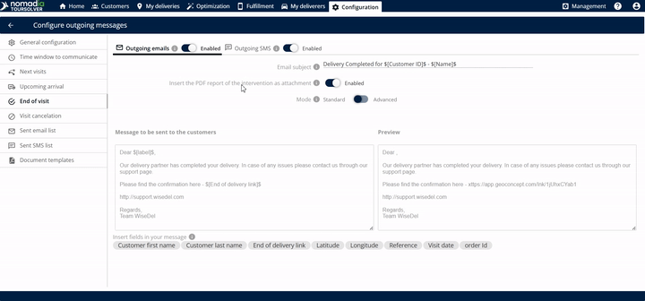
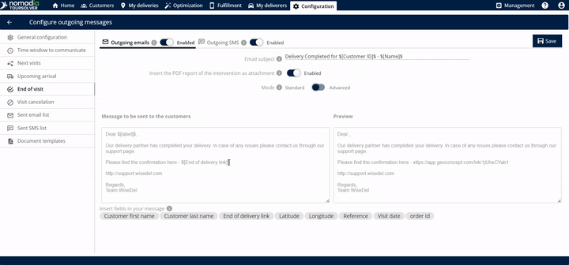
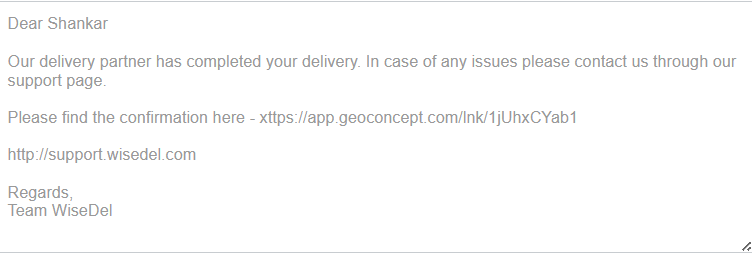

# Fin de la visite

## 1. Introduction

**Fin de la visite** et le paramètre de communication vous permet d'automatiser les messages de suivi envoyés à votre client.

**Qu'est-ce que la Fin de visite ?** C'est le processus qui se produit **une fois la livraison terminée**. À la fin, le client reçoit automatiquement un email avec un fichier PDF en pièce jointe.

**Le PDF Preuve de Livraison (PdL)** Ce PDF joint sert de preuve officielle de livraison. Il confirme des informations essentielles pour le client, notamment :

* Le nom du client
* L'adresse du client
* Les signatures recueillies lors de la visite

## 2. Configuration initiale

Avant d'envoyer votre premier message, vous devez activer les canaux de communication de base.

1. **Accédez aux paramètres de Fin de visite :**
   * Cliquez sur l' **Fin de la visite** option pour accéder à l'écran de configuration.

2. **Activer les canaux sortants :**
   * Activez les **emails sortants** option

3. **Définir l'objet de l'email**

4. Activez l'interrupteur pour envoyer la PdL en tant que fichier PDF

5. Cliquez sur l' **Enregistrer** bouton pour appliquer les modifications au modèle modifié.

## 3. Explications des fonctionnalités avec avantages

Cette fonctionnalité offre flexibilité et livraison claire de la documentation.

| Fonctionnalité                      | Description                                                                                                                                                        |
| ----------------------------------- | ------------------------------------------------------------------------------------------------------------------------------------------------------------------ |
| **Lien ETA**                        | Un lien contenant l'heure d'arrivée estimée (ETA) est automatiquement créé et envoyé une fois la livraison terminée.                                               |
| **Édition de l'objet de l'email**   | Vous pouvez entrer et personnaliser le **objet de l'email** afin que les clients sachent immédiatement l'objet du message.                                         |
| **Édition du corps du message**     | Vous pouvez librement **modifier le message** qui sera envoyé à vos clients, permettant un langage personnalisé et des détails importants                          |
| **Balises de personnalisation ($)** | En saisissant le **symbole dollar** ($) révèle des options que vous pouvez insérer et modifier directement dans le corps de l'email, vous faisant gagner du temps. |
| **Fenêtre d'aperçu**                | Avant d'enregistrer, vous pouvez voir l' **aperçu** du message exact qui sera envoyé, garantissant qu'il ait l'air professionnel et précis.                        |
| **Suivi de localisation en direct** | Le lien permet au client de suivre la localisation en direct de la livraison (ou du livreur).                                                                      |
| **Email sortant**                   | Option pour activer l'envoi du lien ETA par email.                                                                                                                 |
| **SMS sortant**                     | Option pour activer l'envoi du lien ETA par message texte.                                                                                                         |

## 4. Personnalisation et révision de l'objet

Suivez ces étapes pour personnaliser le corps du message et confirmer l'apparence finale de l'email.

1. **Sélectionnez le mode de communication :**
   * Changez le **mode de communication** en **standard** ou **avancé** en fonction du niveau de détail requis.

2. **Voir le message actuel :**
   * Regardez la section qui affiche le **message à envoyer au client**.
3. **Modifier le corps du message (facultatif) :**
   * Si vous devez ajuster le contenu, vous pouvez **modifier ce corps de l'email**.

4.  **Aperçu de l'email final :**

    * Passez en revue le **Objet :** Vérifiez la **aperçu** zone pour voir exactement à quoi ressemblera l'email final pour le client. C'est votre chance de revoir le message avant d'enregistrer
    * **Insérer des informations personnalisées (facultatif)** Pour inclure des informations dynamiques (comme le nom d'un client ou des détails spécifiques de rendez-vous), saisissez le **symbole dollar** ($). Cela affichera des options que vous pouvez utiliser pour modifier le corps de l'email.

    > 💡 **Astuce :** L'utilisation de balises de personnalisation rend le message plus direct et professionnel.

5. **Enregistrez la configuration :**
   * Une fois que vous êtes satisfait des paramètres et de l'aperçu, cliquez sur **Enregistrer**.

6. Le client recevra l'email suivant

<figure><figcaption></figcaption></figure>

***

## 5. Conseils de productivité

Utilisez ces conseils pour maximiser l'efficacité et la clarté de vos communications clients.

* **💡 Vérifiez à l'avance le contenu de la PdL :** N'oubliez pas que la pièce jointe PDF est cruciale. Vous pouvez vous rappeler que le client vérifiera son nom, son adresse et les signatures dans la pièce jointe.
* **💡 Utilisez souvent l'aperçu :** Avant d'enregistrer des modifications, utilisez la fonction d'aperçu pour vérifier la mise en forme et vous assurer que le corps du message se lit correctement. L'aperçu montre exactement ce que le client verra.
* **💡 Vérifiez l'inclusion de la pièce jointe :** Assurez-vous toujours d'avoir activé l'option pour **Insérer le rapport PDF de l'intervention en tant que pièce jointe**. Cela garantit que la preuve de livraison nécessaire est incluse.
