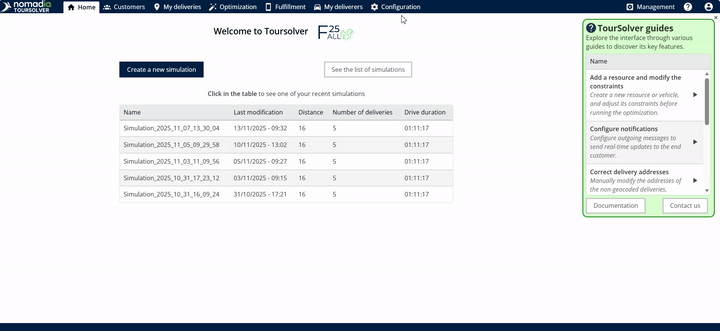
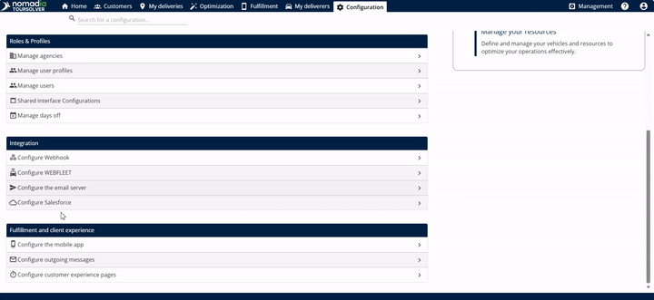
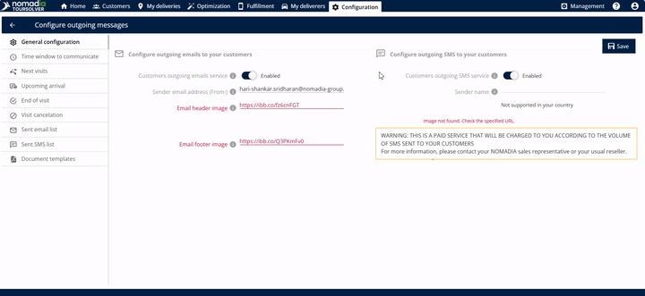
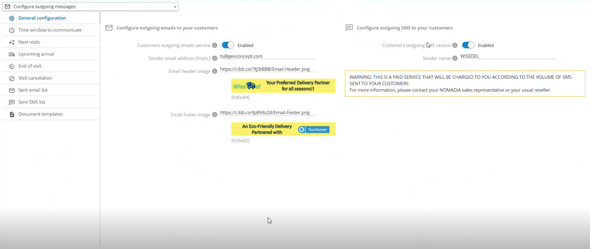
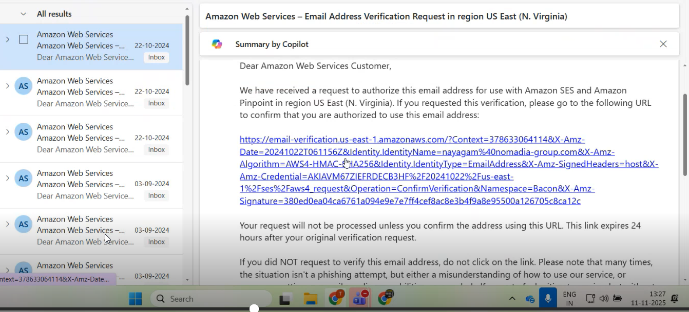
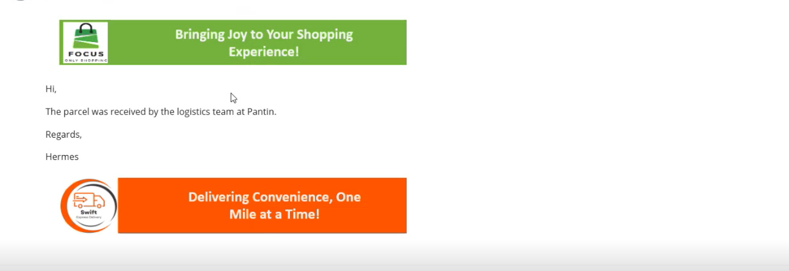

# Configuration générale

## 1. Introduction

Le **Configuration générale de la communication client** l'écran vous permet d'activer, de désactiver et de personnaliser les paramètres de base pour l'envoi de messages sortants à vos clients. Vous pouvez contrôler à la fois le **service d'e-mail sortant client** et la **service SMS sortant client**.

## 2. Configuration initiale

Pour commencer à configurer vos préférences de communication client, vous devez accéder à l'écran de Configuration Générale :

1. **Commencez depuis la page d'accueil :** Aller depuis le **page d’accueil**.

2. Cliquez sur **Configurer le message sortant**

3. **Ouvrir la Configuration Générale :** Vous arriverez à **Configuration générale** écran.

***

## 3. Explications des fonctionnalités et avantages

Cette zone de configuration gère deux moyens puissants par lesquels vous pouvez joindre vos clients :

| Fonctionnalité                      | Description et utilité                                                                                                                                                                                                      |
| ----------------------------------- | --------------------------------------------------------------------------------------------------------------------------------------------------------------------------------------------------------------------------- |
| **Service d'e-mail sortant client** | Permet au système d'envoyer des e-mails aux clients en votre nom. **Avantage :** Vous pouvez personnaliser l'apparence de vos e-mails en utilisant des éléments de marque tels que vos images d'en-tête et de pied de page. |
| **Service SMS sortant client**      | Permet au système d'envoyer des messages texte (SMS) directement aux clients. **Avantage :** Fournit une communication rapide et directe pour des mises à jour urgentes ou importantes.                                     |

**Points clés à considérer pour les SMS :**

* ⚠️ **Avertissement : service payant** – L'activation du service SMS sortant est un **service payant**. Des frais vous seront facturés en fonction du volume de messages SMS envoyés à vos clients.
* **Limite de caractères** – Chaque message SMS standard doit comporter **160 caractères**. Si votre message dépasse 160 caractères, le système va automatiquement **diviser le SMS en deux messages SMS**.

***

## 4. Configuration de la communication client

Cette section vous guide à travers le processus de configuration et d'activation de vos canaux de communication par e-mail et SMS.

#### Activation et personnalisation de l'e-mail sortant

Utilisez ces étapes pour activer la communication par e-mail et vous assurer que vos e-mails ont une apparence professionnelle avec les images de votre marque.

1. **Activer le service d'e-mail :** Une fois que vous êtes sur l'écran de Configuration Générale, activez le **service d'e-mail sortant client**.
2. **Saisir l'e-mail de l'expéditeur :** Saisissez le **adresse e-mail de l'expéditeur**.

3. **Ajouter le lien de l'image d'en-tête/pied de page (facultatif) :** Entrez le **lien de l'image d'en-tête/pied de page**. Cela contient souvent des informations légales ou des coordonnées. 💡 **Astuce :** Si vous n'entrez pas de lien d'image d'en-tête et de lien d'image de pied de page, l'e-mail résultant sera envoyé sans ces éléments visuels.

#### Activation du SMS sortant

1. **Activer le service SMS :** Localisez et activez le **service SMS sortant client**.
   * **Contexte :** Si vous activez ce service, vos clients commenceront à recevoir des SMS du système.

#### Enregistrement des modifications et validation de votre e-mail

Pour activer votre configuration de communication, vous devez enregistrer vos modifications et effectuer une étape importante de validation.

2. **Recevoir l'e-mail de validation :** Après avoir cliqué **enregistrer**, le système enverra automatiquement un e-mail à l'adresse d'expéditeur que vous avez fournie. Cet e-mail inclut un **lien pour valider l'e-mail**.

<figure><figcaption></figcaption></figure>

3. **Cliquer sur le lien de validation :** Allez dans votre boîte de réception, ouvrez l'e-mail de validation et cliquez sur le lien fourni.

<figure><figcaption></figcaption></figure>

4. **Activation confirmée :** Une fois que vous cliquez sur le lien, le système sera autorisé à envoyer des e-mails aux clients **en votre nom**.

<figure><figcaption></figcaption></figure>

***

## 5. Conseils de productivité

Voici quelques conseils pour maximiser votre efficacité lors de l'utilisation des paramètres de Configuration Générale :

* 💡 **Image de marque cohérente :** Essayez toujours d'entrer à la fois le **lien de l'image d'en-tête** et la **lien de l'image de pied de page**. L'utilisation de ces liens aide à maintenir une image de marque professionnelle pour tous les e-mails envoyés à vos clients.
* ⚠️ **Surveillez le nombre de caractères :** L'envoi de SMS est un abonnement payant et lors de l'envoi de messages SMS, rappelez-vous la **limite de 160 caractères**. Gardez vos messages concis pour éviter qu'ils ne soient divisés en deux messages distincts facturables.
* 💡 **Validation immédiate :** Pour assurer une livraison d'e-mail fluide, effectuez l'étape de validation immédiatement après avoir cliqué **enregistrer**. Le lien de validation confirme que le système (TourSolver) a l'autorisation d'envoyer des messages en utilisant l'adresse d'expéditeur que vous avez choisie.
