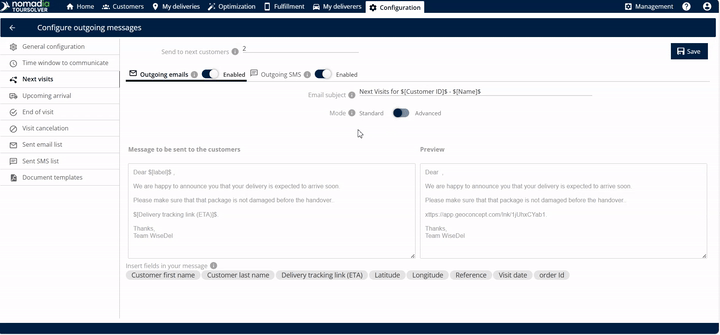
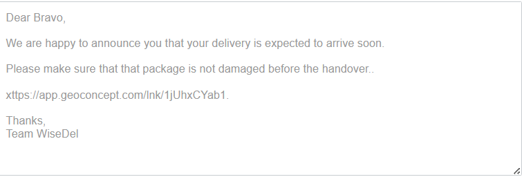

# Prochaines visites

## 1. Introduction

**Prochaines visites** la fonctionnalité et conçue pour automatiser les notifications, informant vos clients à venir que vous êtes en route. Cela garantit une communication fluide et une meilleure préparation pour votre arrivée.

Vous pouvez choisir exactement combien de clients à venir recevront ce message, personnaliser le contenu et décider d'envoyer par e-mail ou par SMS.

## 2. Configuration initiale

Votre première étape consiste à définir comment vous allez notifier vos clients à venir.

**Accéder à la fonctionnalité Prochaines visites :** Cliquez sur **prochaines visites**.

**Définir le nombre de clients ciblés** Spécifiez le nombre de clients à venir que vous souhaitez notifier. Vous pouvez choisir d'envoyer une notification au prochain, aux deux prochains ou aux trois prochains clients.

* Si vous saisissez **un**, l'e-mail est envoyé au prochain client.
* Si vous saisissez **deux**, l'e-mail est envoyé aux deux prochains clients.
* Si vous saisissez **trois** (ou n'importe quel nombre que vous souhaitez), l'e-mail est envoyé à ce nombre de clients.

***

## 3. Explications des fonctionnalités avec avantages

La force de cet outil réside dans sa personnalisation et son mécanisme de déclenchement.

| Fonctionnalité                      | Description                                                                                                                                                        |
| ----------------------------------- | ------------------------------------------------------------------------------------------------------------------------------------------------------------------ |
| **Lien ETA**                        | Un lien contenant l'heure d'arrivée estimée (ETA) est automatiquement créé et envoyé une fois la livraison terminée.                                               |
| **Édition de l'objet de l'email**   | Vous pouvez entrer et personnaliser le **objet de l'email** afin que les clients sachent immédiatement l'objet du message.                                         |
| **Édition du corps du message**     | Vous pouvez librement **modifier le message** qui sera envoyé à vos clients, permettant un langage personnalisé et des détails importants                          |
| **Balises de personnalisation ($)** | En saisissant le **symbole dollar** ($) révèle des options que vous pouvez insérer et modifier directement dans le corps de l'email, vous faisant gagner du temps. |
| **Fenêtre d'aperçu**                | Avant d'enregistrer, vous pouvez voir l' **aperçu** du message exact qui sera envoyé, garantissant qu'il ait l'air professionnel et précis.                        |
| **Suivi de localisation en direct** | Le lien permet au client de suivre la localisation en direct de la livraison (ou du livreur).                                                                      |
| **Email sortant**                   | Option pour activer l'envoi du lien ETA par email.                                                                                                                 |
| **SMS sortant**                     | Option pour activer l'envoi du lien ETA par message texte.                                                                                                         |

## 4. Personnaliser et enregistrer les paramètres de communication client

Cette tâche garantit que vos clients à venir reçoivent un message personnalisé les informant de votre arrivée imminente.

1. **Saisir l'objet de l'e-mail :** Trouvez le champ pour l'objet de l'e-mail et saisissez un titre clair et concis.

2. **Modifier le contenu du message** Personnalisez le corps du message qui sera envoyé à vos clients.
3.  **Insérer des informations personnalisées (facultatif)** Pour inclure des informations dynamiques (comme le nom d'un client ou des détails spécifiques de rendez-vous), saisissez le **symbole dollar** ($). Cela affichera des options que vous pouvez utiliser pour modifier le corps de l'email.

    > 💡 **Astuce :** L'utilisation de balises de personnalisation rend le message plus direct et professionnel.

4. **Vérifier l'objet :** Vérifiez la **aperçu** zone pour voir exactement à quoi ressemblera l'e-mail final pour le client. C'est votre chance de revoir le message avant d'enregistrer.
5. **Enregistrer vos paramètres** Une fois que vous avez saisi et modifié toutes les informations nécessaires, cliquez sur **enregistrer**.

6. Le client recevra l'email suivant.&#x20;

<figure><figcaption></figcaption></figure>

***

## 5. Conseils de productivité

Voici quelques conseils pour maximiser l'efficacité de la fonctionnalité de communication Prochaines visites :

1. **Maximiser la personnalisation :** Utilisez toujours le symbole dollar ($) lors de la modification du corps du message. Cela vous permet d'utiliser les champs disponibles pour du contenu dynamique, créant une communication professionnelle et détaillée sans saisie manuelle à chaque fois.
