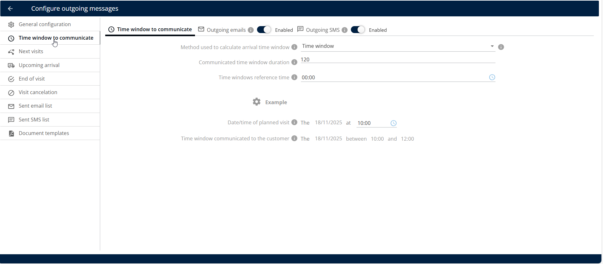
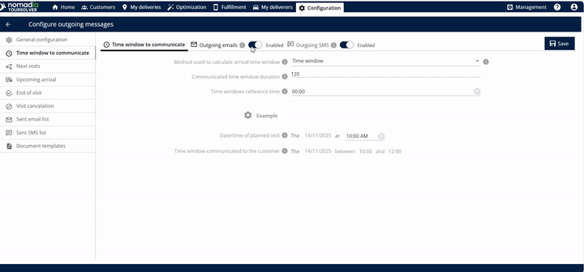
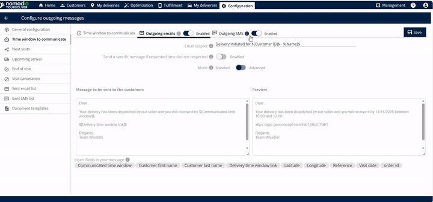
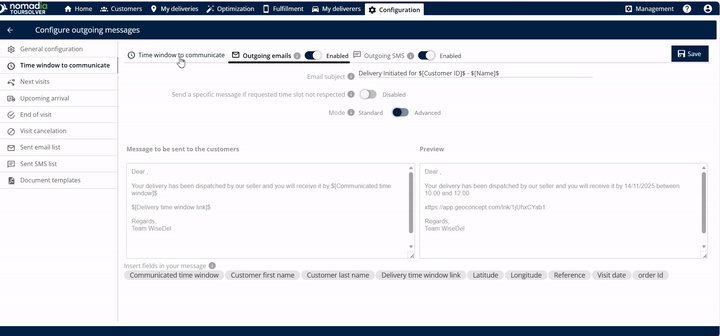
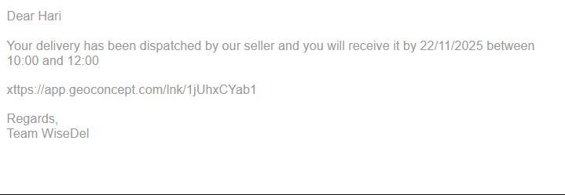

# Fenêtre temporelle à communiquer

## 1. Introduction

Le **Fenêtre temporelle à communiquer** cette fonctionnalité vous permet de définir la période exacte communiquée à votre client concernant une visite à venir. Elle calcule la fenêtre d'arrivée et gère les communications sortantes par e-mail et SMS.

## 2. Configuration initiale

1. Cliquez sur **Fenêtre temporelle à communiquer**.

<figure><figcaption></figcaption></figure>

***

## 3. Explications des fonctionnalités et avantages

Cette fonctionnalité est puissante car elle vous permet de contrôler exactement comment l'information d'arrivée est calculée et délivrée.

| Fonctionnalité                      | Description                                                                                                                                                        |
| ----------------------------------- | ------------------------------------------------------------------------------------------------------------------------------------------------------------------ |
| **Lien ETA**                        | Un lien contenant l'heure d'arrivée estimée (ETA) est automatiquement créé et envoyé une fois la livraison terminée.                                               |
| **Édition de l'objet de l'email**   | Vous pouvez entrer et personnaliser le **objet de l'email** afin que les clients sachent immédiatement l'objet du message.                                         |
| **Édition du corps du message**     | Vous pouvez librement **modifier le message** qui sera envoyé à vos clients, permettant un langage personnalisé et des détails importants                          |
| **Balises de personnalisation ($)** | En saisissant le **symbole dollar** ($) révèle des options que vous pouvez insérer et modifier directement dans le corps de l'email, vous faisant gagner du temps. |
| **Fenêtre d'aperçu**                | Avant d'enregistrer, vous pouvez voir l' **aperçu** du message exact qui sera envoyé, garantissant qu'il ait l'air professionnel et précis.                        |
| **Suivi de localisation en direct** | Le lien permet au client de suivre la localisation en direct de la livraison (ou du livreur).                                                                      |
| **Email sortant**                   | Option pour activer l'envoi du lien ETA par email.                                                                                                                 |
| **SMS sortant**                     | Option pour activer l'envoi du lien ETA par message texte.                                                                                                         |

## 4. Configuration de la fenêtre temporelle de communication au client et des notifications

Suivez ces étapes pour définir la fenêtre temporelle précise et activer la communication pour la visite de votre client.

1. **Accéder à la fonctionnalité :** Cliquez sur **Fenêtre temporelle à communiquer**.
2. **Définir la méthode de calcul :**
   * Sélectionnez la méthode de fenêtre temporelle utilisée pour calculer la fenêtre d'arrivée.

3. **Définir la durée :**
   * Saisissez la durée de la fenêtre temporelle communiquée.

💡 Astuce : Saisir 120 minutes donnera lieu à une fenêtre de 2 heures communiquée au client (par exemple, de 10 h à 12 h).

4\. **Sélectionner l'heure de référence :**

5. **Saisir les détails de la visite prévue :**
   * Localisez le **Date et heure de la visite prévue** champ.

6. **Vérifier la fenêtre temporelle calculée :**
   * Le système affichera la **fenêtre temporelle communiquée au client**.
   * Par exemple, si vous définissez la durée à 2 heures, le système pourrait calculer la fenêtre comme étant de 10 h à 12 h.
7.  **Activer la communication par email :**

    * Vous pouvez activer l' **emails sortants** option.
    * Vérifiez le message qui doit être envoyé au client sous cette section.
    * **Insérer des informations personnalisées (facultatif)** Pour inclure des informations dynamiques (comme le nom d'un client ou des détails spécifiques de rendez-vous), saisissez le **symbole dollar** ($). Cela affichera des options que vous pouvez utiliser pour modifier le corps de l'email.

    &#x20;      💡 **Astuce :** L'utilisation de balises de personnalisation rend le message plus direct et professionnel

8.  **Activer la communication par SMS (optionnel) :**

    * Vous pouvez également activer le **les SMS sortants** option.
    * **Insérer des informations personnalisées (facultatif)** Pour inclure des informations dynamiques (comme le nom d'un client ou des détails spécifiques de rendez-vous), saisissez le **symbole dollar** ($). Cela affichera des options que vous pouvez utiliser pour modifier le corps de l'email.

    > 💡 **Astuce :** L'utilisation de balises de personnalisation rend le message plus direct et professionnel.

9. **Enregistrez vos paramètres :**

10. Le client recevra l'email suivant

<figure><figcaption></figcaption></figure>

## 5. Conseils de productivité

Ces conseils vous aideront à travailler plus efficacement et à assurer une communication fluide avec vos clients :

* **Utilisez la fonction d'aperçu :** Utilisez toujours l'option de message **aperçu** disponible pour les e-mails sortants et les SMS sortants. Cela vous aide à confirmer exactement ce que le client verra avant d'enregistrer vos paramètres, garantissant précision et clarté.
* **Rendre les durées claires :** Lors de la définition de la **Durée de la fenêtre temporelle communiquée**, choisissez des incréments courants (comme 60 minutes ou 120 minutes) qui sont faciles à comprendre pour les clients. Une fenêtre claire et définie évite la confusion.
