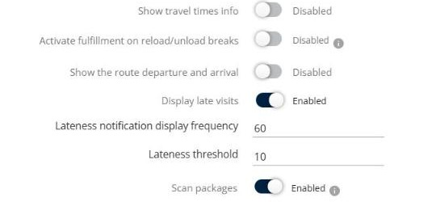

# Prochaine arrivée

Envoyez à votre client un lien d’heure d’arrivée estimée (ETA) lorsque le processus de livraison commence, afin qu’il puisse suivre la position en direct du livreur.

## Avant de commencer

* Connectez-vous à **TourSolver**.
* Configurez les services d’e-mails et de SMS sortants. Voir [Configuration générale](general-configuration.md).
* Cliquez sur **Prochaine arrivée** pour ouvrir sa configuration.

## Aperçu des fonctionnalités

La fonctionnalité Prochaine arrivée fournit des mises à jour en temps réel sur le statut de la livraison et permet une communication proactive, afin que les clients soient prêts à recevoir leurs articles. Son principal avantage est la transparence : le client clique sur le lien et suit la position en direct du livreur.

| Fonctionnalité | Description |
| -------------- | ----------- |
| **Lien ETA** | Un lien contenant l’heure d’arrivée estimée (ETA) est créé automatiquement et envoyé une fois la livraison terminée. |
| **Modification de l’objet de l’e-mail** | Vous permet de personnaliser l’**objet de l’e-mail**, afin que les clients connaissent immédiatement l’objet du message. |
| **Modification du corps du message** | Vous permet de **modifier le message** envoyé à vos clients, avec un langage personnalisé et des informations importantes. |
| **Balises de personnalisation ($)** | La saisie du **symbole dollar** ($) affiche des options que vous pouvez insérer et modifier dans le corps de l’e-mail. |
| **Fenêtre d’aperçu** | Affiche un **aperçu** du message exact avant l’enregistrement, afin qu’il soit professionnel et précis. |
| **Suivi de la localisation en direct** | Le lien permet au client de suivre la localisation en direct de la livraison (ou du livreur). |
| **E-mail sortant** | Option permettant d’envoyer le lien ETA par e-mail. |
| **SMS sortant** | Option permettant d’envoyer le lien ETA par SMS. |

## Configurer les notifications client

Choisissez les canaux de communication pour l’ETA et le lien de localisation en direct.

1. Cliquez sur **Prochaine arrivée**.
2. Activez l’option **E-mails sortants**.

3. Facultatif : activez l’option **SMS sortants**.
4. Facultatif : pour inclure des informations dynamiques, comme le nom du client ou des détails précis du rendez-vous, saisissez le **symbole dollar** ($). Les options que vous pouvez utiliser pour modifier le corps de l’e-mail s’affichent.

5. Recommandé : sélectionnez l’option pour **voir l’aperçu de l’e-mail**, afin de vérifier l’expérience client.
6. Cliquez sur **Enregistrer**.

### Résultat

Le client reçoit l’e-mail suivant.

<figure><figcaption></figcaption></figure>

## Éviter les notifications Prochaine arrivée non souhaitées

La notification Prochaine arrivée est envoyée lorsque le livreur accepte la visite dans l’application mobile et se rend chez le client. Si le livreur accepte une visite puis l’annule, le client a déjà reçu la notification.

* **Refuser au lieu d’accepter puis d’annuler** : demandez à vos livreurs de **refuser** les visites qu’ils ne peuvent pas effectuer, au lieu de les accepter puis de les annuler. Une visite refusée n’envoie pas la notification. Pour l’autoriser, activez **Refuser des livraisons** dans **Configuration** > **Configurer l’application mobile** > **LIVRAISONS**. Voir [Refuser ou annuler une visite sans prévenir le client](https://nomadia-docs.gitbook.io/products/toursolver-mobile/intervention/refuse-or-cancel-without-notifying-the-customer).
* **Désactiver temporairement la notification** : cliquez sur **Prochaine arrivée**, puis désactivez **E-mails sortants** et **SMS sortants**. Réactivez-les lorsque vous souhaitez de nouveau prévenir vos clients. Tant que la notification est activée, l’**étape d’acceptation** de l’application mobile ne peut pas être désactivée.

## Comprendre les alertes de retard

TourSolver compare l’heure prévue de chaque visite avec l’heure actuelle et la progression du livreur.

* **Livraisons en retard** : dans l’onglet **Suivi**, la carte affiche les livraisons en retard, par tranche de retard : **10-30 mins**, **30-60 mins** et **> 60 mins**.
* **Alerte avant le début de la tournée** : si le livreur n’a pas ouvert la tournée dans l’application mobile à l’heure de départ prévue, les visites sont déjà considérées comme en retard, et les alertes de retard commencent. Demandez à vos livreurs d’ouvrir et de démarrer leur tournée à l’heure.
* **Alertes dans l’application mobile** : dans **Configuration** > **Configurer l’application mobile** > **OPTIONS**, définissez **Afficher les visites en retard**, le **Seuil de retard** (en minutes) et la **Fréquence d’affichage des notifications de retard** (en minutes).

<figure><figcaption></figcaption></figure>

## Conseils


**Utilisez les deux canaux** : activez à la fois les e-mails sortants et les SMS sortants. Le client reçoit alors l’information d’ETA, qu’il consulte d’abord sa boîte de réception ou ses SMS.



**Utilisez les balises de personnalisation** : les balises rendent le message plus direct et plus professionnel.



**Prévisualisez toujours** : utilisez l’option pour **voir l’aperçu de l’e-mail** avant d’enregistrer. Elle vous permet de vérifier que le message contient le lien de localisation en direct.



**Point de déclenchement** : le lien ETA est envoyé une fois que le livreur a terminé la phase de livraison, c’est-à-dire lorsqu’il est en route vers le client. Vérifiez que ce moment correspond à celui où vous souhaitez que le client commence à suivre la localisation en direct.


## Rubriques connexes

* [Configuration générale](general-configuration.md)
* [Fenêtre temporelle à communiquer](time-window-to-communicate.md)
* [Prochaines visites](next-visits.md)
* [Pourquoi mes SMS ou e-mails clients ne sont-ils pas envoyés ?](../faq/why-are-my-customer-sms-or-emails-not-sent.md)
* [Refuser ou annuler une visite sans prévenir le client](https://nomadia-docs.gitbook.io/products/toursolver-mobile/intervention/refuse-or-cancel-without-notifying-the-customer)
