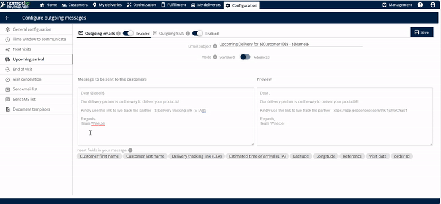
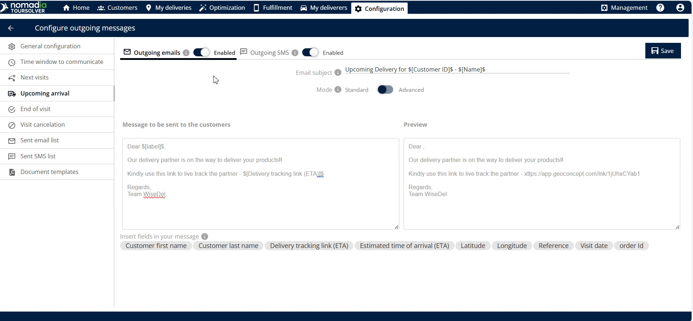
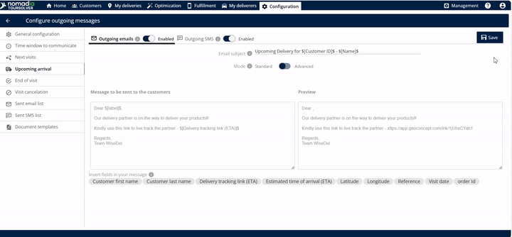
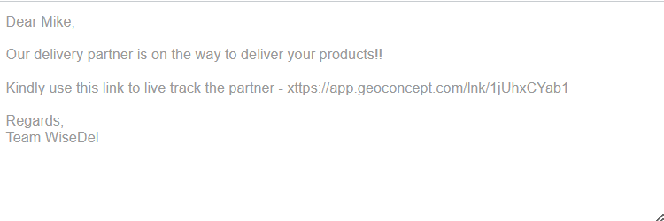

# Prochain Arrivée

## 1. Introduction

la fonctionnalité **Prochain Arrivée** améliorera l'expérience client en fournissant des mises à jour en temps réel sur le statut de la livraison. Elle génère automatiquement et envoie un lien d'heure d'arrivée estimée (ETA) à votre client une fois le processus de livraison commencé.

**Le bénéfice principal est la transparence** : Lorsque le client clique sur ce lien, il peut **suivre la position en direct du livreur**.

## 2. Configuration initiale

Pour commencer à utiliser cette fonctionnalité, vous devez d'abord naviguer vers **Prochain Arrivée**

## 3. Explications des fonctionnalités avec avantages

La fonctionnalité Prochain Arrivée permet une communication proactive, garantissant que les clients sont prêts à recevoir leurs articles.

| Fonctionnalité                         | Description                                                                                                                                                 |
| -------------------------------------- | ----------------------------------------------------------------------------------------------------------------------------------------------------------- |
| **Lien ETA**                           | Un lien contenant l'heure d'arrivée estimée (ETA) est automatiquement créé et envoyé une fois la livraison terminée.                                        |
| **Édition de l'objet de l'email**      | Vous pouvez saisir et personnaliser le **sujet de l'email** afin que les clients sachent immédiatement quel est l'objet du message.                         |
| **Édition du corps du message**        | Vous pouvez librement **modifier le message** qui sera envoyé à vos clients, permettant un langage personnalisé et des détails importants                   |
| **Balises de personnalisation ($)**    | Saisir le **symbole dollar** ($) révèle des options que vous pouvez insérer et modifier directement dans le corps de l'email, vous faisant gagner du temps. |
| **Fenêtre d'aperçu**                   | Avant d'enregistrer, vous pouvez voir l' **aperçu** du message exact qui sera envoyé, garantissant qu'il soit professionnel et précis.                      |
| **Suivi de la localisation en direct** | Le lien permet au client de suivre la localisation en direct de la livraison (ou du livreur).                                                               |
| **Email sortant**                      | Option pour activer l'envoi du lien ETA par email.                                                                                                          |
| **SMS sortant**                        | Option pour activer l'envoi du lien ETA par message texte.                                                                                                  |

## 4. Configuration des notifications client

Ceci est l'action principale que vous effectuerez : choisir les canaux de communication pour le lien ETA et la localisation en direct.

1. **Accéder à la configuration :** Naviguez vers et cliquez sur **Prochain e Arrivée** (voir les étapes de Configuration initiale ci-dessus).
2. **Activer la communication par email :** Sélectionnez l'option pour activer **les emails sortants**.

3. **Activer la communication par SMS (optionnel) :** Sélectionnez l'option pour activer **les SMS sortants**.
4. **Insérer des informations personnalisées (optionnel)** Pour inclure des informations dynamiques (comme le nom d'un client ou des détails spécifiques du rendez-vous), saisissez le **symbole dollar** ($). Cela affichera des options que vous pouvez utiliser pour modifier le corps de l'email.

&#x20;      💡 **Astuce :** L'utilisation de balises de personnalisation rend le message plus direct et professionnel.

5. **Vérifier le contenu du message (recommandé) :** Pour confirmer l'expérience client, sélectionnez l'option pour **voir l'aperçu de l'email**.
6. **Enregistrez vos paramètres :** Une fois que vous êtes satisfait des canaux activés et de l'aperçu, cliquez sur **enregistrer**.

7. Le client recevra l'email suivant.&#x20;

<figure><figcaption></figcaption></figure>

***

## 5. Conseils de productivité

Voici quelques moyens de maximiser l'efficacité de vos communications de prochaine arrivée :

* 💡 **Communication double canal :** Envisagez d'activer **les deux** emails sortants et SMS sortants. L'utilisation des deux méthodes garantit que le client reçoit l'information critique de l'ETA qu'il consulte sa boîte de réception ou ses messages texte en premier.
* 💡 **Toujours prévisualiser :** Utilisez l'option pour **voir l'aperçu de l'email** avant d'enregistrer les modifications de configuration. C'est votre chance de vérifier que le message contient le lien de la localisation en direct comme prévu.
* ⚠️ **Comprendre les points de déclenchement :** N'oubliez pas que le lien ETA est envoyé _une fois que le livreur a terminé la phase de livraison_ (c'est-à-dire, qu'il est en route vers le client). Assurez-vous que vos définitions opérationnelles de « termine la livraison » correspondent au moment où vous souhaitez que le client commence à suivre la localisation en direct.
