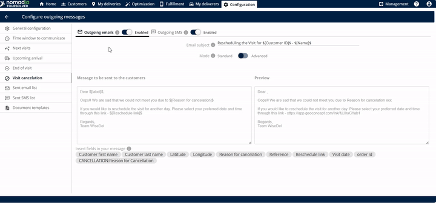
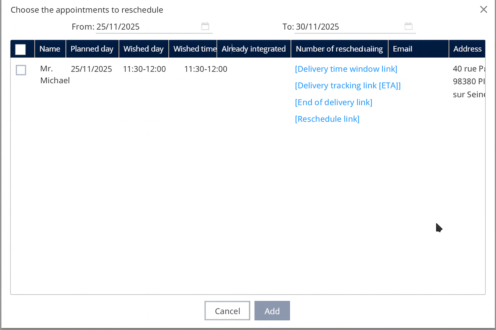

# Annulation de visite

## 1. Introduction

Ce processus vous permet de marquer une visite comme annulée tout en déclenchant simultanément une action qui invite le client final à sélectionner une nouvelle date et heure pour le replanification.

## 2. Configuration initiale&#x20;

Avant de traiter une annulation, vous devez vous assurer que les canaux de communication sont actifs afin que le client reçoive le lien de reprogrammation.

1. **Accéder aux paramètres d'annulation :** Cliquez sur l' **annulation de visite** option.
2. **Activer les messages sortants :** Assurez-vous que les deux types de communication sortante sont activés :
   * **Emails sortants**
   * **SMS sortant**
3. **Définir l'objet (e-mails et SMS) :** Mentionnez le **sujet** spécifique que vous voulez que le client voie.

***

## 3. Explications des fonctionnalités et avantages

Cette fonctionnalité simplifie la communication et la logistique lorsqu'une tentative de livraison échoue en raison de l'indisponibilité du client.

| Fonctionnalité                      | Description                                                                                                                                                        |
| ----------------------------------- | ------------------------------------------------------------------------------------------------------------------------------------------------------------------ |
| **Lien ETA**                        | Un lien contenant l'heure d'arrivée estimée (ETA) est automatiquement créé et envoyé une fois la livraison terminée.                                               |
| **Édition de l'objet de l'email**   | Vous pouvez entrer et personnaliser le **objet de l'email** afin que les clients sachent immédiatement l'objet du message.                                         |
| **Édition du corps du message**     | Vous pouvez librement **modifier le message** qui sera envoyé à vos clients, permettant un langage personnalisé et des détails importants                          |
| **Balises de personnalisation ($)** | En saisissant le **symbole dollar** ($) révèle des options que vous pouvez insérer et modifier directement dans le corps de l'email, vous faisant gagner du temps. |
| **Fenêtre d'aperçu**                | Avant d'enregistrer, vous pouvez voir l' **aperçu** du message exact qui sera envoyé, garantissant qu'il ait l'air professionnel et précis.                        |
| **Suivi de localisation en direct** | Le lien permet au client de suivre la localisation en direct de la livraison (ou du livreur).                                                                      |
| **Email sortant**                   | Option pour activer l'envoi du lien ETA par email.                                                                                                                 |
| **SMS sortant**                     | Option pour activer l'envoi du lien ETA par message texte.                                                                                                         |

💡 **Astuce :** Le corps de l'e-mail inclut automatiquement le **motif de l'annulation** et la **date de reprogrammation** d'information.

**Insérer des informations personnalisées (facultatif)** Pour inclure des informations dynamiques (comme le nom d'un client ou des détails spécifiques de rendez-vous), saisissez le **symbole dollar** ($). Cela affichera des options que vous pouvez utiliser pour modifier le corps de l'email.

💡 **Astuce :** L'utilisation de balises de personnalisation rend le message plus direct et professionnel.

#### Gestion des rendez-vous reprogrammés&#x20;

Après qu'une visite est annulée, le livreur doit réintégrer le rendez-vous dans le planning une fois qu'une nouvelle date est sélectionnée.

**Trouver les données**

1. **Accéder à l'exécution :** Allez à la **onglet exécution**.
2. **Afficher la liste des annulations :** Cliquez sur **à reprogrammer**.
3. **Examiner les données :** Vous pouvez **voir les données reprogrammées ici**.

<figure><figcaption></figcaption></figure>

**Ajouter le rendez-vous au planning**

1. **Accéder aux outils du livreur :** Le livreur doit cliquer sur **mes livraisons**.
2. **Sélectionner les rendez-vous :** Cliquez sur **ajouter des rendez-vous à reprogrammer**.
3. **Lister et ajouter :** **Listez les données ici** et cliquez **ajouter**.

**Résultat attendu :** Les visites reprogrammées **seront ajoutées avec succès à la prochaine simulation/optimisation**.

<figure><figcaption></figcaption></figure>

## 5. Conseils de productivité

* **Toujours activer les deux :** Pour atteindre un maximum de clients, assurez-vous de **activer les e-mails sortants et les SMS sortants** lors de la configuration de l'annulation. Cette fonctionnalité est disponible sur plusieurs canaux, garantissant que les clients peuvent y accéder même si une méthode est manquée.
* **Utilisez la fonction Aperçu :** Avant de cliquer **enregistrer**, utilisez toujours la fonctionnalité pour **voir l'aperçu de l'email**. Cela confirme que le motif de l'annulation et le lien de reprogrammation sont affichés correctement, évitant les erreurs de communication.
* **Suivre les éléments reprogrammés :** Vérifiez régulièrement le **onglet exécution** sous **à reprogrammer**. Cela garantit qu'aucune visite annulée n'est oubliée et maintient votre flux de travail logistique à jour.
