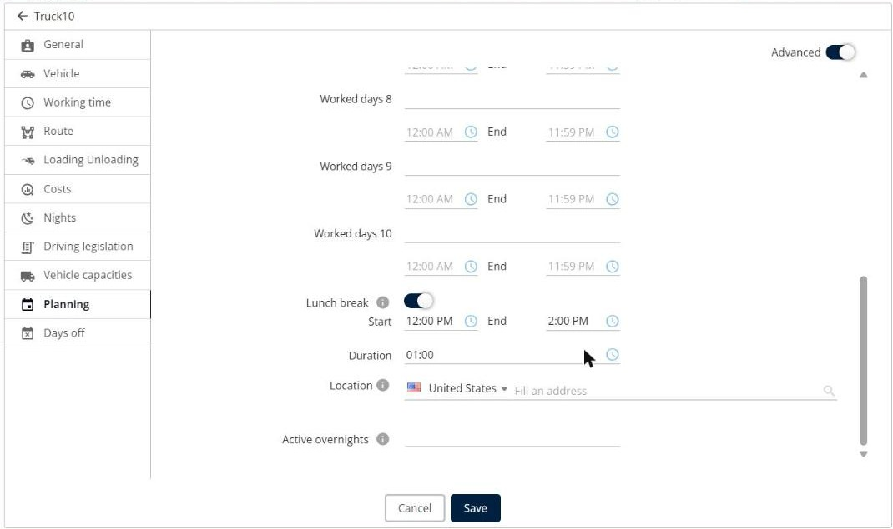
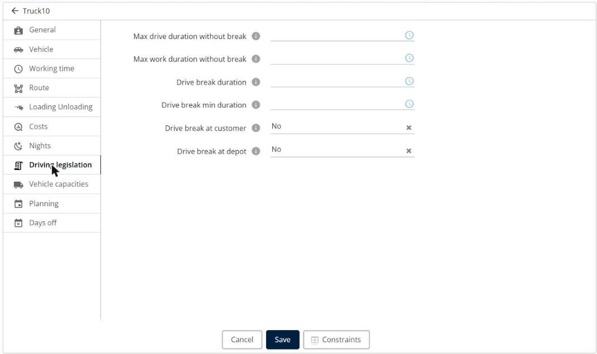
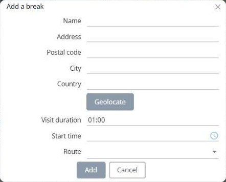

# Comment ajouter des pauses déjeuner et des pauses de conduite réglementaires ?

Définissez la pause déjeuner et les pauses de conduite de vos ressources, ajoutez une pause à une tournée, et évitez les erreurs les plus courantes.

## Avant de commencer

* Connectez-vous à **TourSolver** avec un profil utilisateur qui peut modifier les ressources.

## Aperçu des fonctionnalités

* **Pause déjeuner** : une pause de chaque ressource, avec un début, une fin, une durée et un lieu facultatif. L’optimisation la place dans la tournée.
* **Législation de conduite** : les durées maximales de conduite et de travail sans pause, et la durée des pauses de conduite.
* **Ajouter une pause** : ajoute une pause à une tournée d’une simulation.
* **Visite de pause** : une ligne de votre fichier d’import que le livreur valide dans l’application mobile comme une visite.

## Définir la pause déjeuner d’une ressource

1. Accédez à **Mes livreurs**, puis cliquez sur l’icône **Modifier** de la ressource.
2. Cliquez sur l’onglet **Planification**.
3. Activez **Pause déjeuner**.
4. Saisissez le **Début** et la **Fin** de la période pendant laquelle la pause déjeuner peut avoir lieu, par exemple de **12:00 PM** à **2:00 PM**.
5. Saisissez la **Durée** au format **HH:MM**, par exemple **01:00** pour une heure. Ne saisissez pas **60**.
6. Si vous le souhaitez, saisissez le **Lieu** de la pause déjeuner.
7. Cliquez sur **Enregistrer**.

<figure><figcaption></figcaption></figure>


**Renseignez tous les champs** : la pause déjeuner n’est prise en compte que si le début, la fin et la durée sont renseignés. La durée ne peut pas dépasser le temps entre le début et la fin.


## Définir les pauses de conduite réglementaires d’une ressource

1. Accédez à **Mes livreurs**, puis cliquez sur l’icône **Modifier** de la ressource.
2. Cliquez sur l’onglet **Législation de conduite**.
3. Renseignez les champs, au format **HH:MM** :
   * **Durée max. de conduite sans pause**
   * **Durée max. de travail sans pause**
   * **Durée de la pause de conduite**
   * **Durée min. de la pause de conduite**
4. Indiquez si la pause de conduite peut avoir lieu chez un client (**Pause de conduite chez le client**) ou au dépôt (**Pause de conduite au dépôt**).
5. Cliquez sur **Enregistrer**.

<figure><figcaption></figcaption></figure>

## Choisir comment ajouter une pause à une tournée

Vous pouvez ajouter une pause de deux façons :

* **Dans la simulation, sur la page Optimisation** : cliquez sur le menu **Livraisons**, puis sur **Ajouter une pause**. Saisissez le nom, l’adresse, la **Durée de la visite** (par exemple **01:00**), l’**Heure de début** et la **Tournée**. Voir [Ajouter une pause](../simulation/simulation-deliveries-add-break.md).
* **Dans votre fichier d’import** : ajoutez une ligne pour la pause, par exemple avec le nom **Pause déjeuner**, l’adresse de la pause, une **Durée de visite** de **01:00** et sa fenêtre horaire. La pause est alors envoyée à l’application mobile comme une visite, et le livreur la valide comme les autres visites.

<figure><figcaption></figcaption></figure>

## Conseils


**Les modifications manuelles n’ajoutent pas la pause** : lorsque vous affectez manuellement une visite à une tournée, TourSolver n’ajoute pas et ne déplace pas la pause déjeuner. Réoptimisez la tournée pour placer la pause.



**La réoptimisation supprime les pauses manuelles** : les pauses que vous avez ajoutées avec **Ajouter une pause** sont supprimées lorsque vous réoptimisez la tournée. TourSolver affiche le message « Some of the selected routes have manually added breaks. Re-optimizing will remove them. »



**Pause fractionnée non disponible** : une ressource a un seul créneau de pause déjeuner, commun à tous les jours. Vous ne pouvez pas fractionner la pause déjeuner en plusieurs parties. Cette fonctionnalité fait l’objet d’une demande d’amélioration.


## Rubriques connexes

* [Ajouter une pause](../simulation/simulation-deliveries-add-break.md)
* [Création d’une ressource](../resource-and-vehicle-management/creating-a-resource.md)
* [Pourquoi ai-je du temps d’attente dans mon plan de tournée ?](why-do-i-have-waiting-time-in-my-route-plan.md)
