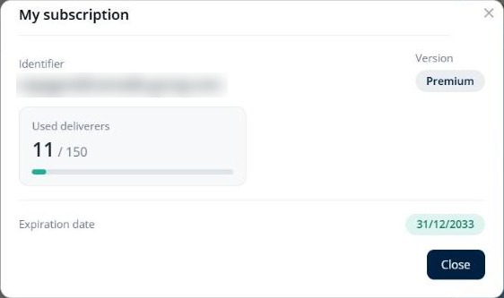
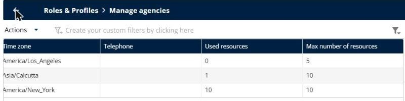

# Comment augmenter le nombre de ressources, de licences ou le quota de SMS ?

Vérifiez combien de ressources votre abonnement autorise, répartissez-les entre vos agences, et demandez des ressources, des licences ou des SMS supplémentaires.

## Avant de commencer

* Connectez-vous à **TourSolver** avec un profil utilisateur qui a accès à la page **Configuration**.

## Aperçu des fonctionnalités

* **Mon abonnement** : affiche votre version, le nombre de livreurs utilisés par rapport au nombre autorisé par votre abonnement, et la date d’expiration.
* **Nombre max. de ressources** : le nombre de ressources que chaque agence peut utiliser. Le total de toutes les agences ne peut pas dépasser votre abonnement.
* **Responsable de compte et équipe Sales Admin** : les seuls contacts qui peuvent ajouter des ressources, des licences ou des SMS à votre abonnement. Le support ne peut pas les ajouter.

## Vérifier votre quota

1. Cliquez sur l’**icône utilisateur** en haut à droite de TourSolver.
2. Cliquez sur **Mon abonnement**.
3. Vérifiez le compteur **Livreurs utilisés**, par exemple **11 / 150**, et la **Date d’expiration**.

<figure><figcaption></figcaption></figure>

4. Cliquez sur **Fermer**.

## Vérifier les ressources de chaque agence

1. Accédez à **Configuration**.
2. Sous **Rôles et profils**, cliquez sur **Gérer les agences**.
3. Faites défiler la liste vers la droite, puis comparez les colonnes **Ressources utilisées** et **Nombre max. de ressources** de chaque agence.

<figure><figcaption></figcaption></figure>

Si une agence a atteint son maximum, vous ne pouvez pas lui ajouter de ressource, et le message « resources limit of the following agencies would be exceeded » s’affiche.

## Répartir les ressources entre vos agences

Si votre abonnement dispose encore de ressources libres, ou si une autre agence n’utilise pas toutes ses ressources, vous n’avez pas besoin d’acheter des ressources supplémentaires :

* Augmentez le **Nombre max. de ressources** de l’agence qui en a besoin, et diminuez-le pour une agence qui a des ressources libres.
* Déplacez un livreur ou un utilisateur d’une agence vers une autre.

Pour les étapes détaillées, voir [Gérer les agences](../import-and-data-setup/manage-agencies.md).

## Demander des ressources, des licences ou des SMS supplémentaires

Si toutes les ressources de votre abonnement sont utilisées, contactez votre responsable de compte ou l’équipe Sales Admin. Indiquez-leur :

* Le nom de votre entreprise et l’adresse e-mail de votre compte administrateur TourSolver.
* Le nombre de ressources, de licences ou de SMS dont vous avez besoin.
* Les agences qui ont besoin des ressources supplémentaires.

Une fois votre abonnement mis à jour, déconnectez-vous et reconnectez-vous pour voir le nouveau quota.

## Conseils


**Message Invalid code** : l’**Identifiant** d’une agence existante ne peut pas être modifié. Si le message « Invalid code » s’affiche lorsque vous enregistrez une agence, vérifiez le champ **Identifiant**. Si le message persiste, contactez le support.


## Rubriques connexes

* [Gérer les agences](../import-and-data-setup/manage-agencies.md)
* [Combien de ressources puis-je créer ?](how-many-resources-can-i-create.md)
* [Comment modifier mon abonnement ?](how-to-modify-my-subscription.md)
* [Création d’une ressource](../resource-and-vehicle-management/creating-a-resource.md)
* [Créer et modifier un utilisateur](../import-and-data-setup/create-and-modify-a-user.md)
