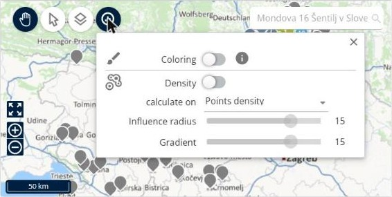
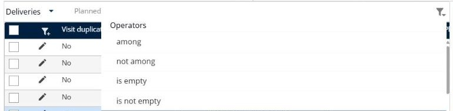
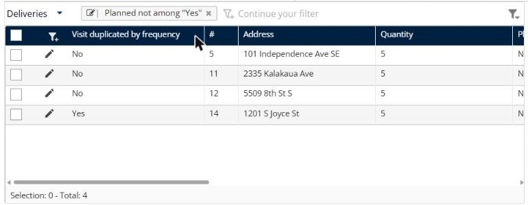
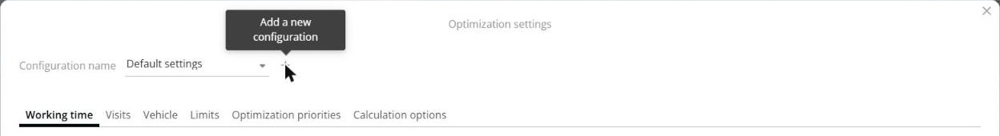

# Comment gérer les couleurs, les filtres et les colonnes affichées ?

Rétablissez les couleurs des points sur la carte, comprenez les couleurs des tournées, filtrez vos listes et enregistrez vos paramètres d’optimisation dans une configuration.

## Avant de commencer

* Connectez-vous à **TourSolver**, puis ouvrez une simulation.

## Aperçu des fonctionnalités

* **Information graphique > Coloration** : colore les points de la carte selon une règle. Lorsque cette option est activée, les points n’affichent plus les couleurs des tournées.
* **Couleurs des tournées** : les couleurs que TourSolver attribue automatiquement à chaque tournée.
* **Filtres personnalisés** : les filtres que vous créez dans la barre située au-dessus d’une liste, avec un opérateur comme **parmi** ou **pas parmi**.
* **Nom de la configuration** : enregistre vos paramètres d’optimisation sous un nom, pour pouvoir les réutiliser.

## Rétablir les couleurs des points sur la carte

Si tous les points de la carte ont la même couleur, ou pas la couleur de leur tournée, la **Coloration** de la carte est probablement activée.

1. Sur la carte, cliquez sur **Information graphique**.
2. Désactivez **Coloration**.

<figure><figcaption></figcaption></figure>

### Résultat

Les points de la carte affichent de nouveau les couleurs de leurs tournées.

Pour colorer plutôt les livraisons selon vos propres règles, voir [Colorer les livraisons](../simulation/simulation-deliveries-coloring.md).

## Comprendre les couleurs des tournées

* TourSolver attribue automatiquement une couleur à chaque tournée.
* Les couleurs peuvent varier d’un utilisateur à l’autre et d’une simulation à l’autre. N’utilisez pas la couleur d’une tournée pour identifier un livreur. Utilisez plutôt le nom de la tournée.
* Pour attribuer des couleurs fixes à vos livraisons, créez des règles de **Coloration**, par exemple une couleur par livreur. Voir [Colorer les livraisons](../simulation/simulation-deliveries-coloring.md).

## Filtrer une liste

1. Cliquez sur **Créez vos filtres personnalisés en cliquant ici** au-dessus de la liste.
2. Sélectionnez une colonne, par exemple **Planifié**.
3. Sélectionnez un opérateur : **parmi**, **pas parmi**, **est vide** ou **n’est pas vide**.

<figure><figcaption></figcaption></figure>

4. Sélectionnez la valeur, par exemple **Oui**, puis appuyez sur **Entrée**.

<figure><figcaption></figcaption></figure>

### Résultat

La liste affiche uniquement les lignes correspondantes. Par exemple, **Planifié pas parmi "Oui"** affiche les livraisons non planifiées. Pour supprimer le filtre, cliquez sur le **x** du filtre.


**Masquer les visites terminées** : dans **Suivi**, utilisez la même méthode pour créer le filtre **Statut pas parmi Terminé**, afin que la liste affiche uniquement les visites qui ne sont pas encore terminées.


## Personnaliser les colonnes affichées

Pour choisir les colonnes d’une liste et leur ordre, cliquez sur le menu de la liste, puis sur **Personnaliser la liste**. Voir [Personnaliser la liste des livraisons](../simulation/simulation-deliveries-customize-list.md) et [Personnaliser la liste des tournées](../simulation/simulation-routes-customize-list.md).


**Largeur des colonnes non mémorisée** : TourSolver conserve les colonnes que vous choisissez et leur ordre, mais pas leur largeur. La largeur revient à sa valeur par défaut lorsque vous rouvrez la page.


## Enregistrer vos paramètres d’optimisation dans une configuration

1. Dans la barre d’outils de la simulation, cliquez sur l’icône **Voir et modifier les paramètres**.
2. À côté de **Nom de la configuration**, cliquez sur **+** (**Ajouter une nouvelle configuration**).

<figure><figcaption></figcaption></figure>

3. Saisissez un nom, définissez les options dans les onglets (**Temps de travail**, **Visites**, **Véhicule**, **Limites**, **Priorité d’optimisation**, **Options de calcul**), puis cliquez sur **Enregistrer**.
4. Pour modifier une configuration, sélectionnez-la dans **Nom de la configuration**, changez les options, puis cliquez sur **Enregistrer**.

### Résultat

La configuration est disponible dans **Paramètres d’optimisation** lorsque vous définissez le périmètre d’une optimisation.

## Rubriques connexes

* [Utiliser l’information graphique](../simulation/simulation-map-graphical-information.md)
* [Colorer les livraisons](../simulation/simulation-deliveries-coloring.md)
* [Personnaliser la liste des livraisons](../simulation/simulation-deliveries-customize-list.md)
* [Diagnostiquer les visites non planifiées et les tournées incohérentes](../operations-and-route-management/diagnose-unplanned-visits-and-inconsistent-routes.md)
