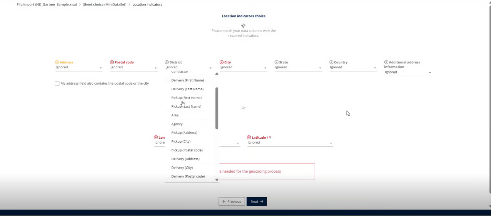

# 12. Comment optimiser le géocodage dans TourSolver ?

* **Fournir des adresses complètes et précises** Veillez à ce que chaque adresse comprenne le nom de la rue, le numéro, le code postal, la ville et le pays. Des données propres et cohérentes améliorent les résultats de géocodage.
*   **Utiliser des champs séparés pour chaque composant d'adresse** TourSolver prend en charge deux formats pour la saisie des informations d'adresse :

    1. **Colonnes structurées** – Rue, code postal, ville et pays saisis séparément.
    2. **Champ combiné unique** – Adresse complète saisie dans une seule colonne.

    👉 Pour garantir un géocodage précis, **choisissez un format et utilisez-le de manière cohérente**. N'utilisez pas à la fois des colonnes structurées et un champ combiné dans le même jeu de données, car cela peut provoquer des erreurs ou des incohérences dans la reconnaissance des adresses.
* **Vérifier les informations de quartier** Pour améliorer la précision du géocodage, toujours **spécifier le bon quartier** lors de la saisie des données d'adresse. TourSolver inclut désormais une **colonne Quartier**, qui aide le système à restreindre la recherche et à localiser la bonne zone plus efficacement.👉 L'utilisation cohérente du champ quartier garantit que les adresses sont associées à la bonne zone géographique et réduit les erreurs dans la planification des itinéraires.

<figure><figcaption></figcaption></figure>

* **Préférer les coordonnées GPS lorsqu'elles sont disponibles** Si vous disposez de valeurs de latitude et de longitude, incluez-les. TourSolver les utilisera directement et évitera le géocodage des adresses, ce qui augmente la précision.
* **Vérifier la qualité du géocodage après l'importation** Utilisez les indicateurs de qualité de géocodage pour identifier les points incorrects ou de faible qualité et les corriger dans les données.
* **Option de repositionnement dans l'application mobile** Pour améliorer la qualité du géocodage, TourSolver propose une **option de repositionnement** dans l'application mobile. Cette fonctionnalité permet aux utilisateurs de **mettre à jour ou ajuster la localisation directement depuis leur appareil mobile**, garantissant que la position enregistrée est précise et conforme au site réel.👉 L'utilisation de l'option de repositionnement aide à corriger les écarts mineurs et améliore la précision des adresses géocodées dans la planification des itinéraires
