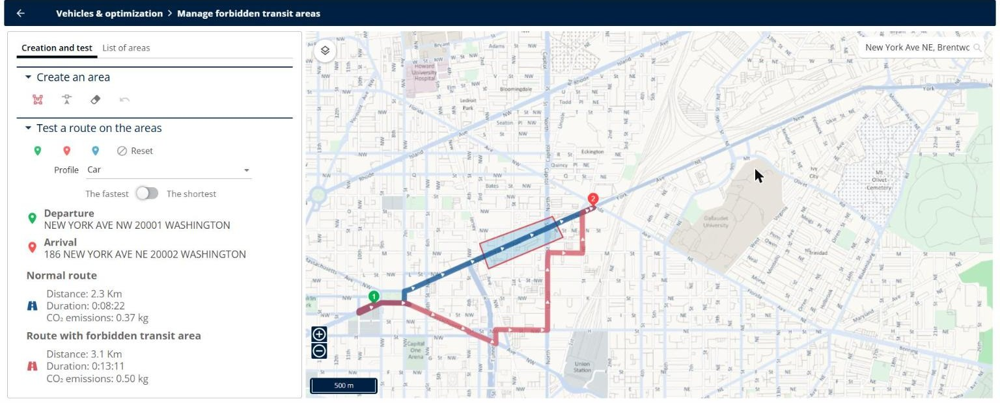

# Comment utiliser les zones de transit interdit ?

Dessinez les zones que vos véhicules ne doivent pas traverser, par exemple des travaux ou un centre-ville, testez un itinéraire sur ces zones et utilisez-les dans vos optimisations.

## Avant de commencer

* Connectez-vous à **TourSolver** avec un profil utilisateur qui a accès à la page **Configuration**.

## Aperçu des fonctionnalités

* **Zone de transit interdit** : une zone dessinée sur la carte que les itinéraires contournent.
* **Gérer les zones de transit interdit** : la page où vous créez, modifiez, supprimez et testez les zones.
* **Prise en compte des zones de transit interdit** : l’option de calcul qui prend en compte les zones dans l’optimisation.
* **useForbiddenTransitAreas** : le paramètre qui prend en compte les zones dans une optimisation lancée avec l’API.

## Créer une zone de transit interdit

Pour créer une zone, accédez à **Configuration** > **Véhicules et optimisation** > **Gérer les zones de transit interdit**, puis dessinez la zone sur la carte. Pour la procédure complète, avec un exemple de fermeture de route, voir [Créer et utiliser des zones de transit interdit](../import-and-data-setup/create-and-use-forbidden-transit-areas.md).

<figure><figcaption></figcaption></figure>

## Utiliser les zones dans l’optimisation

1. Accédez à **Configuration** > **Véhicules et optimisation** > **Options de calcul**.
2. Activez **Prise en compte des zones de transit interdit**.

<figure><figcaption></figcaption></figure>

3. Pour activer ou désactiver les zones pour une seule optimisation, ouvrez les **Paramètres d’optimisation** de votre simulation, cliquez sur l’onglet **Véhicule**, puis définissez **Prise en compte des zones de transit interdit** sur **Oui** ou **Non**.

### Résultat

Les tournées optimisées contournent les zones activées. Seules les zones dont l’**Utilisation** est **Activée** dans la **Liste des zones** sont prises en compte.

## Utiliser les zones avec l’API

Lorsque vous lancez une optimisation avec l’API TourSolver, définissez l’option **useForbiddenTransitAreas** sur **true**. Voir la [documentation de l’API TourSolver](https://toursolver.readme.io/reference/introduction).

## Conseils


**Un seul moyen de transport par simulation** : les zones de transit interdit s’appliquent à un seul moyen de transport par simulation. Si vos ressources utilisent des profils de véhicule différents, optimisez-les dans des simulations distinctes.



**Livraison dans une zone** : si une livraison se trouve dans une zone de transit interdit, TourSolver affiche « This address is inside a forbidden transit zone » et la tournée ne peut pas l’atteindre. Vérifiez l’adresse de la livraison, ou modifiez la zone.


## Rubriques connexes

* [Créer et utiliser des zones de transit interdit](../import-and-data-setup/create-and-use-forbidden-transit-areas.md)
* [Pourquoi les distances et les temps de trajet sont-ils différents de Google Maps ?](why-are-distances-and-travel-times-different-from-google-maps.md)
* [Où trouver ma clé API et la documentation de l’API ?](where-can-i-find-my-api-key-and-the-api-documentation.md)
* [Optimiser vos livraisons](../operations-and-route-management/optimize-your-deliveries.md)
