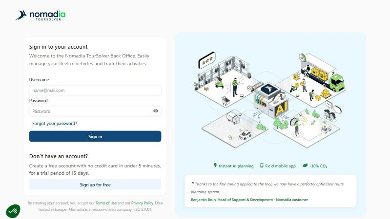
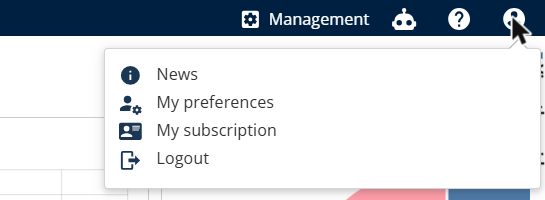
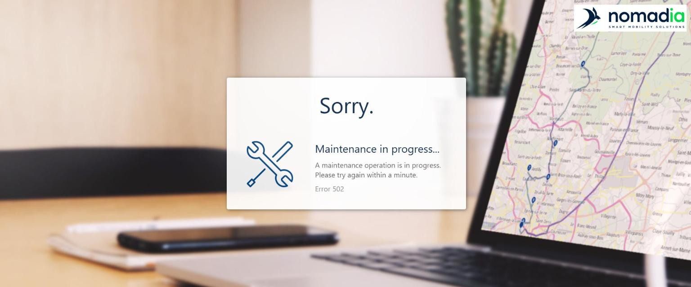

# Pourquoi ne puis-je pas me connecter à TourSolver ?

Résolvez vous-même les problèmes de connexion les plus courants, et découvrez quelles informations envoyer au support si le problème persiste.

## Avant de commencer

* Munissez-vous de l’adresse e-mail de votre compte TourSolver.
* Utilisez un navigateur compatible. Voir [Quels navigateurs et systèmes sont compatibles avec TourSolver ?](which-browsers-and-systems-are-compatible-with-toursolver.md).

## Aperçu des fonctionnalités

* **Page de connexion** : la seule adresse à utiliser pour vous connecter à TourSolver.
* **Mot de passe oublié ?** : réinitialise votre mot de passe avec un code de validation envoyé par e-mail.
* **Cache et cookies du navigateur** : d’anciennes données du navigateur peuvent provoquer une page blanche, un chargement sans fin ou une boucle de connexion.
* **Incident de plateforme** : une page de maintenance ou d’incident qui touche tous les utilisateurs, et pas seulement votre compte.
* **Console du navigateur** : affiche les erreurs techniques dont le support a besoin pour analyser le problème.

## Vérifier l’adresse de connexion

1. Ouvrez [https://app.geoconcept.com/ToursolverCloud/ts/trsolver/home](https://app.geoconcept.com/ToursolverCloud/ts/trsolver/home). Pour la procédure de connexion complète, voir [Se connecter à TourSolver](../getting-started/log-in-to-toursolver.md).
2. Enregistrez cette adresse dans les favoris de votre navigateur.
3. N’utilisez pas d’anciens favoris ni de liens copiés depuis d’anciens e-mails, car ils peuvent pointer vers une page obsolète.

<figure><figcaption></figcaption></figure>

## Réinitialiser un mot de passe oublié

Si vous avez oublié votre mot de passe, cliquez sur **Mot de passe oublié ?** sur la page de connexion. Pour la procédure complète, voir [Réinitialiser un mot de passe oublié](../getting-started/log-in-to-toursolver.md).

Si vous ne recevez pas le code de validation :

* Patientez quelques minutes, puis vérifiez votre dossier **Spam** ou **Courrier indésirable**.
* Vérifiez que vous avez saisi l’adresse e-mail de votre compte TourSolver.
* Demandez à votre service informatique si les e-mails d’expéditeurs externes sont filtrés.
* Si l’adresse e-mail n’est pas reconnue, contactez votre administrateur TourSolver. Votre utilisateur a peut-être été supprimé ou rattaché à une autre adresse e-mail.

## Vider le cache et les cookies, ou changer de navigateur

1. Ouvrez une fenêtre de navigation privée (**Ctrl+Maj+N** dans Chrome et Edge, **Ctrl+Maj+P** dans Firefox) ou un autre navigateur compatible, puis connectez-vous.
2. Si cela fonctionne, revenez à votre navigateur habituel et appuyez sur **Ctrl+Maj+Suppr** (Mac : **Cmd+Maj+Suppr**).
3. Sélectionnez **Toutes les périodes**.
4. Sélectionnez **Cookies et autres données des sites** et **Images et fichiers en cache**.
5. Cliquez sur **Effacer les données**.
6. Fermez toutes les fenêtres du navigateur, rouvrez le navigateur, puis connectez-vous.

## Se déconnecter et se reconnecter

Si vous êtes connecté mais que TourSolver ne se comporte pas comme prévu, par exemple si des menus sont absents ou si votre accès ou votre abonnement n’est pas mis à jour :

1. Cliquez sur l’**icône utilisateur** en haut à droite de TourSolver.
2. Cliquez sur **Déconnexion**.
3. Fermez l’onglet, rouvrez la page de connexion, puis connectez-vous.

<figure><figcaption></figcaption></figure>

## Identifier un incident de plateforme ou un problème de compte

* **« Sorry. Maintenance in progress… », erreur 502 ou 503, ou la page ne se charge pas** : il s’agit d’un incident de plateforme ou d’une maintenance. Patientez quelques minutes et réessayez, et demandez à un collègue s’il peut se connecter. Si le problème dure plus de 15 minutes, signalez-le au support.
* **Vos collègues ne peuvent pas se connecter non plus** : il s’agit d’un incident de plateforme. Signalez-le au support.
* **Mot de passe incorrect, ou compte introuvable** : il s’agit d’un problème de compte. Réinitialisez votre mot de passe, ou contactez votre administrateur TourSolver.
* **Cela fonctionne uniquement dans une fenêtre de navigation privée ou dans un autre navigateur** : il s’agit d’un problème local du navigateur. Videz le cache et les cookies.
* **Vous pouvez vous connecter, mais vous voyez Abonnement terminé ou des menus sont absents** : il s’agit d’un problème d’abonnement ou de droits utilisateur. Contactez votre responsable de compte ou votre administrateur TourSolver.

<figure><figcaption></figcaption></figure>

## Contacter le support

1. Préparez les informations suivantes :
   * L’adresse e-mail que vous utilisez pour vous connecter.
   * La date et l’heure du problème, et s’il se produit à chaque fois.
   * Votre navigateur et sa version, et si un autre navigateur fonctionne.
   * Le message d’erreur exact, avec une capture d’écran de toute la page, barre d’adresse comprise.
   * Si vos collègues sont également concernés.
2. Sur la page qui affiche l’erreur, appuyez sur **Ctrl+Maj+I** (Mac : **Cmd+Option+I**) ou sur **F12** pour ouvrir la console du navigateur.
3. Ouvrez l’onglet **Console**.
4. Appuyez sur **F5** pour recharger la page et reproduire le problème.
5. Faites une capture d’écran des messages en rouge, ou cliquez avec le bouton droit dans la console et sélectionnez **Enregistrer sous…**.
6. Envoyez les informations, les captures d’écran et le fichier de la console au support.

## Conseils


**Testez d’abord dans une fenêtre de navigation privée** : c’est le moyen le plus rapide de savoir si le problème vient de votre navigateur ou de votre compte.



**Ne communiquez jamais votre mot de passe** : le support ne vous demande jamais votre mot de passe.


## Rubriques connexes

* [Se connecter à TourSolver](../getting-started/log-in-to-toursolver.md)
* [Processus d’inscription](../getting-started/signup-process.md)
* [Quels navigateurs et systèmes sont compatibles avec TourSolver ?](which-browsers-and-systems-are-compatible-with-toursolver.md)
* [Comment modifier mon abonnement ?](how-to-modify-my-subscription.md)
