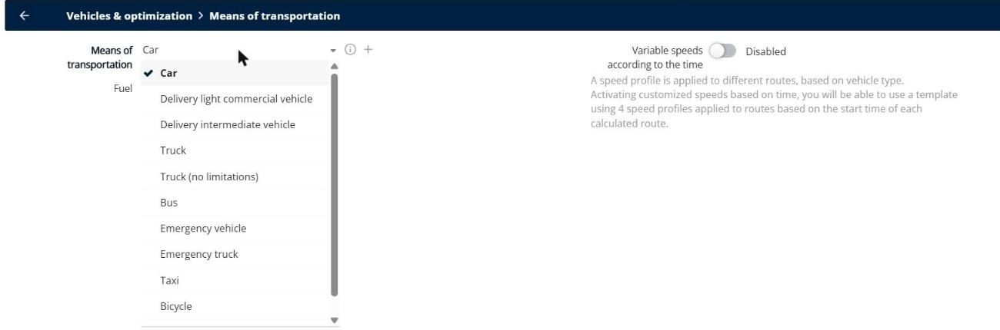
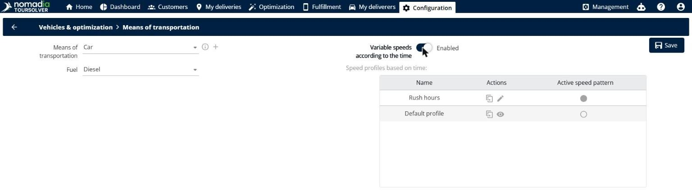
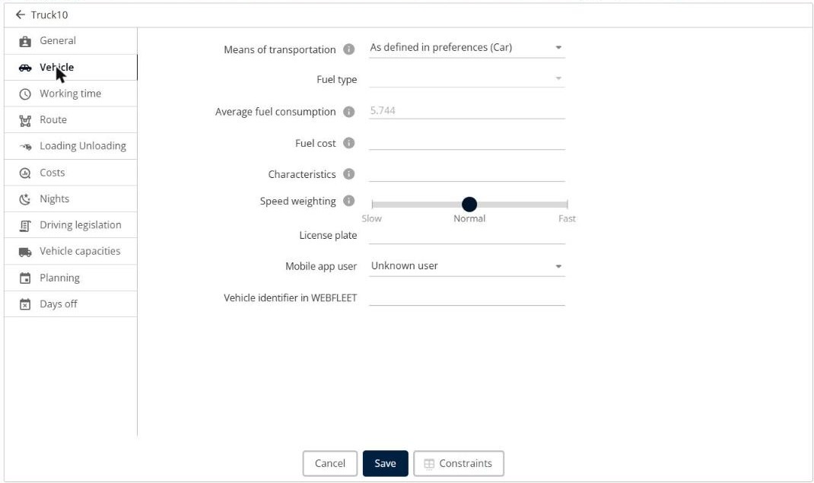

# Pourquoi les distances et les temps de trajet sont-ils différents de Google Maps ?

Découvrez pourquoi les distances et les temps de trajet calculés par TourSolver peuvent être différents de Google Maps ou des kilomètres réellement parcourus par vos livreurs, et quels paramètres vérifier.

## Avant de commencer

* Connectez-vous à **TourSolver** avec un profil utilisateur qui a accès à la page **Configuration**.

## Aperçu des fonctionnalités

* **Moyen de transport** : le profil de véhicule que TourSolver utilise pour calculer les itinéraires, par exemple **Voiture** ou **Poids lourd**. Chaque profil a ses propres vitesses et restrictions de circulation.
* **Options d’itinéraire** : les routes que les véhicules peuvent emprunter, comme les péages, les tunnels, les ponts, les zones à faibles émissions et les ferries.
* **Vitesse variable selon l’heure** : des profils de vitesse qui changent selon l’heure de départ de la tournée, pour tenir compte de la circulation.
* **Pondération de la vitesse** : fait rouler une ressource plus lentement ou plus vite que la vitesse moyenne.

## Vérifier le profil de véhicule

Google Maps calcule un itinéraire pour une voiture. Si vos véhicules sont des poids lourds, TourSolver utilise des vitesses plus faibles et évite les routes interdites aux poids lourds : les distances et les temps sont donc plus longs.

1. Accédez à **Configuration**.
2. Sous **Véhicules et optimisation**, cliquez sur **Moyens de transport**.
3. Vérifiez le **Moyen de transport**, par exemple **Voiture**, **Véhicule utilitaire léger de livraison**, **Poids lourd** ou **Poids lourd (sans limitations)**.

<figure><figcaption></figcaption></figure>

4. Pour utiliser un autre profil pour une ressource, accédez à **Mes livreurs**, modifiez la ressource, puis sélectionnez le **Moyen de transport** dans l’onglet **Véhicule**.

## Vérifier les options d’itinéraire

1. Accédez à **Configuration**.
2. Sous **Véhicules et optimisation**, cliquez sur **Options de calcul**.
3. Dans **Calculer l’itinéraire**, vérifiez si TourSolver calcule l’itinéraire **Le plus rapide**.
4. Vérifiez les options **Autoriser les péages**, **Autoriser les tunnels**, **Autoriser les ponts**, **Autoriser les zones à faibles émissions** et, si elle est disponible, **Autoriser les ferries**. Une option désactivée oblige les véhicules à contourner ces routes, ce qui augmente la distance.

<figure><figcaption></figcaption></figure>

## Tenir compte de la circulation

Par défaut, TourSolver utilise les mêmes vitesses toute la journée. Google Maps utilise la circulation en temps réel au moment de votre recherche.

TourSolver est un outil de planification : il applique la circulation habituelle de chaque moment de la journée (données historiques), par exemple des vitesses plus faibles aux heures de pointe ou dans les embouteillages en ville. Pour utiliser ces profils :

1. Accédez à **Configuration** > **Véhicules et optimisation** > **Moyens de transport**.
2. Activez **Vitesse variable selon l’heure**. TourSolver applique alors les profils de vitesse du modèle actif, selon l’heure de départ de chaque tournée.

<figure><figcaption></figcaption></figure>

Pour les plages horaires, les profils de vitesse et la création de votre propre modèle, voir [Configurer les vitesses variables](../resource-and-vehicle-management/configure-variable-speeds.md).

## Ajuster la vitesse d’une ressource

Sur les routes de montagne, dans les rues étroites ou dans les centres-villes denses, vos livreurs peuvent être plus lents que la vitesse moyenne. Sur les routes rapides, ils peuvent être plus rapides.

1. Accédez à **Mes livreurs**, puis cliquez sur l’icône **Modifier** de la ressource.
2. Dans l’onglet **Véhicule**, déplacez le curseur **Pondération de la vitesse** vers **Lente** ou **Rapide**.
3. Cliquez sur **Enregistrer**.

<figure><figcaption></figcaption></figure>

## Comprendre l’écart entre les kilomètres réels et calculés

Les kilomètres réellement parcourus par vos livreurs peuvent être différents des kilomètres calculés pour les raisons suivantes :

* Les livreurs ne suivent pas l’ordre prévu des visites, ou prennent une autre route.
* Les livreurs font des arrêts qui ne sont pas dans la tournée, par exemple pour le carburant ou le déjeuner.
* L’adresse d’une livraison n’est pas géocodée avec précision. Voir [Corriger les adresses non géocodées](../import-and-data-setup/fix-addresses-that-are-not-geocoded.md).
* Les routes sont fermées ou en travaux.

Pour mesurer l’écart réel, comparez les tournées prévues avec les tournées suivies par vos livreurs. Voir [Évaluer vos tournées existantes](../operations-and-route-management/evaluate-your-existing-routes.md).

## Conseils


**Comparez le même itinéraire** : pour comparer avec Google Maps, utilisez le même point de départ, le même ordre de visites, le même type de véhicule et la même heure de départ.


## Rubriques connexes

* [Configurer les vitesses variables](../resource-and-vehicle-management/configure-variable-speeds.md)
* [Optimiser vos livraisons](../operations-and-route-management/optimize-your-deliveries.md)
* [Pourquoi mon optimisation est-elle lente, bloquée ou interrompue ?](why-is-my-optimization-slow-stuck-or-interrupted.md)
* [Comment prioriser le moins de km possible / le plus de clients planifiés ?](how-to-prioritize-the-fewest-possible-km-the-most-planned-customers.md)
