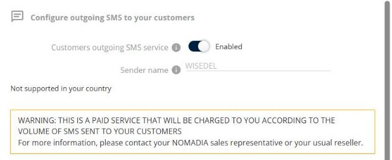
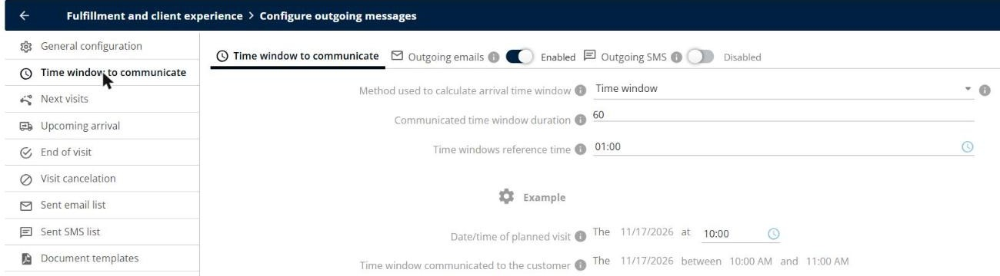

# Pourquoi mes SMS ou e-mails clients ne sont-ils pas envoyés ?

Découvrez pourquoi vos clients ne reçoivent pas les SMS ou les e-mails de TourSolver, et vérifiez les paramètres, les numéros de téléphone et le quota de SMS.

## Avant de commencer

* Connectez-vous à **TourSolver** avec un profil utilisateur qui a accès à la page **Configuration**.
* Configurez vos messages. Voir [Comment envoyer un SMS et un e-mail ?](how-to-send-an-sms-and-an-email.md).

## Aperçu des fonctionnalités

* **Service SMS sortant client** et **Service d’e-mail sortant client** : activent l’envoi de tous les messages.
* **SMS sortants** et **E-mails sortants** de chaque message : activent l’envoi d’un message, par exemple **Fenêtre temporelle à communiquer** ou **Arrivée imminente**.
* **Téléphone mobile** : le champ d’import qui contient le numéro de téléphone du client.
* **SMS consommés** : le nombre de SMS envoyés par rapport à votre quota de SMS.
* **Liste des SMS envoyés** et **Liste des e-mails envoyés** : les messages envoyés, avec leur statut.

## Vérifier que les messages sont activés

1. Accédez à **Configuration** > **Suivi et expérience client** > **Configurer les messages sortants**.
2. Dans **Configuration générale**, vérifiez que **Service SMS sortant client** et **Service d’e-mail sortant client** sont **Activés**.

<figure><figcaption></figcaption></figure>

3. Cliquez sur chaque message, par exemple **Fenêtre temporelle à communiquer**, et vérifiez que **SMS sortants** ou **E-mails sortants** est **Activé** pour ce message. Un message peut être activé pour les e-mails et désactivé pour les SMS.

<figure><figcaption></figcaption></figure>


**Non pris en charge dans votre pays** : si **Nom de l’expéditeur** affiche « Not supported in your country », le service SMS n’est pas disponible pour votre pays. Utilisez plutôt les e-mails, ou contactez votre responsable de compte.


## Vérifier les numéros de téléphone

* **Associez la colonne du téléphone avant d’optimiser** : lors de l’import, associez la colonne du téléphone de votre fichier au champ **Téléphone mobile**. Si vous l’associez après l’optimisation, optimisez de nouveau : les messages utilisent les données de la simulation optimisée.
* **Utilisez le format international** : saisissez les numéros avec l’indicatif du pays, par exemple **+33 6 12 34 56 78** ou **+1 202 555 0123**.
* **Vérifiez les numéros non valides** : dans la **Liste des SMS envoyés**, un numéro refusé par la passerelle SMS affiche le statut **Rejeté**. Corrigez le numéro dans votre fichier, puis importez-le de nouveau.

## Vérifier le quota de SMS

1. Cliquez sur **Liste des SMS envoyés**.
2. Vérifiez **SMS consommés**, par exemple **0 / 50**.

Lorsque plus de 95 % de votre quota est utilisé, TourSolver affiche « More than 95% of your SMS quota has been used. It will be reset on the {DATE}. ». Lorsque le quota est atteint, TourSolver affiche « The limit of your SMS quota has been reached, no SMS was sent. ». Pour augmenter votre quota, voir [Comment augmenter le nombre de ressources, de licences ou le quota de SMS ?](how-do-i-increase-the-number-of-resources-licences-or-the-sms-quota.md).

## Vérifier la fenêtre temporelle à communiquer

Le message **Fenêtre temporelle à communiquer** est envoyé selon ses paramètres : **Méthode de calcul de la fenêtre d’arrivée**, **Durée de la fenêtre temporelle communiquée** et **Heure de référence des fenêtres temporelles**. Vérifiez ces paramètres si le message est envoyé à un moment inattendu, ou s’il n’est pas envoyé du tout. Voir [Fenêtre temporelle à communiquer](../customer-communication/time-window-to-communicate.md).

## Lire le statut des messages

Dans la **Liste des SMS envoyés**, chaque SMS a un statut : **Soumis**, **Envoyé**, **Remis**, **Rejeté** ou **Introuvable**. Utilisez le filtre de période pour afficher les messages d’une période, et vérifiez le statut des messages que le client n’a pas reçus.

## Conseils


**Incident de la plateforme** : si aucun message n’est envoyé à l’ensemble de vos clients alors que vos paramètres sont corrects, il peut s’agir d’un incident temporaire du service d’envoi. Attendez quelques minutes, vérifiez de nouveau la **Liste des SMS envoyés**, puis contactez le support en indiquant la date, l’heure et les clients concernés.


## Rubriques connexes

* [Qu’est-ce que la liste des SMS envoyés ?](what-is-the-sent-sms-list.md)
* [Qu’est-ce que la liste des e-mails envoyés ?](what-is-the-sent-email-list.md)
* [Comment envoyer un SMS et un e-mail ?](how-to-send-an-sms-and-an-email.md)
* [Configuration générale](../customer-communication/general-configuration.md)
