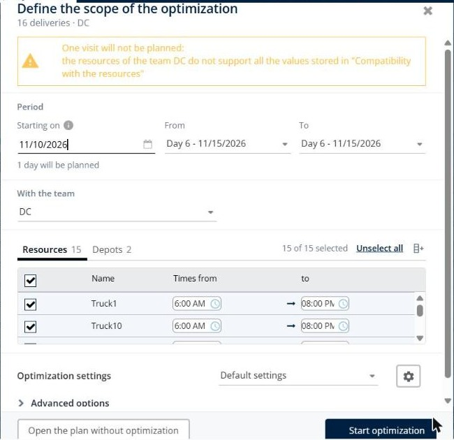
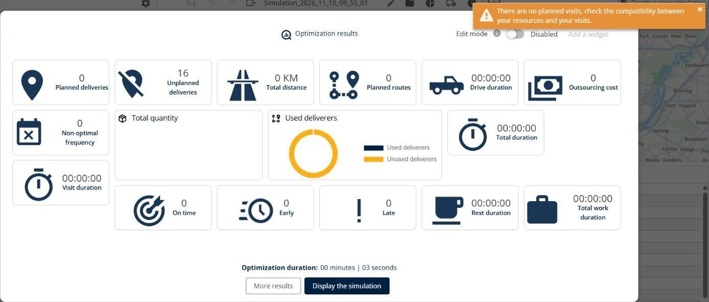
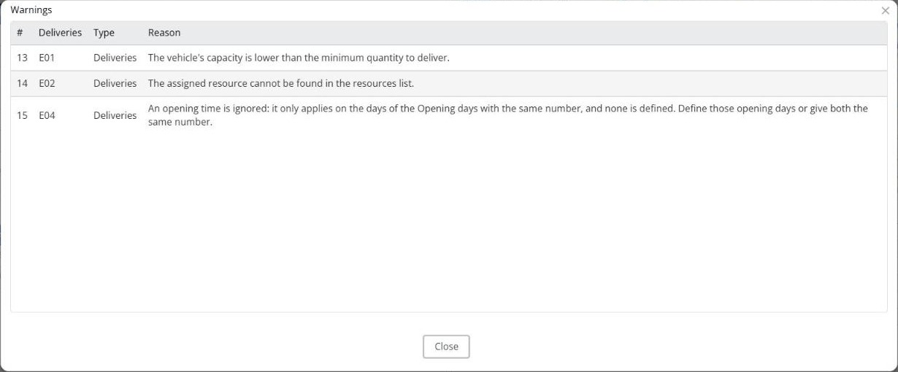
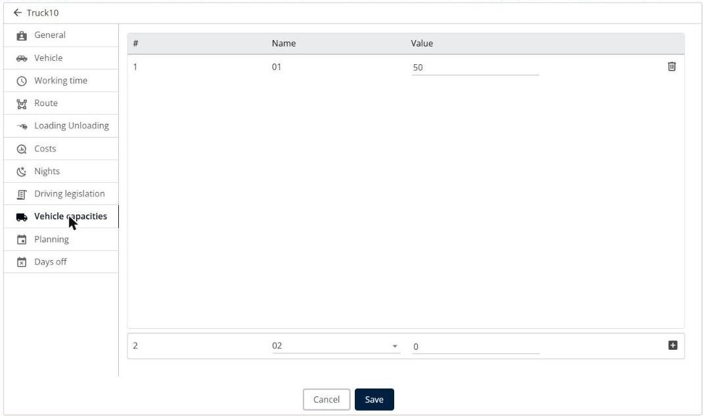
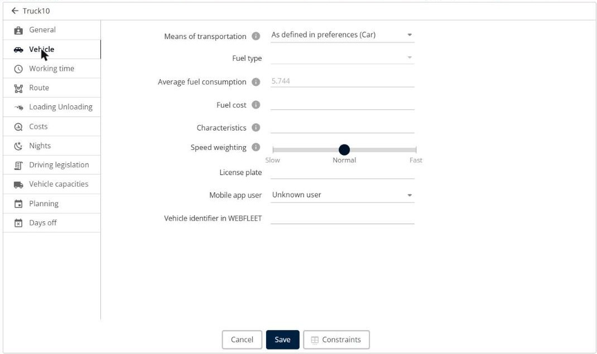
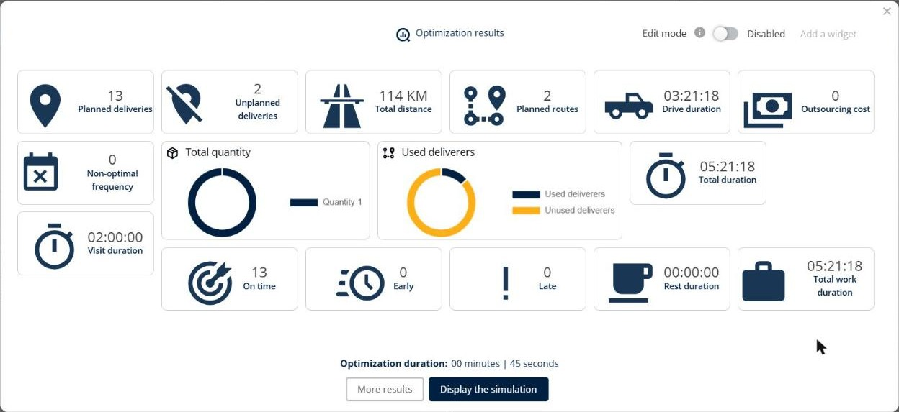

# Pourquoi aucune visite n’est-elle planifiée après l’optimisation ?

Découvrez pourquoi TourSolver affiche le message « There are no planned visits, check the compatibility between your resources and your visits. », ou laisse certaines visites non planifiées, et comment résoudre les erreurs les plus courantes.

## Avant de commencer

* Connectez-vous à **TourSolver**.
* Importez vos livraisons et créez vos ressources. Voir [Import des livraisons](../import-and-data-setup/import-of-deliveries.md).

## Aperçu des fonctionnalités

* **Avertissement de périmètre** : avant l’optimisation, **Définir le périmètre de l’optimisation** vous avertit des visites qui ne peuvent pas être planifiées.
* **Livraisons non planifiées** : le nombre de visites que l’optimisation n’a pas pu planifier, dans les **Résultats de l’optimisation**.
* **Avertissements** : la liste des problèmes détectés pour chaque visite, avec la raison.

## Lire les avertissements

1. Avant de lancer l’optimisation, lisez le message en haut de **Définir le périmètre de l’optimisation**, par exemple « One visit will not be planned: the resources of the team DC do not support all the values stored in "Compatibility with the resources" ».

<figure><figcaption></figcaption></figure>

2. Après l’optimisation, vérifiez les **Livraisons non planifiées** dans les **Résultats de l’optimisation**.

<figure><figcaption></figcaption></figure>

3. Cliquez sur **Afficher la simulation**.
4. Dans la barre d’outils, cliquez sur l’icône **Plus d’informations**. Son info-bulle indique le nombre d’avertissements.
5. Dans la fenêtre **Avertissements**, lisez la **Raison** de chaque livraison, puis cliquez sur **Fermer**.

<figure><figcaption></figcaption></figure>

## Résoudre les erreurs les plus courantes

### La quantité dépasse la capacité du véhicule

**Raison** : « The vehicle's capacity is lower than the minimum quantity to deliver. »

1. Accédez à **Mes livreurs**, puis modifiez la ressource.
2. Cliquez sur **Capacités du véhicule**, puis vérifiez la capacité, par exemple **50**.
3. Augmentez la capacité si le véhicule peut transporter davantage, ou divisez la livraison en plusieurs visites.

<figure><figcaption></figcaption></figure>

### Aucune ressource n’a la compétence requise

**Raison** : « No resource can be found with required skills. » ou « The assigned resource cannot be found in the resources list. »

1. Vérifiez la colonne **Compatibilité avec les ressources** de la visite, par exemple **AC** pour une visite qui nécessite un technicien en climatisation.
2. Accédez à **Mes livreurs**, modifiez une ressource qui peut réaliser la visite, puis cliquez sur **Véhicule**.
3. Saisissez la même valeur dans **Caractéristiques**.

<figure><figcaption></figcaption></figure>

### Aucune ressource ne travaille le jour de la visite

**Raison** : « No resource can be found working the required day. »

* Vérifiez le **Jour d’ouverture** de la visite et les **Jours travaillés** des ressources dans **Mes livreurs** > **Planification**.
* Vérifiez les jours **Du** et **Au** dans **Définir le périmètre de l’optimisation**. Si une visite a un jour d’ouverture qu’aucune ressource ne travaille, la période peut être limitée à ce jour, et aucune visite n’est alors planifiée.

### La fenêtre horaire n’est pas valide

**Raison** : « The time window end time is earlier than the start time. », « An opening time is ignored: it only applies on the days of the Opening days with the same number, and none is defined. » ou « No resource can be found with enough work time. »

* Vérifiez que l’heure de fermeture est postérieure à l’heure d’ouverture.
* Pour une fenêtre horaire qui passe minuit, saisissez l’heure de fermeture après 24:00, par exemple de 23:00 à 26:00.
* Vérifiez que chaque **Heure d’ouverture** a un **Jour d’ouverture** avec le même numéro.
* Vérifiez que la durée de la visite tient dans la fenêtre horaire et dans le temps de travail des ressources.

### Il n’y a pas assez de ressources

Si les visites sont compatibles mais que certaines ne sont toujours pas planifiées :

* Ajoutez des véhicules à l’optimisation. Dans **Définir le périmètre de l’optimisation**, sélectionnez davantage de ressources, ou créez de nouvelles ressources.
* Si vos véhicules roulent plus vite que la vitesse moyenne, déplacez le curseur **Pondération de la vitesse** de la ressource vers **Rapide**.

## Cas d’usage : visites qui ne peuvent pas être planifiées

Téléchargez le fichier d’exemple ci-dessous. Il contient 16 livraisons autour de Washington, DC, pour des ressources d’une capacité de 50 qui travaillent les jours 1 à 5. La feuille **Use cases** décrit chaque ligne.


UseCase_UnplannedVisits.xlsx


* **D01 à D12** : livraisons valides, qui peuvent être planifiées.
* **E01** : quantité **80**, supérieure à la capacité du véhicule de **50**. Raison : « The vehicle's capacity is lower than the minimum quantity to deliver. »
* **E02** : nécessite la caractéristique **AC**, qu’aucun véhicule ne possède. L’avertissement de périmètre s’affiche avant l’optimisation.
* **E03** : jour d’ouverture **6**, mais les ressources travaillent les jours 1 à 5. La période de l’optimisation est limitée au jour 6, et le message « There are no planned visits, check the compatibility between your resources and your visits. » s’affiche.
* **E04** : heure d’ouverture 2:00 PM et heure de fermeture 10:00 AM. Raison : « An opening time is ignored… ».

Lorsque vous supprimez la ligne E03 et optimisez à nouveau les jours 1 à 5, 13 livraisons sont planifiées, et seules E01 et E02 restent non planifiées.

<figure><figcaption></figcaption></figure>

## Conseils


**Commencez avec quelques visites** : pour trouver rapidement la cause, optimisez quelques visites avec une seule ressource, puis ajoutez les autres visites.



**Vérifiez l’association des colonnes** : une colonne associée au mauvais champ, ou une colonne vide associée à une contrainte, peut rendre toutes vos visites incompatibles. Voir [Pourquoi ai-je une erreur lorsque j’importe mon fichier ?](why-do-i-get-an-error-when-i-import-my-file.md).


## Rubriques connexes

* [Optimiser vos livraisons](../operations-and-route-management/optimize-your-deliveries.md)
* [Modifier une ressource et les contraintes associées](../resource-and-vehicle-management/modifying-a-resource-and-associated-constraints.md)
* [Pourquoi ai-je du temps d’attente dans mon plan de tournée ?](why-do-i-have-waiting-time-in-my-route-plan.md)
