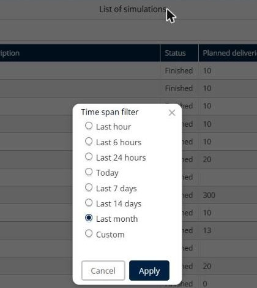
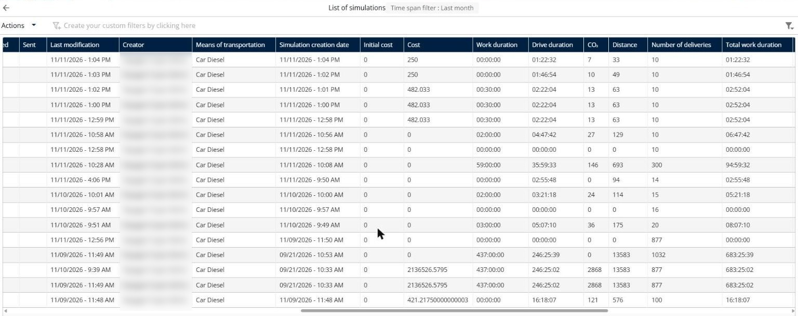
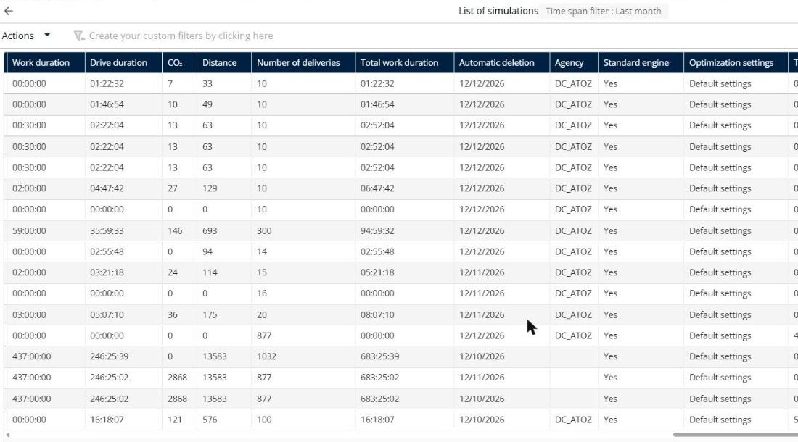
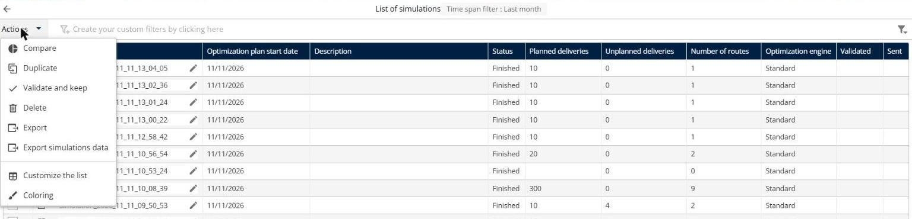

# Pourquoi ne puis-je pas trouver une simulation ou une ancienne optimisation ?

Retrouvez une simulation qui semble perdue, comprenez les dates de la liste des simulations, conservez les simulations dont vous avez besoin et consultez les simulations des autres utilisateurs.

## Avant de commencer

* Connectez-vous à **TourSolver**.
* Sur la page **Accueil**, cliquez sur **Voir la liste des simulations**.

## Aperçu des fonctionnalités

* **Filtre de période** : affiche uniquement les simulations d’une période, par exemple **Le mois dernier**.
* **Dates d’une simulation** : la **Date de début du plan d’optimisation**, la **Date de création de la simulation** et la **Dernière modification**.
* **Suppression automatique** : la date à laquelle TourSolver supprime automatiquement la simulation.
* **Valider et conserver** : conserve une simulation plus longtemps. Voir [Combien de temps les optimisations de mes itinéraires sont-elles conservées ?](how-long-are-my-route-optimizations-kept.md).
* **Supprimer** : supprime une simulation. La suppression est définitive.

## Vérifier le filtre de période

1. Dans la **Liste des simulations**, cliquez sur le **Filtre de période**, par exemple **Filtre de période : Le mois dernier**.
2. Sélectionnez une période plus longue, ou sélectionnez **Personnalisé** et saisissez les dates.
3. Cliquez sur **Appliquer**.

<figure><figcaption></figcaption></figure>

## Comprendre les dates d’une simulation

Une simulation a plusieurs dates. Vérifiez la bonne colonne lorsque vous cherchez une simulation :

* **Date de début du plan d’optimisation** : le premier jour des tournées.
* **Date de création de la simulation** : la date à laquelle la simulation a été créée.
* **Dernière modification** : la date de la dernière modification. La page **Accueil** trie les simulations récentes selon cette date.

<figure><figcaption></figcaption></figure>

Par exemple, une simulation créée le 21/09/2026 peut avoir des tournées qui commencent le 24/08/2026 et une dernière modification le 09/11/2026.

## Conserver une simulation avant sa suppression automatique

1. Dans la **Liste des simulations**, faites défiler jusqu’à la colonne **Suppression automatique** pour voir quand chaque simulation sera supprimée.

<figure><figcaption></figcaption></figure>

2. Cochez les cases des simulations que vous voulez conserver.
3. Cliquez sur **Actions**, puis sur **Valider et conserver**.

<figure><figcaption></figcaption></figure>


**La suppression est définitive** : lorsque vous cliquez sur **Actions** > **Supprimer**, TourSolver demande « Do you want to delete the simulation? ». Une simulation supprimée, manuellement ou automatiquement, ne peut pas être restaurée, même par le support. Si les tournées ont été envoyées à l’application mobile, vous ne pouvez plus les exporter depuis **Suivi**.


## Voir les simulations des autres utilisateurs

* Un utilisateur voit les simulations des autres utilisateurs uniquement avec le droit **Voir les simulations des autres**, et ne peut les modifier qu’avec le droit **Modifier les simulations des autres**. Demandez à votre administrateur de vérifier vos droits. Voir [Définir les droits d’un sous-utilisateur](../import-and-data-setup/create-and-modify-a-user.md).
* Utilisez la colonne **Créateur** de la liste pour voir qui a créé chaque simulation.
* Un collègue peut aussi vous envoyer un lien de partage d’une simulation. Le lien est valable jusqu’à une date donnée. Après cette date, demandez un nouveau lien.

## Conseils


**Nommez vos simulations** : cliquez sur l’icône en forme de crayon à côté du nom d’une simulation pour lui donner un nom explicite, afin de la retrouver facilement.



**Dossiers** : le regroupement des simulations dans des dossiers n’est pas encore disponible. Cette fonctionnalité fait l’objet d’une demande d’amélioration.


## Rubriques connexes

* [Combien de temps les optimisations de mes itinéraires sont-elles conservées ?](how-long-are-my-route-optimizations-kept.md)
* [Créer et modifier un utilisateur](../import-and-data-setup/create-and-modify-a-user.md)
* [Simulation](../simulation/simulation.md)
