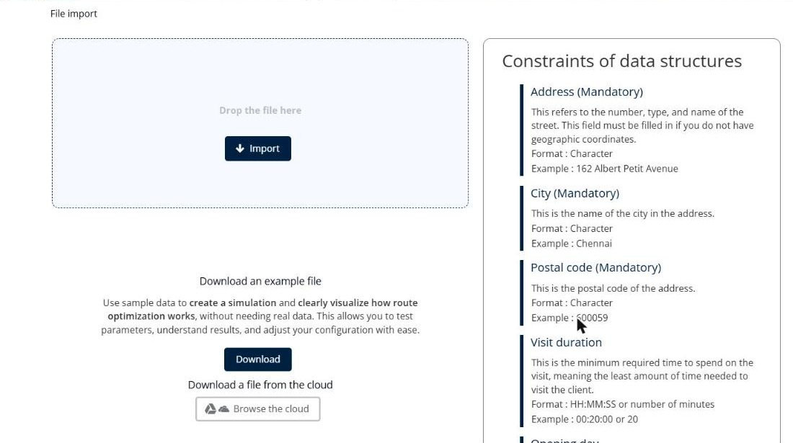
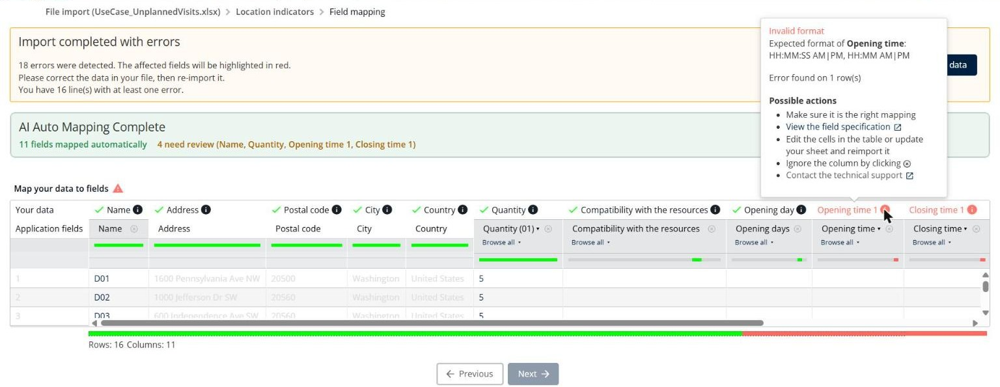
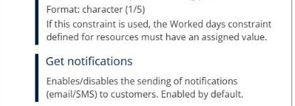
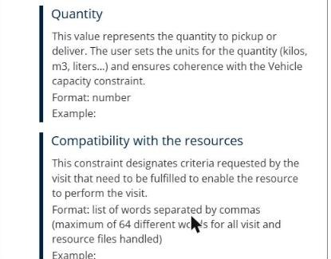

# Pourquoi ai-je une erreur lorsque j’importe mon fichier ?

Vérifiez le format de votre fichier d’import, afin que TourSolver importe vos livraisons sans erreur ni blocage.

## Avant de commencer

* Connectez-vous à **TourSolver**.
* Préparez votre fichier d’import. Voir [Import des livraisons](../import-and-data-setup/import-of-deliveries.md).

## Aperçu des fonctionnalités

* **Contraintes des structures de données** : la liste de la page **Importation de fichier** qui indique le format et un exemple pour chaque champ.
* **Exemple de fichier** : un fichier d’exemple au format attendu.
* **Compatibilité avec les ressources** : un champ qui bloque souvent l’import lorsqu’il est mal renseigné.

## Vérifier le format de chaque champ

1. Accédez à **Mes livraisons**.
2. Sur la page **Importation de fichier**, lisez la liste **Contraintes des structures de données**. Elle indique le format et un exemple pour chaque champ, par exemple :
   * **Adresse**, **Ville** et **Code postal** : obligatoires, au format caractères.
   * **Durée de visite** : **HH:MM:SS** ou un nombre de minutes, par exemple **00:20:00** ou **20**.
   * **Jour d’ouverture** : **1, 2, 5**, **1-4**, une date (**dd/mm/yyyy**) ou un intervalle (**14/05/2016 => 18/05/2016**).
3. Cliquez sur **Voir toutes les contraintes** pour voir le format de tous les champs.
4. Si vous n’êtes pas sûr du format, cliquez sur **Télécharger** pour obtenir l’exemple de fichier, puis copiez-y vos données.

<figure><figcaption></figcaption></figure>

## Comparer les valeurs au format attendu

La plupart des erreurs d’import viennent d’une valeur qui ne correspond pas au format de son champ. Comparez vos valeurs à ces exemples :

* **Nombre** : saisissez uniquement un nombre, sans unité. Par exemple, saisissez **20** dans **Durée de visite** pour 20 minutes, et non **20 min**. Pour une **Quantité**, saisissez **2.5**, et non **2,5 kg**.
* **Date** : saisissez la date au format **dd/mm/yyyy**, par exemple **10/11/2026**. Pour une période, saisissez **14/05/2016 => 18/05/2016**.
* **Heure** : utilisez le format d’heure de votre compte. Par exemple, si votre compte utilise AM et PM, saisissez **2:00 PM**, et non **14:00**. Sinon, l’import affiche « Invalid format » avec le format attendu, par exemple **HH:MM AM|PM**.

<figure><figcaption></figcaption></figure>

* **Valeur binaire** : saisissez **0** ou **1**. Par exemple, dans **Exiger que toutes les compétences soient compatibles**, **0** signifie qu’une seule caractéristique suffit.
* **Valeur par défaut** : si vous laissez une cellule vide, TourSolver utilise la valeur par défaut du champ. Par exemple, **Recevoir les notifications** est activé par défaut : le client reçoit donc les notifications, sauf si vous les désactivez.

<figure><figcaption></figcaption></figure>

## Préparer le fichier

* **Gardez une seule feuille par fichier** : placez toutes vos livraisons dans une seule feuille, et supprimez les autres feuilles.
* **Supprimez les colonnes inutilisées** : supprimez les colonnes vides ou inutilisées qui sont associées à une contrainte, par exemple les champs d’évaluation lorsque vous n’utilisez pas le mode évaluation.
* **Utilisez un point pour les décimales** : saisissez **2.5**, et non **2,5**.
* **Évitez les apostrophes dans les noms de ressources** : une apostrophe dans un nom de ressource peut bloquer l’import.
* **Vérifiez les dates** : si toutes les dates sont décalées d’environ quatre ans, votre fichier Excel utilise le calendrier depuis 1904. Dans Excel, désactivez l’option **Utiliser le calendrier depuis 1904**, puis vérifiez à nouveau les dates.

## Renseigner la colonne Compatibilité avec les ressources

Le champ **Compatibilité avec les ressources** liste les critères dont une ressource a besoin pour réaliser la visite.

* Séparez les mots par des virgules, par exemple **Fridge,Tailgate**.
* Utilisez exactement les mêmes mots que dans les ressources.
* N’utilisez pas plus de 64 mots différents dans l’ensemble de vos fichiers de visites et de ressources.

<figure><figcaption></figcaption></figure>

## Conseils


**Partez de l’exemple de fichier** : copiez vos données dans l’exemple de fichier. Ses colonnes ont déjà le format attendu.



**Toujours bloqué ?** : envoyez votre fichier d’import et une capture d’écran du message d’erreur au support.


## Rubriques connexes

* [Import des livraisons](../import-and-data-setup/import-of-deliveries.md)
* [Comment optimiser le géocodage dans TourSolver ?](how-do-i-optimize-geocoding-in-toursolver.md)
* [Évaluer vos tournées existantes](../operations-and-route-management/evaluate-your-existing-routes.md)
