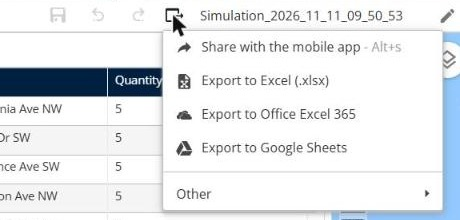
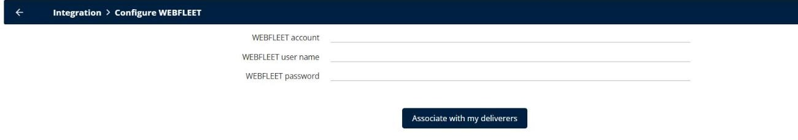

# Pourquoi mon export vers WEBFLEET, Google Calendar ou Google Sheets échoue-t-il ?

Résolvez les erreurs les plus courantes lorsque vous exportez vos tournées vers WEBFLEET, Google Calendar ou Google Sheets.

## Avant de commencer

* Connectez-vous à **TourSolver**, puis ouvrez une simulation.
* Dans la barre d’outils de la simulation, cliquez sur **Exporter**. **Exporter vers Google Sheets** se trouve dans la liste principale. **Exporter vers WEBFLEET** et **Exporter vers Google Calendar** se trouvent sous **Autres**.

<figure><figcaption></figcaption></figure>

## Aperçu des fonctionnalités

* **Exporter vers WEBFLEET** : envoie les tournées sous forme de commandes aux véhicules dans WEBFLEET.
* **Exporter vers Google Calendar** : ajoute les visites aux agendas Google de vos livreurs.
* **Exporter vers Google Sheets** : crée un fichier Google Sheets avec vos tournées.

## Résoudre « WEBFLEET export error » ou « order already exists »

WEBFLEET refuse une commande qui existe déjà, par exemple lorsque vous exportez deux fois la même tournée.

1. Dans WEBFLEET, supprimez les commandes de votre export précédent.
2. Dans TourSolver, exportez les tournées une par une : sélectionnez une tournée dans le panneau **Tournées**, puis cliquez sur **Exporter** > **Autres** > **Exporter vers WEBFLEET**.

Vérifiez aussi que chaque ressource est associée à son véhicule WEBFLEET :

1. Accédez à **Configuration** > **Intégration** > **Configurer WEBFLEET**.
2. Vérifiez le **Compte WEBFLEET**, le **Nom d’utilisateur WEBFLEET** et le **Mot de passe WEBFLEET**.
3. Cliquez sur **Associer à mes livreurs**.

<figure><figcaption></figcaption></figure>

4. Pour chaque ressource, vérifiez l’**Identifiant du véhicule dans WEBFLEET** dans l’onglet **Véhicule** de **Mes livreurs**.

## Résoudre « Google Calendar export error »

1. Si TourSolver affiche « Failed to login to Google, check that popups are not blocked », autorisez les fenêtres contextuelles pour TourSolver dans votre navigateur.
2. Autorisez de nouveau Nomadia à accéder à votre compte Google, puis exportez de nouveau.

## Résoudre l’erreur 403 de « Google Sheets »

Une erreur 403 signifie que Google refuse l’accès.

* Vérifiez que vous êtes connecté avec un compte Google qui peut créer et partager des fichiers dans Google Drive.
* Vérifiez les autorisations de partage du fichier Google Sheets et du dossier Google Drive.
* Si votre entreprise utilise Google Workspace, demandez à votre administrateur si l’accès des applications externes à Gmail et à Google Drive est autorisé.

## Conseils


**Distances en mètres** : dans l’export Excel, les distances sont en mètres, par exemple **Distance (m)**. Un export en kilomètres fait l’objet d’une demande d’amélioration. Pour convertir, divisez les valeurs par 1 000 dans Excel.


## Rubriques connexes

* [Exporter mes itinéraires](../operations-and-route-management/export-my-routes.md)
* [Pourquoi mon export Excel est-il vide, incomplet ou en échec ?](why-is-my-excel-export-empty-incomplete-or-failed.md)
