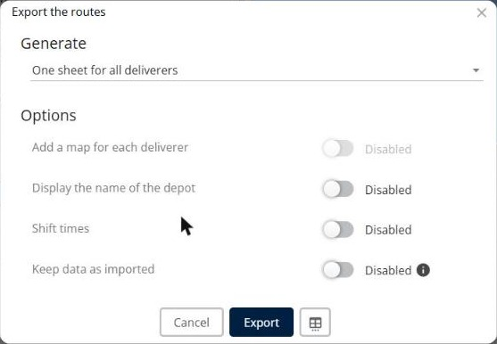
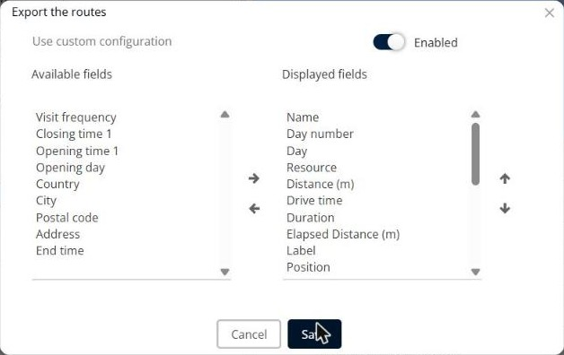

# Pourquoi mon export Excel est-il vide, incomplet ou en échec ?

Résolvez les problèmes les plus courants de l’export Excel de vos tournées : colonnes vides, champs manquants, dates incorrectes et message « Export failed ».

## Avant de commencer

* Connectez-vous à **TourSolver**, puis ouvrez une simulation.
* Pour exporter seulement certaines tournées, sélectionnez-les dans le panneau **Tournées**. Sinon, TourSolver demande « Do you want to export all routes? ».

## Aperçu des fonctionnalités

* **Exporter vers Excel (.xlsx)** : exporte les tournées de la simulation.
* **Générer** : une feuille pour tous les livreurs, ou une feuille par livreur.
* **Conserver les données telles qu’importées** : exporte les jours d’ouverture et les contraintes booléennes telles que vous les avez importés.
* **Utiliser une configuration personnalisée** : vous permet de choisir les **Champs affichés** de l’export.

## Exporter les tournées vers Excel

1. Dans la barre d’outils de la simulation, cliquez sur **Exporter**, puis sur **Exporter vers Excel (.xlsx)**.
2. Dans **Exporter les tournées**, sélectionnez ce que vous voulez **Générer**, par exemple **Une feuille pour tous les livreurs**.
3. Définissez les **Options** : **Ajouter une carte pour chaque livreur**, **Afficher le nom du dépôt**, **Décaler les horaires** et **Conserver les données telles qu’importées**.
4. Cliquez sur **Exporter**.

<figure><figcaption></figcaption></figure>

Voir [Exporter mes itinéraires](../operations-and-route-management/export-my-routes.md).

## Conserver les données telles que vous les avez importées

Lorsque **Conserver les données telles qu’importées** est désactivé, TourSolver normalise certaines contraintes dans l’export :

* Les jours d’ouverture sont exportés sous la forme d’un nombre de jours à partir de la date de début de la simulation.
* Les contraintes booléennes sont exportées sous la forme **0** ou **1**.

Pour exporter les données telles que vous les avez importées, activez **Conserver les données telles qu’importées**. Si vous avez fait d’importantes modifications manuelles dans la simulation, par exemple si vous avez supprimé des visites, désactivez de nouveau cette option : les données ne peuvent pas être garanties.

## Choisir les champs de l’export

1. Dans **Exporter les tournées**, cliquez sur l’icône des champs à côté de **Exporter**.
2. Activez **Utiliser une configuration personnalisée**.
3. Déplacez les champs entre **Champs disponibles** et **Champs affichés** avec les flèches, et changez leur ordre avec les flèches haut et bas.
4. Cliquez sur **Enregistrer**.

<figure><figcaption></figcaption></figure>

Si une colonne est vide ou manquante, vérifiez que son champ figure dans **Champs affichés**.

## Résoudre « Export failed » (erreur 500)

Une erreur 500 signifie généralement que l’un des champs affichés bloque l’export.

1. Ouvrez la liste des champs de l’export.
2. Retirez tous les champs que vous avez ajoutés aux **Champs affichés**, puis exportez de nouveau.
3. Ajoutez de nouveau les champs un par un, et exportez après chacun d’eux, pour trouver le champ qui bloque l’export.
4. Retirez ce champ des **Champs affichés**, puis signalez-le au support.

## Vérifier les autres causes

* **Date de la tournée** : la date de la tournée est disponible uniquement dans un export depuis la page **Optimisation**.
* **Une feuille par ressource** : lorsque vous générez une feuille par livreur, une apostrophe ou un caractère spécial dans le nom d’une ressource peut bloquer l’export. Renommez la ressource sans l’apostrophe.
* **Jours planifiés manquants** : des visites sans jour planifié peuvent bloquer l’export. Vérifiez que toutes les visites exportées sont planifiées, ou sélectionnez uniquement les tournées planifiées.

## Rubriques connexes

* [Exporter mes itinéraires](../operations-and-route-management/export-my-routes.md)
* [Pourquoi ai-je une erreur lorsque j’importe mon fichier ?](why-do-i-get-an-error-when-i-import-my-file.md)
* [Comment gérer les couleurs, les filtres et les colonnes affichées ?](how-do-i-manage-colors-filters-and-displayed-columns.md)
