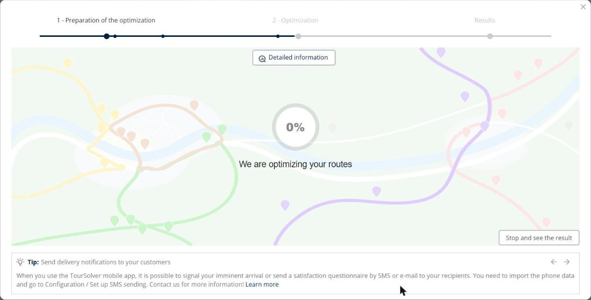
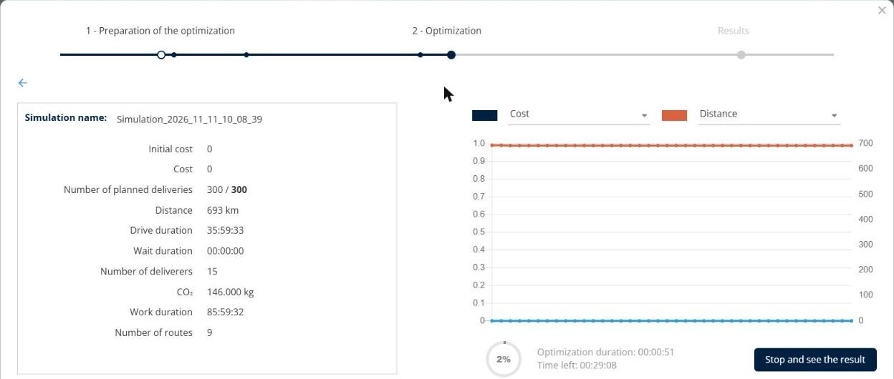
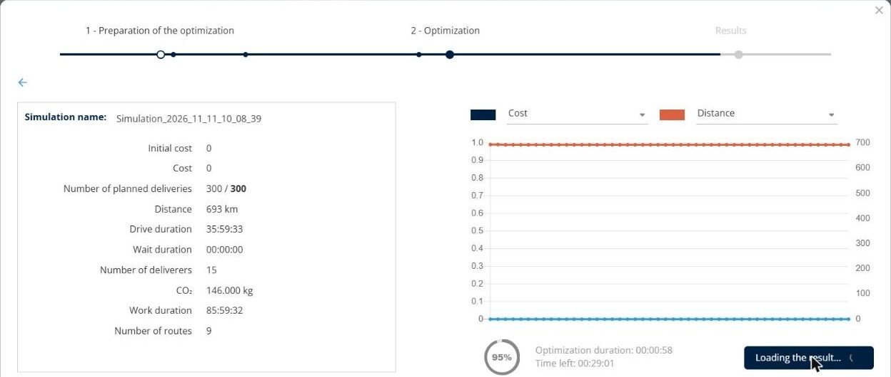

# Pourquoi mon optimisation est-elle lente, bloquée ou interrompue ?

Découvrez pourquoi une optimisation prend beaucoup de temps, semble bloquée ou affiche le message « The simulation was interrupted », et comment obtenir un résultat plus rapidement.

## Avant de commencer

* Connectez-vous à **TourSolver** avec un profil utilisateur qui a accès à la page **Configuration**.

## Aperçu des fonctionnalités

* **Durée maximale d’optimisation** : la durée maximale d’une optimisation, par exemple **30 minutes**. L’optimisation continue d’améliorer les tournées jusqu’à cette durée.
* **Arrêt automatique de l’optimisation** : arrête l’optimisation lorsqu’il n’y a plus d’amélioration après la durée définie.
* **Avancé : première solution** : la méthode qui construit les premières tournées. **NEAREST** ajoute la visite la plus proche à chaque étape et est la plus rapide.
* **Arrêter et voir le résultat** : arrête l’optimisation et charge le dernier résultat calculé par le moteur.
* **Informations détaillées** : affiche la progression de l’optimisation, les livraisons planifiées et le temps restant.

## Suivre la progression de l’optimisation

1. Pendant l’optimisation, cliquez sur **Informations détaillées**.

<figure><figcaption></figcaption></figure>

2. Vérifiez le **Nombre de livraisons planifiées**, la **Durée de l’optimisation** et le **Temps restant**.

<figure><figcaption></figcaption></figure>

3. Si le premier résultat vous convient, cliquez sur **Arrêter et voir le résultat**. TourSolver charge le dernier résultat calculé par le moteur.

<figure><figcaption></figcaption></figure>

## Accélérer l’optimisation de grands volumes

1. Accédez à **Configuration**.
2. Sous **Véhicules et optimisation**, cliquez sur **Options de calcul**.
3. Dans la section **Optimisation**, vérifiez les paramètres :
   * **Durée maximale d’optimisation** : réduisez-la pour obtenir un résultat plus tôt.
   * **Arrêt automatique de l’optimisation** : sélectionnez une durée, par exemple **1 minute**, pour arrêter l’optimisation lorsque les tournées ne s’améliorent plus. Les options sont **Pas d’arrêt automatique**, **5 secondes**, **10 secondes**, **30 secondes**, **1 minute**, **2 minutes**, **5 minutes** et **10 minutes**.
   * **Avancé : première solution** : sélectionnez **NEAREST** pour les grands volumes. **CLUSTERING** est la plus lente.

<figure><figcaption></figcaption></figure>


**Arrêt automatique trop court** : un arrêt automatique très court peut arrêter l’optimisation avant d’obtenir un bon premier résultat. Si les tournées ne sont pas satisfaisantes, sélectionnez une durée plus longue.


## Éviter les optimisations simultanées

Plusieurs optimisations lancées en même temps par plusieurs utilisateurs de votre compte partagent les mêmes ressources et sont plus lentes.

* Attendez la fin d’une optimisation avant d’en lancer une autre.
* Fermez les onglets du navigateur que vous n’utilisez pas.

## Résoudre « The simulation was interrupted »

1. Fermez la fenêtre d’optimisation, puis relancez l’optimisation depuis **Mes livraisons**.
2. Demandez à un collègue si ses optimisations s’arrêtent également. Si c’est le cas, il peut s’agir d’un incident de plateforme. Patientez quelques minutes, puis réessayez.
3. Si le problème persiste, ouvrez la console du navigateur avec **Ctrl+Maj+I** (Mac : **Cmd+Option+I**), puis faites une capture d’écran des messages en rouge dans l’onglet **Console**.
4. Envoyez le nom de la simulation, la date et l’heure, ainsi que la capture d’écran au support. Voir [Contacter le support](i-cannot-log-in-to-toursolver-web.md#contacter-le-support).

## Cas d’usage : optimiser un grand volume

Téléchargez le fichier d’exemple ci-dessous. Il contient 300 livraisons positionnées par coordonnées GPS autour de Washington, DC.


UseCase_LargeVolume.xlsx


1. Importez le fichier dans **Mes livraisons**, puis lancez l’optimisation avec 15 ressources sur 5 jours.
2. Cliquez sur **Informations détaillées**. Au bout d’environ 20 secondes, le premier résultat planifie déjà les 300 livraisons, avec un **Temps restant** de 29 minutes.
3. Cliquez sur **Arrêter et voir le résultat**. TourSolver charge les tournées au bout d’environ une minute, au lieu de 30 minutes.

Pour obtenir ce résultat automatiquement, sélectionnez un **Arrêt automatique de l’optimisation** dans les **Options de calcul**.

## Conseils


**Divisez les très gros fichiers** : pour des milliers de visites, optimisez une zone ou une semaine à la fois. Voir [Quel est le nombre maximum de visites pouvant être importées ou optimisées ?](what-is-the-maximum-number-of-visits-that-can-be-imported-or-optimized.md).


## Rubriques connexes

* [Optimiser vos livraisons](../operations-and-route-management/optimize-your-deliveries.md)
* [Diagnostiquer les visites non planifiées et les tournées incohérentes](../operations-and-route-management/diagnose-unplanned-visits-and-inconsistent-routes.md)
* [Pourquoi ne puis-je pas me connecter à TourSolver ?](i-cannot-log-in-to-toursolver-web.md)
