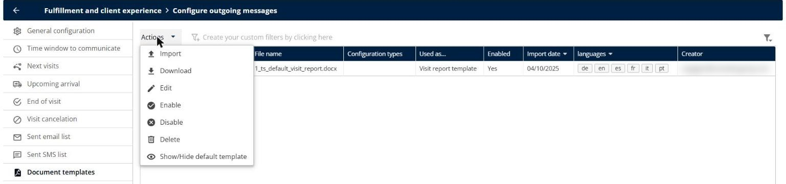
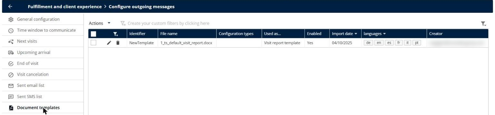
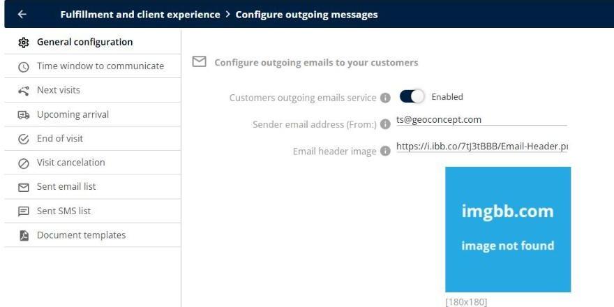

# Pourquoi mon document PDF est-il vide ou sans logo ?

Créez un modèle de document à partir d’un fichier Word, affichez votre logo dans les documents et résolvez les problèmes les plus courants des documents PDF générés.

## Avant de commencer

* Connectez-vous à **TourSolver** avec un profil utilisateur qui a accès à la page **Configuration**.
* Lisez [Que sont les modèles de documents dans TourSolver ?](what-are-document-templates-in-toursolver.md).

## Aperçu des fonctionnalités

* **Modèles de documents** : les fichiers Word (.docx) que TourSolver utilise pour générer les documents PDF, par exemple le **Modèle de rapport de visite**.
* **Variables** : les champs d’un modèle que TourSolver remplace par les données de la visite.
* **Modèle par défaut** : le modèle fourni par TourSolver. Vous pouvez le télécharger et l’utiliser comme base.

## Créer un modèle à partir d’un fichier Word

Le bouton **Créer** n’est plus disponible. Créez votre modèle dans Word, puis importez-le.

1. Accédez à **Configuration** > **Suivi et expérience client** > **Configurer les messages sortants**.
2. Cliquez sur **Modèles de documents**.
3. Cliquez sur **Actions**, puis sur **Afficher/Masquer le modèle par défaut**. Sélectionnez le modèle par défaut, puis cliquez sur **Actions** > **Télécharger**.

<figure><figcaption></figcaption></figure>

4. Ouvrez le fichier .docx dans Word, modifiez la mise en page, et conservez ou ajoutez les variables dont vous avez besoin.
5. Cliquez sur **Actions** > **Importer**, puis sélectionnez votre fichier .docx.
6. Sélectionnez l’utilisation du modèle, par exemple **Modèle de rapport de visite**, puis activez-le.

<figure><figcaption></figcaption></figure>

### Résultat

Le modèle apparaît dans la liste avec ses colonnes **Utilisé comme...**, **Activé** et **langues**, et TourSolver l’utilise pour générer les documents.

## Afficher votre logo

Le logo d’un document ou d’un e-mail doit être une image que tout le monde peut ouvrir, sans se connecter.

* Utilisez un lien public vers l’image, par exemple sur le site web de votre entreprise.
* N’utilisez pas de lien qui demande un mot de passe, de lien de partage privé ou de lien vers une image supprimée.
* Ouvrez le lien dans une fenêtre de navigation privée pour vérifier que l’image s’affiche.

Si l’image n’est pas accessible, TourSolver affiche l’image du service d’hébergement à la place de votre logo, par exemple **image not found**.

<figure><figcaption></figcaption></figure>

## Résoudre un téléchargement vide

* **Ancien modèle** : les anciens modèles, réalisés avec des constructions graphiques, donnent un fichier vide. TourSolver affiche aussi « Older models (graphic constructions) cannot be exported. Only models based on a Word document can be. ». Créez un nouveau modèle à partir d’un fichier Word.
* **Modèle désactivé** : vérifiez que le modèle est **Activé** et qu’il a une utilisation dans **Utilisé comme...**. Un modèle sans utilisation ne peut pas être activé.

## Renseigner les valeurs par défaut

Lorsqu’une variable n’a pas de valeur pour une visite, le document affiche la valeur par défaut du champ, ou rien. Renseignez les champs de vos visites, ou ajoutez un texte par défaut à côté de la variable dans votre modèle Word.

## Rubriques connexes

* [Que sont les modèles de documents dans TourSolver ?](what-are-document-templates-in-toursolver.md)
* [Fin de la visite](../customer-communication/end-of-visit.md)
* [Configuration générale](../customer-communication/general-configuration.md)
