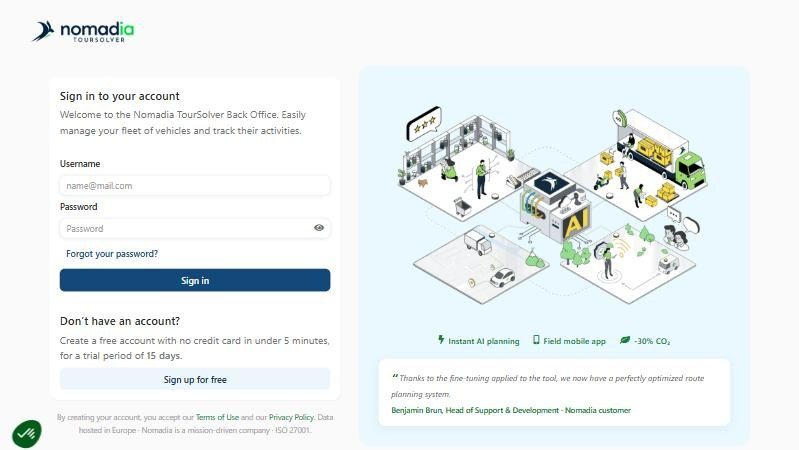
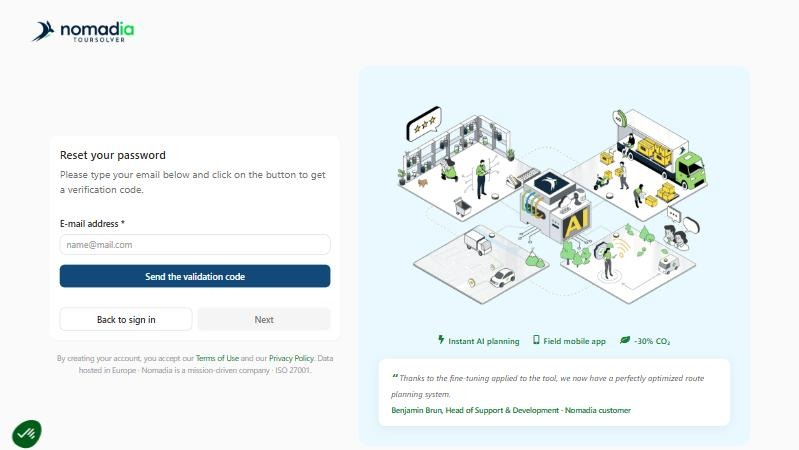
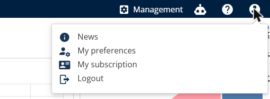

# Se connecter à TourSolver

Connectez-vous à TourSolver, réinitialisez un mot de passe oublié et déconnectez-vous à la fin de votre session.

## Avant de commencer

* Disposez d’un compte TourSolver. Voir [Processus d’inscription](signup-process.md).
* Utilisez un navigateur compatible. Voir [Quels navigateurs et systèmes sont compatibles avec TourSolver ?](../faq/which-browsers-and-systems-are-compatible-with-toursolver.md).

## Aperçu des fonctionnalités

* **Connectez-vous à votre compte** : vous connecte à TourSolver avec votre nom d’utilisateur, qui est votre adresse e-mail, et votre mot de passe.
* **Mot de passe oublié ?** : réinitialise votre mot de passe avec un code de validation envoyé par e-mail.
* **Déconnexion** : met fin à votre session depuis le menu utilisateur.

## Se connecter

1. Ouvrez [https://app.geoconcept.com/ToursolverCloud/ts/trsolver/home](https://app.geoconcept.com/ToursolverCloud/ts/trsolver/home).
2. Sur la page **Connectez-vous à votre compte**, saisissez votre **Nom d’utilisateur**, qui est l’adresse e-mail de votre compte TourSolver.
3. Saisissez votre **Mot de passe**.
4. Cliquez sur **Se connecter**.

<figure><figcaption></figcaption></figure>

### Résultat

La page **Accueil** de TourSolver s’ouvre.

## Réinitialiser un mot de passe oublié

1. Sur la page de connexion, cliquez sur **Mot de passe oublié ?**.
2. Sur la page **Réinitialiser votre mot de passe**, saisissez l’**Adresse e-mail** de votre compte TourSolver.
3. Cliquez sur **Envoyer le code de validation**.

<figure><figcaption></figcaption></figure>

4. Saisissez le code de validation que vous avez reçu par e-mail, puis cliquez sur **Suivant**.
5. Saisissez deux fois votre nouveau mot de passe, puis confirmez.

Cliquez sur **Retour à la connexion** pour revenir à la page de connexion sans changer votre mot de passe.


**Exigences du mot de passe** : votre mot de passe doit contenir au moins une lettre majuscule, une lettre minuscule, un chiffre et un caractère spécial.


### Résultat

Votre mot de passe est modifié. Vous pouvez vous connecter avec votre nouveau mot de passe.

## Se déconnecter

1. Cliquez sur l’**icône utilisateur** en haut à droite de TourSolver.
2. Cliquez sur **Déconnexion**.

<figure><figcaption></figcaption></figure>

### Résultat

La page de connexion s’ouvre.

## Conseils


**Impossible de vous connecter ?** : voir [Pourquoi ne puis-je pas me connecter à TourSolver ?](../faq/i-cannot-log-in-to-toursolver-web.md) pour résoudre les problèmes de connexion les plus courants.


## Rubriques connexes

* [Processus d’inscription](signup-process.md)
* [Pourquoi ne puis-je pas me connecter à TourSolver ?](../faq/i-cannot-log-in-to-toursolver-web.md)
* [Créer et modifier un utilisateur](../import-and-data-setup/create-and-modify-a-user.md)
