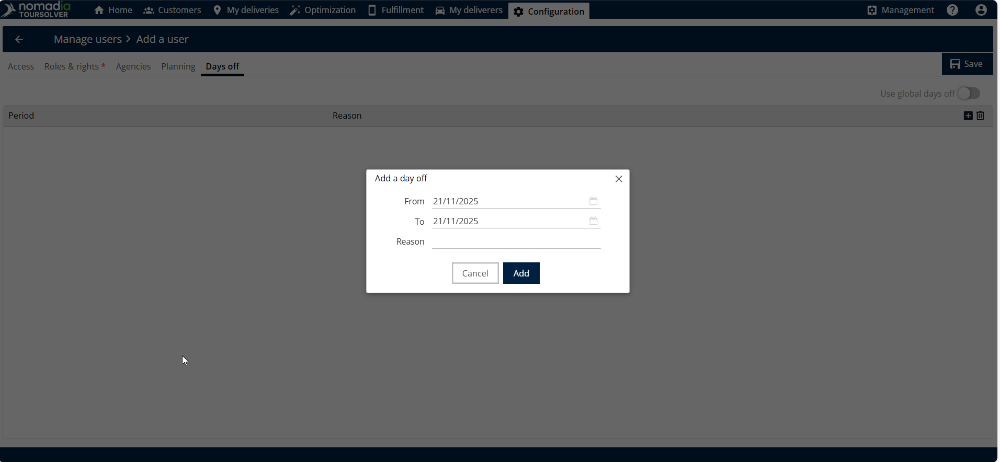

# Créer et modifier un utilisateur

## 1. Introduction

Ce guide fournit des instructions étape par étape pour intégrer de nouveaux membres d'équipe et mettre à jour les informations, les rôles ou les horaires des utilisateurs actuels. En suivant ces étapes simples, vous pourrez gérer les paramètres d'accès avec confiance et efficacité !

## 2. Configuration initiale

La première étape pour créer ou modifier un utilisateur consiste à accéder à la zone principale de configuration depuis la page d'accueil.

Pour commencer à créer ou modifier un utilisateur, suivez ces étapes :

1. Depuis la **page d'accueil**, allez à la **configuration.**
2. Cliquez sur **Gérer les utilisateurs.**

<figure><figcaption></figcaption></figure>

<figure><figcaption></figcaption></figure>

3. Cliquez sur **menu Actions**.
4. Cliquez sur **Ajouter**

<figure><figcaption></figcaption></figure>

## 3. Explications des fonctionnalités et avantages

Lorsque vous créez ou modifiez un utilisateur, vous interagirez avec plusieurs sections clés pour définir son accès et son planning.

| Section             | But (Contexte)                                                                                                             | Actions clés                                                                                             |
| ------------------- | -------------------------------------------------------------------------------------------------------------------------- | -------------------------------------------------------------------------------------------------------- |
| **Accès**           | Définit l'identité de base et les autorisations de connexion (web et mobile) pour l'utilisateur.                           | Saisir l'identifiant de connexion, les noms et définir le mot de passe initial pour l'utilisateur mobile |
| **Rôles et droits** | Détermine ce que l'utilisateur est autorisé à voir et à faire dans l'application (par ex. : administrateur, optimisation). | Activer les rôles et droits nécessaires, tels que **administrateur** ou **optimisation**.                |
| **Agences**         | Attribue les agences spécifiques dont l'utilisateur est responsable ou auxquelles il doit avoir accès.                     | Sélectionnez les agences requises et utilisez la **flèche droite** pour les affecter.                    |
| **Planification**   | Vous permet de planifier le créneau horaire pour l'utilisateur.                                                            | Appuyez sur le jour et l'heure pour définir le créneau, puis appuyez sur **mettre à jour**.              |
| **Jours de congé**  | Vous permet de préplanifier et d'enregistrer les jours de congé que l'utilisateur prévoit de prendre.                      | Entrez le **date de début** et **à la date** pour la période de congé prévue.                            |

**Remarque** : La planification et les jours de congé seront accessibles uniquement à l'utilisateur mobile. Les rôles et droits seront accessibles uniquement à l'utilisateur web

## 4. Création d'utilisateurs

Vous pouvez créer un utilisateur entièrement à partir de zéro ou modifier efficacement un utilisateur existant en utilisant ses informations comme modèle.

### Créer un utilisateur à partir de zéro

Ceci est nécessaire lors de l'intégration d'un nouvel employé qui nécessite un identifiant de connexion unique et des rôles définis.

1. Après être allé à l'écran Ajouter, confirmez que vous créez un utilisateur à partir de zéro.
2. D'abord, voyons comment créer l'utilisateur à partir de zéro. Cliquez sur **OK** – Commence la création d'un nouvel utilisateur.

<figure><figcaption></figcaption></figure>

<figure><figcaption></figcaption></figure>

3. Remplir les informations d'accès : Dans la section Accès, saisissez les informations requises : **Identifiant de connexion, prénom et nom**
4. Définir **Type d'accès** et **Mot de passe :** Pour l'accès web, activez l'option Accès Web, et pour l'accès mobile, activez l'option Accès Mobile.
5. Entrez le **mot de passe**

**Conseil** : Vous pouvez activer à la fois les options Accès Web et Accès Mobile en même temps si l'utilisateur en a besoin. ⚠ Avertissement (Exigence de mot de passe) : Le mot de passe doit contenir 8 caractères, y compris un caractère numérique et un caractère spécial.

<figure><figcaption></figcaption></figure>

<figure><figcaption></figcaption></figure>

6. **Définir les rôles et droits** : Dans la section Rôles et droits, activez tous les rôles nécessaires, tels qu'administrateur, optimisation ou dépôt.&#x20;
7. **Attribuer des agences** : Dans la section Agences, cliquez sur les agences que vous devez attribuer, puis cliquez sur la flèche droite pour les déplacer dans la liste attribuée.

<figure><figcaption></figcaption></figure>

<figure><figcaption></figcaption></figure>

8. **Planifier les créneaux** : Dans la section Planification, cliquez sur le jour et l'heure pour définir le créneau souhaité, puis cliquez sur mettre à jour.

<figure><figcaption></figcaption></figure>

<figure><figcaption></figcaption></figure>

**Planifier des jours de congé (optionnel) : Dans la section Jours de congé, vous pouvez planifier des congés futurs :**

9. Cliquez sur l' **symbole plus** icône sur le côté droit.
10. Entrez le **date de début** et la **à la date** pour le jour de congé.
11. Cliquez sur **Ajouter**

<figure><figcaption></figcaption></figure>

<figure><figcaption></figcaption></figure>

12. **Enregistrer l'utilisateur** : Après avoir rempli toutes les informations requises, cliquez sur **Enregistrer** pour finaliser la création.

<figure><figcaption></figcaption></figure>

<figure><figcaption></figcaption></figure>

**Résultat&#x20;**_**attendu**:_ L'utilisateur a été créé avec succès

<figure><figcaption></figcaption></figure>

### Modifier un utilisateur existant

Vous pouvez facilement mettre à jour les informations d'un utilisateur existant, telles que ses rôles, agences ou planning, sans recommencer.

1. **Sélectionner un utilisateur existant :** Activez Oui dans la section créer à partir d'un utilisateur existant.
2. **Choisir l'utilisateur** : Sélectionnez l'utilisateur spécifique que vous souhaitez modifier, puis cliquez sur **OK**.

<figure><figcaption></figcaption></figure>

3. **Modifier les informations** : Toutes les informations de l'utilisateur seront automatiquement copiées depuis l'utilisateur sélectionné. Parcourez les différentes sections (Accès, Rôles et droits, Planification, etc.) et modifiez les informations existantes selon les besoins.
4. **Enregistrer les modifications :** Une fois que vous avez mis à jour les informations nécessaires, cliquez sur Enregistrer pour terminer la modification.

<figure><figcaption></figcaption></figure>

<figure><figcaption></figcaption></figure>

## 5. Conseils de productivité

Voici quelques conseils et avertissements utiles pour garantir que votre processus de gestion des utilisateurs se déroule sans accroc :
