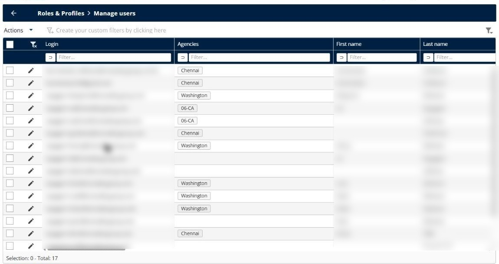
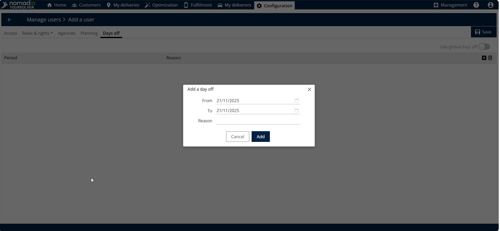
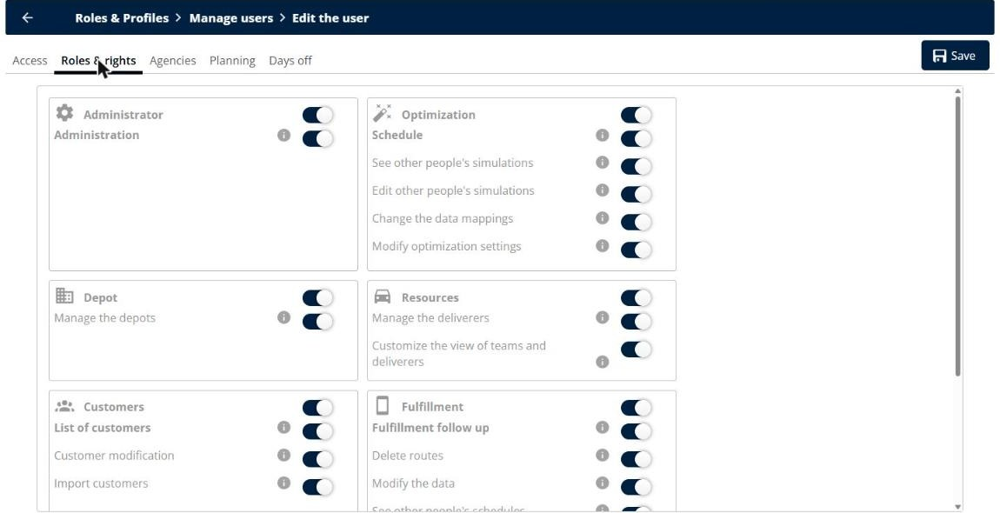
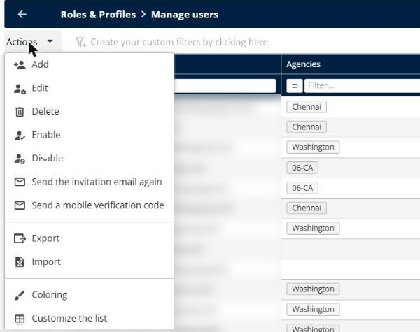
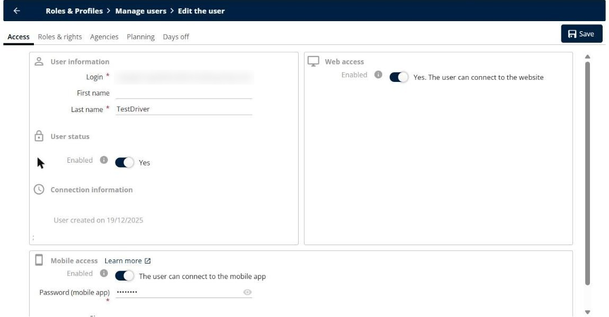

# Créer et modifier un utilisateur

Créez, modifiez, désactivez, supprimez ou remplacez les utilisateurs de votre compte, et conservez les données d’un utilisateur qui part.

## Avant de commencer

* Connectez-vous à **TourSolver** avec un profil utilisateur qui dispose du droit **Administration**.
* Accédez à **Configuration** > **Rôles et profils** > **Gérer les utilisateurs**.

## Aperçu des fonctionnalités

* **Gérer les utilisateurs** : liste les utilisateurs de votre compte avec leur identifiant, leurs agences, leurs rôles, leur statut et leurs accès.
* **Menu Actions** : ajoute, modifie, supprime, active ou désactive des utilisateurs, et renvoie l’e-mail d’invitation.
* **Statut de l’utilisateur** : l’interrupteur **Activé** d’un utilisateur. Un utilisateur désactivé ne peut plus se connecter, mais ses données sont conservées.
* **Rôles et droits** : définit ce qu’un utilisateur peut voir et faire, par exemple gérer les dépôts ou voir les plans de tournées de ses collègues.

<figure><figcaption></figcaption></figure>

Lorsque vous créez ou modifiez un utilisateur, vous travaillez dans ces sections :

| Section | Objectif | Actions clés |
| ------- | -------- | ------------ |
| **Accès** | Définit l’identité de base et les autorisations de connexion (web et mobile) de l’utilisateur. | Saisissez l’identifiant de connexion et les noms, et définissez le mot de passe initial d’un utilisateur mobile. |
| **Rôles et droits** | Détermine ce que l’utilisateur peut voir et faire dans l’application, par exemple administrateur ou optimisation. | Activez les rôles et droits nécessaires, tels que **Administrateur** ou **Optimisation**. |
| **Agences** | Attribue les agences dont l’utilisateur est responsable ou auxquelles il doit avoir accès. | Sélectionnez les agences requises et utilisez la **flèche droite** pour les attribuer. |
| **Planification** | Planifie le créneau horaire de l’utilisateur. | Sélectionnez le jour et l’heure pour définir le créneau, puis cliquez sur **Mettre à jour**. |
| **Jours de congé** | Enregistre les jours de congé que l’utilisateur prévoit de prendre. | Saisissez la **date de début** et la **date de fin** du congé prévu. |


**Remarque** : **Planification** et **Jours de congé** sont disponibles uniquement pour un utilisateur mobile. **Rôles et droits** est disponible uniquement pour un utilisateur web.


## Ouvrir l’écran Ajouter

1. Depuis la **page d’accueil**, accédez à **Configuration**.
2. Sous **Rôles et profils**, cliquez sur **Gérer les utilisateurs**.

<figure><figcaption></figcaption></figure>

3. Cliquez sur **Actions**.
4. Cliquez sur **Ajouter**.

<figure><figcaption></figcaption></figure>

## Créer un utilisateur à partir de zéro

Utilisez cette option pour intégrer un nouvel employé qui a besoin d’un identifiant de connexion unique et de rôles définis.

1. Sur l’écran **Ajouter**, confirmez que vous créez un utilisateur à partir de zéro.
2. Cliquez sur **OK** pour commencer la création du nouvel utilisateur.

<figure><figcaption></figcaption></figure>

3. Dans la section **Accès**, saisissez l’**Identifiant de connexion**, le **Prénom** et le **Nom**.
4. Définissez le **Type d’accès**. Pour l’accès web, activez **Accès Web**. Pour l’accès mobile, activez **Accès Mobile**.
5. Saisissez le **mot de passe**.

<figure><figcaption></figcaption></figure>

6. Dans la section **Rôles et droits**, activez tous les rôles nécessaires, tels qu’administrateur, optimisation ou dépôt.
7. Dans la section **Agences**, cliquez sur les agences à attribuer, puis cliquez sur la flèche droite pour les déplacer dans la liste des agences attribuées.

<figure><figcaption></figcaption></figure>

8. Dans la section **Planification**, cliquez sur le jour et l’heure pour définir le créneau, puis cliquez sur **Mettre à jour**.

<figure><figcaption></figcaption></figure>

9. Facultatif : dans la section **Jours de congé**, cliquez sur l’icône **plus** à droite.
10. Saisissez la **date de début** et la **date de fin** du congé.
11. Cliquez sur **Ajouter**.

<figure><figcaption></figcaption></figure>

12. Cliquez sur **Enregistrer**.

<figure><figcaption></figcaption></figure>

### Résultat

L’utilisateur est créé.

<figure><figcaption></figcaption></figure>

## Modifier un utilisateur existant

Mettez à jour les rôles, les agences ou le planning d’un utilisateur existant sans tout recommencer.

1. Sur l’écran **Ajouter**, activez **Oui** dans la section **Créer à partir d’un utilisateur existant**.
2. Sélectionnez l’utilisateur à modifier.
3. Cliquez sur **OK**.

<figure><figcaption></figcaption></figure>

4. Vérifiez les informations, qui sont copiées automatiquement depuis l’utilisateur sélectionné. Parcourez les sections (**Accès**, **Rôles et droits**, **Planification**, etc.) et modifiez les informations selon vos besoins.
5. Cliquez sur **Enregistrer**.

<figure><figcaption></figcaption></figure>

## Définir les droits d’un sous-utilisateur

Donnez à chaque utilisateur uniquement les droits dont il a besoin. Par exemple, un planificateur peut avoir besoin de gérer les dépôts, ou de voir les plans de tournées de ses collègues sans les modifier.

1. Dans **Gérer les utilisateurs**, cliquez sur l’icône en forme de **crayon** à côté de l’utilisateur.
2. Cliquez sur l’onglet **Rôles et droits**.
3. Activez les droits dont l’utilisateur a besoin, par exemple :
   * **Dépôt** > **Gérer les dépôts** : gère les dépôts où les colis sont chargés au début de la tournée et déchargés à la fin. Ce droit est toujours associé au droit **Planning**.
   * **Optimisation** > **Voir les simulations des autres** : voit et ouvre les simulations des collègues, sans les modifier.
   * **Optimisation** > **Modifier les simulations des autres** : modifie les simulations des collègues.
   * **Suivi** > **Voir les plannings des autres** : voit les plans de tournées des collègues dans le suivi de l’exécution.
4. Cliquez sur **Enregistrer**.

<figure><figcaption></figcaption></figure>

### Résultat

L’utilisateur voit et fait uniquement ce que ses droits autorisent. Cliquez sur l’icône d’information à côté d’un droit pour voir ce qu’il autorise.

## Renvoyer l’e-mail d’invitation

Lorsque vous créez un utilisateur, TourSolver lui envoie un e-mail d’invitation avec un lien de validation. Le lien est valable **24 heures**.

1. Demandez à l’utilisateur d’attendre quelques minutes et de vérifier son dossier **Spam** ou **Courrier indésirable**.
2. Si l’e-mail n’est toujours pas reçu, ou si le lien a expiré, accédez à **Gérer les utilisateurs** et cochez la case de l’utilisateur.
3. Cliquez sur **Actions** > **Renvoyer l’e-mail d’invitation**.

<figure><figcaption></figcaption></figure>

### Résultat

L’utilisateur reçoit un nouvel e-mail d’invitation avec un nouveau lien de validation.

## Désactiver ou supprimer un utilisateur

1. Dans **Gérer les utilisateurs**, cochez la case de l’utilisateur.
2. Cliquez sur **Actions**, puis cliquez sur l’une des options suivantes :
   * **Désactiver** : l’utilisateur ne peut plus se connecter. Ses données et son historique sont conservés. Cliquez sur **Activer** pour lui rendre l’accès.
   * **Supprimer** : supprime l’utilisateur.

Vous pouvez aussi désactiver l’interrupteur **Activé** sous **Statut de l’utilisateur**, dans l’onglet **Accès** de l’utilisateur.

<figure><figcaption></figcaption></figure>


**Désactivez plutôt que de supprimer** : désactivez un utilisateur qui part, afin de conserver son historique. Supprimez un utilisateur uniquement lorsque vous n’avez plus besoin de ses données.


## Remplacer un utilisateur et conserver ses données

Lorsqu’un employé part et qu’un nouvel employé reprend son travail, conservez l’historique du premier utilisateur.

1. Créez le nouvel utilisateur. Pour lui donner les mêmes rôles et agences, utilisez **Créer à partir d’un utilisateur existant**. Voir [Modifier un utilisateur existant](#modifier-un-utilisateur-existant).
2. Désactivez l’utilisateur qui part. Voir [Désactiver ou supprimer un utilisateur](#désactiver-ou-supprimer-un-utilisateur).
3. Contactez le support et demandez-lui de transférer l’historique de l’utilisateur qui part vers le nouvel utilisateur. Indiquez l’identifiant des deux utilisateurs.

### Résultat

Le nouvel utilisateur se connecte avec son propre identifiant et retrouve l’historique de l’utilisateur qu’il remplace.

## Utiliser une adresse e-mail déjà utilisée

Chaque identifiant doit être unique. Si vous saisissez une adresse e-mail déjà utilisée par un autre utilisateur, le message « the email id is already used » s’affiche.

1. Dans **Gérer les utilisateurs**, saisissez l’adresse e-mail dans le filtre **Identifiant** pour trouver l’utilisateur qui l’utilise.
2. Si cet utilisateur n’est plus nécessaire, supprimez-le. Voir [Désactiver ou supprimer un utilisateur](#désactiver-ou-supprimer-un-utilisateur).
3. Créez le nouvel utilisateur avec l’adresse e-mail.

Si vous ne trouvez pas l’utilisateur, l’adresse e-mail est peut-être utilisée dans un autre compte TourSolver. Contactez le support pour la libérer.

## Conseils


**Double accès** : vous pouvez activer à la fois **Accès Web** et **Accès Mobile** pour un utilisateur, afin qu’il puisse utiliser le système des deux façons.



**Exigence du mot de passe** : le mot de passe doit contenir **8 caractères** et inclure au moins **un chiffre** et **un caractère spécial**.


## Rubriques connexes

* [Processus d’inscription](../getting-started/signup-process.md)
* [Se connecter à TourSolver](../getting-started/log-in-to-toursolver.md)
* [Créer un dépôt](create-a-depot.md)
* [Création d’une ressource](../resource-and-vehicle-management/creating-a-resource.md)
