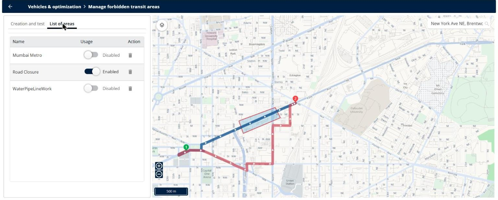
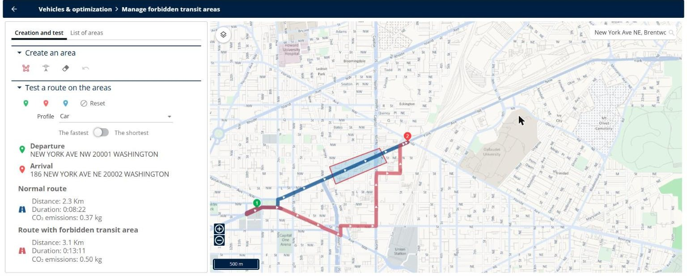
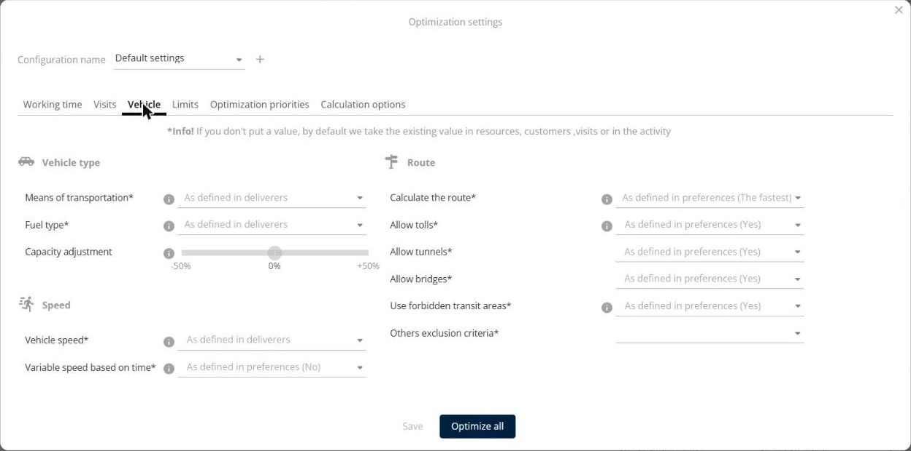

# Créer et utiliser des zones de transit interdit

Dessinez les zones que vos véhicules ne doivent pas traverser, par exemple une route fermée, des travaux ou un centre-ville, vérifiez leur effet sur un itinéraire de test, et prenez-les en compte dans vos optimisations.

## Avant de commencer

* Connectez-vous à **TourSolver** avec un profil utilisateur qui a accès à la page **Configuration**.
* Vérifiez que votre abonnement inclut les zones de transit interdit. Elles sont disponibles uniquement avec la version **PREMIUM**.

## Aperçu des fonctionnalités

* **Zone de transit interdit** : une zone dessinée sur la carte que les itinéraires contournent.
* **Gérer les zones de transit interdit** : la page dans laquelle vous créez, modifiez, supprimez et testez les zones.
* **Utilisation** : chaque zone est **Activée** ou **Désactivée**. Seules les zones activées sont prises en compte.
* **Tester un itinéraire sur les zones** : compare l’**Itinéraire normal** avec l’**Itinéraire avec zone de transit interdit**.
* **Prise en compte des zones de transit interdit** : l’option qui prend en compte les zones activées dans l’optimisation.

## Créer une zone de transit interdit

1. Accédez à **Configuration**.
2. Sous **Véhicules et optimisation**, cliquez sur **Gérer les zones de transit interdit**.
3. Dans le champ d’adresse en haut à droite de la carte, saisissez le lieu où vous souhaitez créer la zone, par exemple la rue fermée.
4. Dans l’onglet **Création et test**, sous **Créer une zone**, cliquez sur la première icône, puis cliquez sur la carte pour dessiner la zone autour des routes à éviter.
5. Pour modifier une zone, cliquez sur la deuxième icône, puis cliquez sur la zone. Pour supprimer une zone, cliquez sur la troisième icône, puis cliquez sur la zone. Pour annuler votre dernière modification, cliquez sur la quatrième icône.
6. Cliquez sur l’onglet **Liste des zones**, puis vérifiez que l’**Utilisation** de la zone est **Activée**. Pour ne plus utiliser une zone sans la supprimer, désactivez son **Utilisation**.

<figure><figcaption></figcaption></figure>

### Résultat

La zone apparaît sur la carte et dans la **Liste des zones**.

## Tester un itinéraire sur les zones

1. Dans l’onglet **Création et test**, sous **Tester un itinéraire sur les zones**, sélectionnez le **Profil**, par exemple **Voiture**, et choisissez l’itinéraire **Le plus rapide** ou **Le plus court**.
2. Cliquez sur l’icône verte, puis cliquez sur la carte pour placer le **Départ**.
3. Cliquez sur l’icône rouge, puis cliquez sur la carte pour placer l’**Arrivée**. Pour ajouter un arrêt, cliquez sur l’icône bleue, puis cliquez sur la carte.
4. Comparez les deux itinéraires sur la carte et dans le panneau.
5. Cliquez sur **Réinitialiser** pour commencer un nouveau test.

<figure><figcaption></figcaption></figure>

### Exemple : une route fermée à Washington, DC

Un tronçon de **New York Ave** est fermé. La zone **Road Closure** est dessinée autour de ce tronçon et est **Activée**.

* L’**Itinéraire normal** (bleu) traverse le tronçon fermé : **2,3 km** et **8 minutes**.
* L’**Itinéraire avec zone de transit interdit** (rouge) le contourne : **3,1 km** et **13 minutes**.

Le détour ajoute 800 mètres. Vos itinéraires optimisés tiennent compte de ce détour, et les horaires prévus restent donc réalistes.

## Utiliser les zones dans l’optimisation

Pour prendre en compte les zones activées dans toutes vos optimisations :

1. Accédez à **Configuration** > **Véhicules et optimisation** > **Options de calcul**.
2. Activez **Prise en compte des zones de transit interdit**.

<figure><figcaption></figcaption></figure>

Pour activer ou désactiver les zones pour une seule optimisation :

1. Dans votre simulation, ouvrez les **Paramètres d’optimisation**.
2. Cliquez sur l’onglet **Véhicule**.
3. Sous **Itinéraire**, définissez **Prise en compte des zones de transit interdit** sur **Oui** ou **Non**.

<figure><figcaption></figcaption></figure>

4. Cliquez sur **Tout optimiser**.

### Résultat

Les itinéraires optimisés contournent les zones activées. Sur la carte de la simulation, aucun itinéraire ne traverse une zone activée.

## Utiliser les zones avec l’API

Lorsque vous lancez une optimisation avec l’API TourSolver, définissez l’option **useForbiddenTransitAreas** sur **true**. Voir la [documentation de l’API TourSolver](https://toursolver.readme.io/reference/introduction).

## Conseils


**Un seul moyen de transport par simulation** : les zones de transit interdit s’appliquent à un seul moyen de transport par simulation. Si vos ressources utilisent des profils de véhicule différents, optimisez-les dans des simulations séparées.



**Livraison à l’intérieur d’une zone** : si une livraison se trouve à l’intérieur d’une zone de transit interdit, TourSolver affiche « This address is inside a forbidden transit zone », et l’itinéraire ne peut pas l’atteindre. Vérifiez l’adresse de la livraison, ou modifiez la zone.



**Fermetures temporaires** : lorsque les travaux sont terminés, désactivez l’**Utilisation** de la zone au lieu de la supprimer. Vous pourrez la réactiver la prochaine fois.


## Rubriques connexes

* [Comment utiliser les zones de transit interdit ?](../faq/how-do-i-use-forbidden-transit-areas.md)
* [Configurer les paramètres d’optimisation](../simulation/simulation-optimization-settings.md)
* [Optimiser vos livraisons](../operations-and-route-management/optimize-your-deliveries.md)
