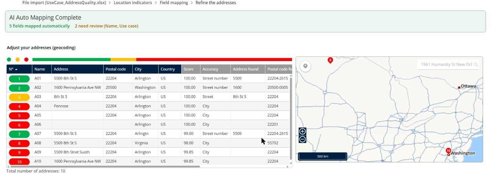
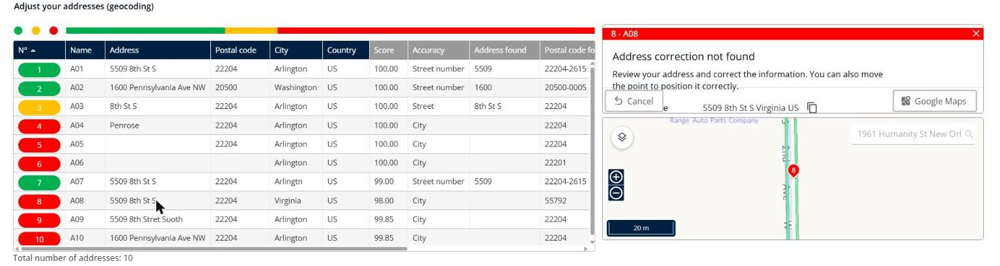

# Corriger les adresses non géocodées

Vérifiez la précision avec laquelle TourSolver a localisé chaque adresse de votre import, et corrigez les adresses introuvables ou mal positionnées.

## Avant de commencer

* Connectez-vous à **TourSolver**.
* Préparez votre fichier d’import. Voir [Import des livraisons](import-of-deliveries.md).

## Aperçu des fonctionnalités

* **Géocodage** : TourSolver transforme chaque adresse en une position sur la carte.
* **Ajustez vos adresses (géocodage)** : l’étape de l’import qui affiche, pour chaque adresse, le score, la précision et l’adresse trouvée par TourSolver.
* **Couleur** : **vert** pour une position précise, **jaune** pour une position au niveau de la rue, et **rouge** pour une position imprécise que vous devez vérifier.
* **Précision** : le niveau auquel l’adresse a été trouvée, du plus précis au moins précis : bâtiment (numéro de rue), rue, localité, code postal et ville.
* **Correction d’adresse** : le panneau dans lequel vous corrigez une adresse ou déplacez son point sur la carte.

## Préparer des adresses complètes

Avant l’import, vérifiez que chaque adresse comporte :

* Le numéro et le nom de la rue, dans la colonne **Adresse**.
* Le **Code postal**.
* La **Ville**, et non une région ou un État.
* Le **Pays**.

Vous pouvez utiliser des colonnes séparées ou un seul champ combiné. Voir [Comment optimiser le géocodage dans TourSolver ?](../faq/how-do-i-optimize-geocoding-in-toursolver.md).

## Vérifier les résultats du géocodage

1. Accédez à **Mes livraisons** et importez votre fichier.
2. Associez les champs, puis cliquez sur **Suivant**.
3. À l’étape **Ajustez vos adresses (géocodage)**, vérifiez la barre de couleur au-dessus de la liste. Elle indique la part d’adresses vertes, jaunes et rouges.
4. Pour chaque adresse rouge ou jaune, comparez les colonnes :
   * **Score** : le degré de correspondance entre l’adresse et l’adresse trouvée par TourSolver.
   * **Précision** : par exemple **Numéro de rue**, **Rue** ou **Ville**.
   * **Adresse trouvée**, **Code postal trouvé**, **Ville trouvée** et **Pays trouvé** : l’adresse utilisée par TourSolver.
5. Vérifiez la carte. Un point éloigné des autres est souvent mal positionné.

<figure><figcaption></figcaption></figure>

## Corriger une adresse

1. À l’étape **Ajustez vos adresses (géocodage)**, cliquez sur l’adresse.
2. Dans le panneau de correction d’adresse, lisez l’**Adresse dans le fichier**.
3. Saisissez l’adresse correcte dans **Nouvelle adresse**, ou faites glisser le point à la bonne position sur la carte.
4. Pour vérifier le lieu, cliquez sur **Google Maps**.

<figure><figcaption></figcaption></figure>

5. Lorsque toutes les adresses sont correctes, cliquez sur **Créer le plan de tournées**.

### Résultat

Vos livraisons sont correctement positionnées, et l’optimisation utilise les bons temps de trajet.

## Cas d’usage : bonnes et mauvaises adresses

Téléchargez l’exemple de fichier ci-dessous. Importez-le ensuite dans **Mes livraisons**. Il contient dix adresses près d’Arlington, en Virginie. La colonne **Use case** décrit chaque ligne, et TourSolver l’ignore lors de l’import.


UseCase_AddressQuality.xlsx


| Ligne | Adresse dans le fichier | Résultat |
| ----- | ----------------------- | -------- |
| **A01** | 5509 8th St S, 22204 Arlington | Vert, précision **Numéro de rue**. |
| **A02** | 1600 Pennsylvania Ave NW, 20500 Washington | Vert, précision **Numéro de rue**. |
| **A03** | 8th St S, 22204 Arlington (sans numéro de rue) | Jaune, précision **Rue**. |
| **A04** | Penrose, 22204 Arlington (quartier au lieu d’une rue) | Rouge, précision **Ville**. |
| **A05** | 22204 Arlington (sans rue) | Rouge, précision **Ville**. |
| **A06** | Arlington (ville uniquement) | Rouge, précision **Ville**. |
| **A07** | 5509 8th St S, 22204 Arlingtn (ville mal orthographiée) | Vert : TourSolver a corrigé la ville, avec un score de 99. |
| **A08** | 5509 8th St S, 22204 Virginia (État au lieu de la ville) | Rouge et **mal positionnée** : TourSolver a trouvé la ville de Virginia, dans le Minnesota, code postal 55792. |
| **A09** | 5509 8th Stret Suoth, 22204 Arlington (rue mal orthographiée) | Rouge, précision **Ville**. |
| **A10** | 1600 Pennsylvania Ave NW, 22204 Arlington (l’adresse et la ville ne correspondent pas) | Rouge, précision **Ville**. |

Corrigez les adresses rouges dans le panneau de correction d’adresse, ou corrigez le fichier et importez-le à nouveau.

## Conseils


**Région au lieu de la ville** : une région ou un État dans la colonne **Ville** peut positionner la livraison dans un autre lieu portant le même nom, comme à la ligne A08. Saisissez toujours la ville.



**Adresse absente de la carte** : si une nouvelle rue est introuvable, utilisez les coordonnées GPS de la livraison, et signalez la rue à HERE avec [HERE Map Creator](https://mapcreator.here.com).



**Erreur de géocodage 502** : le service de géocodage est temporairement indisponible. Patientez quelques minutes, puis importez à nouveau le fichier. Si l’erreur persiste, contactez le support.


## Rubriques connexes

* [Import des livraisons](import-of-deliveries.md)
* [Modifier l’adresse d’une livraison](modify-address-of-a-delivery.md)
* [Comment optimiser le géocodage dans TourSolver ?](../faq/how-do-i-optimize-geocoding-in-toursolver.md)
