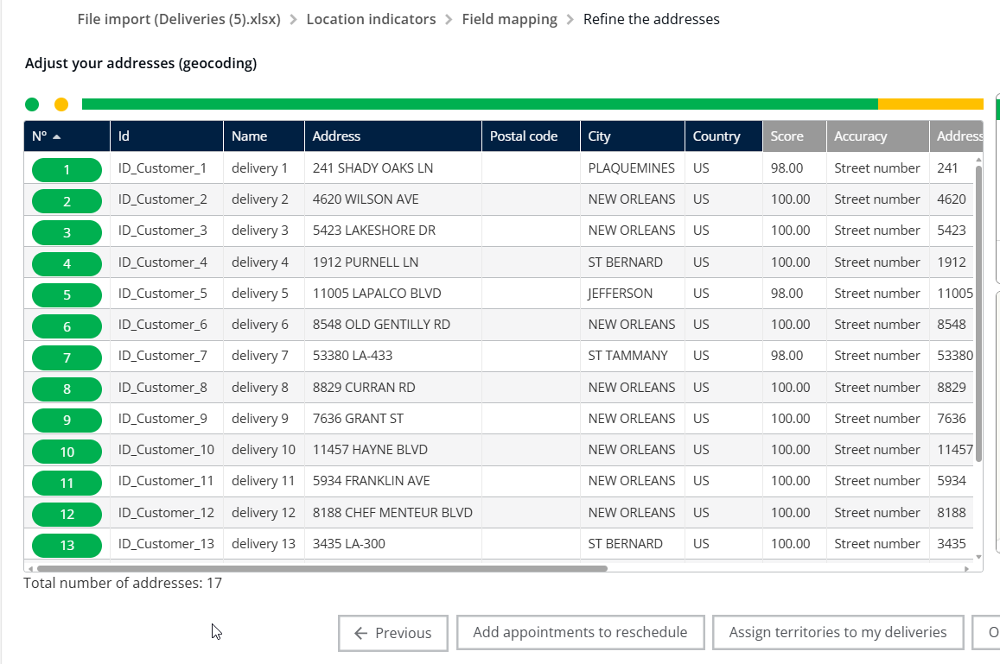

# Import des livraisons

## 1. Introduction

Bienvenue ! Ce guide est conçu pour rendre l'importation de vos données de livraison sur le serveur fluide et réussie.

L'importation des livraisons vous permet de téléverser une liste d'adresses et d'informations client directement dans le système pour les visualiser et optimiser les itinéraires. En suivant ces étapes simples, vous associez les colonnes de votre feuille de calcul aux champs requis par le système, visualisez les emplacements sur une carte et commencez à optimiser vos itinéraires de livraison.

***

## 2. Configuration initiale

#### Accéder à Mes Livraisons

Pour commencer à importer vos livraisons, vous devez d'abord naviguer :

1. Depuis le menu principal vers **Mes livraisons**.
2. Vous êtes maintenant prêt à importer vos **Données.**

#### Téléchargement de données d'exemple

Si vous ne savez pas comment formater votre fichier Excel, vous pouvez télécharger un modèle d'exemple. L'utilisation des données d'exemple garantit que votre fichier est prêt à être importé immédiatement.

1. Cliquez sur **Télécharger**.
2. Le fichier Excel contenant les données d'exemple sera téléchargé.

<figure><figcaption></figcaption></figure>

<figure><figcaption></figcaption></figure>

💡 **Conseil** : Utilisez toujours les données d'exemple fournies si vous êtes nouveau dans la structure du système. Cela réduit souvent les erreurs de mappage potentielles par la suite !

***

## 3. Explications des fonctionnalités avec avantages

Le processus d'importation comprend plusieurs étapes clés qui aident à garantir que vos données sont correctement préparées pour la planification des itinéraires :

| Fonctionnalité                   | Contexte et avantage                                                                                                                                                                                                                            |
| -------------------------------- | ----------------------------------------------------------------------------------------------------------------------------------------------------------------------------------------------------------------------------------------------- |
| **Mappage des données**          | Cela garantit que les en-têtes de colonne de votre feuille de calcul téléchargée (comme "Cust ID" ou "Client Name") sont correctement associés aux champs utilisés par le serveur. Cet appariement précis est crucial pour un routage exact.    |
| **Couleurs de géocodage**        | Après l'importation, le système tente automatiquement de trouver l'emplacement précis (géocoder) de chaque adresse de livraison. Les couleurs indiquent le succès ou l'échec, vous permettant de repérer et de corriger rapidement les erreurs. |
| **Optimisation des itinéraires** | C'est l'étape finale où le système calcule l'ordre et le trajet les plus efficaces pour vos livraisons importées.                                                                                                                               |

## 4. Importer les livraisons et optimiser les itinéraires

Cette tâche couvre le processus de téléversement de vos données de livraison, la vérification de l'appariement des champs et le lancement de la planification des itinéraires.

#### Importer des données et mapper les champs

Vous devez indiquer au système quelles colonnes de votre feuille de calcul correspondent aux champs du système (comme l'ID client ou le nom).

1. Cliquez sur **importer** pour commencer le processus d'importation de vos données de livraison sur le serveur

<figure><figcaption></figcaption></figure>

2. Une fenêtre de mappage apparaîtra, vous invitant à faire correspondre vos champs Excel avec les champs requis par le serveur.
3. Si un champ est déjà correctement mappé (comme c'est le cas si vous utilisez le modèle), vous pouvez ignorer le mappage pour ce champ.

**Pour réinitialiser ou ajuster un mappage de champ (en utilisant l'ID client et le nom comme exemple) :**

4. Si un champ est actuellement mappé, vous pouvez choisir de l'ignorer.
5. Cliquez sur _ignoré_ pour mapper le champ à une contrainte différente de TourSolver.

<figure><figcaption></figcaption></figure>

<figure><figcaption></figcaption></figure>

6. Cliquez sur **afficher tout** pour voir toutes les options de champs possibles.

<figure><figcaption></figcaption></figure>

7. Cliquez sur le **ID client** option pour le mapper.

<figure><figcaption></figcaption></figure>

8. Si vous devez modifier le champ Nom, cliquez sur ignorer sous le mappage de nom actuel.

<figure><figcaption></figcaption></figure>

9. Cliquez sur **Nom** pour compléter le mappage du champ de nom

<figure><figcaption></figcaption></figure>

#### Vérification des données et des résultats de géocodage

Après avoir confirmé le mapping des données, vous pouvez passer à la vue carte pour vérifier les résultats de géocodage.

1. Cliquez sur **Suivant** une fois le mappage terminé

<figure><figcaption></figcaption></figure>

2. La vue carte apparaîtra, affichant vos emplacements avec les couleurs de géocodage

<figure><figcaption></figcaption></figure>

3. Passez en revue le **emplacements** et leurs **couleurs**.
4. Si vous voyez des emplacements gris, ces adresses n'ont pas été trouvées par le système. Vous devrez peut-être vérifier et corriger ces adresses dans vos données d'origine avant d'optimiser l'itinéraire pour plus de précision

<figure><figcaption></figcaption></figure>

5. Cliquez sur **Optimiser mes itinéraires** pour commencer le calcul de l'itinéraire

<figure><figcaption></figcaption></figure>

6. Une fois que vous **démarrez l'optimisation**, le système commencera le processus de calcul.

<figure><figcaption></figcaption></figure>

## 5. Comprendre le statut du géocodage

Lorsque la vue carte apparaît, les couleurs vous aident à comprendre si vos adresses ont été localisées avec succès (géocodées) :

* **Couleur jaune** indique que l'emplacement a été géocodé avec succès au niveau de la rue.

<figure><figcaption></figcaption></figure>

* La couleur verte indique que l'emplacement a été géocodé avec succès au niveau du bâtiment.

<figure><figcaption></figcaption></figure>

<figure><figcaption></figcaption></figure>

* **Couleur grise** indique que l'emplacement n'a pas été géocodé.

<figure><figcaption></figcaption></figure>

<figure><figcaption></figcaption></figure>

***

## 6. Conseils de productivité

Voici quelques façons de rendre l'importation de vos données plus rapide et plus précise :

* 💡 **Donnez la priorité au jaune :** Lorsque vous examinez la vue carte, vous savez que les emplacements jaunes sont fiables (géocodés au niveau des rues). Concentrez votre attention sur tous les emplacements marqués **Gris**.
* 💡 **Maîtriser l'efficacité du mappage :** Si vous avez besoin de changer rapidement la façon dont un champ est associé, rappelez-vous que vous pouvez choisir de **ignorer** le mappage actuel puis sélectionner immédiatement le bon nom de champ. C'est plus rapide que de corriger les données dans votre feuille de calcul en dehors du système.
