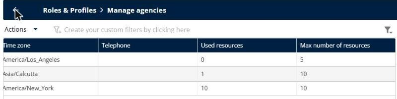
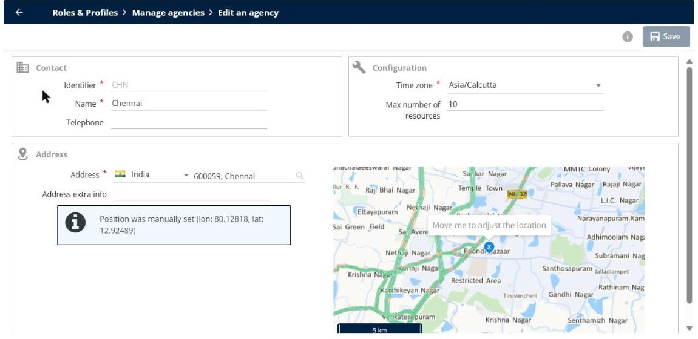
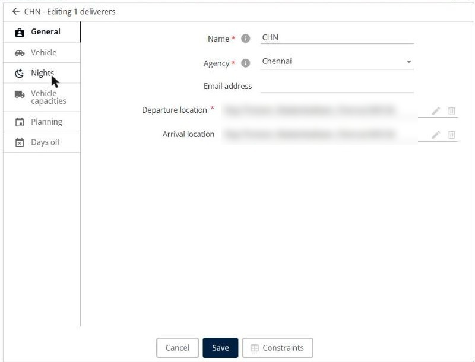
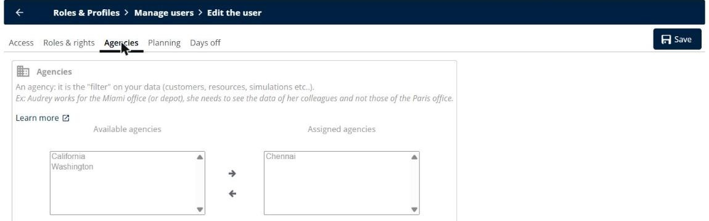

# Gérer les agences

Répartissez vos ressources entre vos agences, et déplacez des utilisateurs et des livreurs d’une agence à une autre.

## Avant de commencer

* Connectez-vous à **TourSolver** avec un profil utilisateur qui a accès à la page **Configuration**.
* Créez vos agences et vos utilisateurs. Voir [Créer et modifier un utilisateur](create-and-modify-a-user.md).

## Aperçu des fonctionnalités

* **Agence** : un filtre sur vos données (clients, ressources, simulations). Par exemple, un utilisateur du bureau de Miami voit les données du bureau de Miami, et non celles du bureau de Paris.
* **Nombre maximum de ressources** : le nombre de ressources qu’une agence peut utiliser. Le total de toutes les agences ne peut pas dépasser votre abonnement.
* **Agences attribuées** : les agences dont un utilisateur peut voir les données.
* **Agence d’un livreur** : l’agence à laquelle appartient un livreur.

## Répartir les ressources entre vos agences

1. Accédez à **Configuration**.
2. Sous **Rôles et profils**, cliquez sur **Gérer les agences**.
3. Faites défiler la liste vers la droite, puis comparez les colonnes **Ressources utilisées** et **Nombre maximum de ressources** de chaque agence.

<figure><figcaption></figcaption></figure>

4. Cliquez sur l’icône **Modifier** de l’agence qui a des ressources libres, diminuez son **Nombre maximum de ressources**, puis cliquez sur **Enregistrer**.
5. Cliquez sur l’icône **Modifier** de l’agence qui a besoin de plus de ressources, augmentez son **Nombre maximum de ressources**, puis cliquez sur **Enregistrer**.

<figure><figcaption></figcaption></figure>

### Résultat

L’agence peut utiliser plus de ressources, sans modifier le nombre total de ressources de votre abonnement.

## Déplacer un livreur vers une autre agence

1. Accédez à **Mes livreurs**.
2. Cliquez sur l’icône **Modifier** du livreur.
3. Dans l’onglet **Général**, sélectionnez la nouvelle **Agence**.
4. Cliquez sur **Enregistrer**.

<figure><figcaption></figcaption></figure>

### Résultat

Le livreur appartient à la nouvelle agence et compte dans ses **Ressources utilisées**.

## Déplacer un utilisateur vers une autre agence

1. Accédez à **Configuration**.
2. Sous **Rôles et profils**, cliquez sur **Gérer les utilisateurs**.
3. Cliquez sur l’icône **Modifier** de l’utilisateur.
4. Cliquez sur l’onglet **Agences**.
5. Sélectionnez la nouvelle agence dans **Agences disponibles**, puis cliquez sur la **flèche droite** pour la déplacer vers **Agences attribuées**.
6. Sélectionnez l’ancienne agence dans **Agences attribuées**, puis cliquez sur la **flèche gauche** pour la retirer.
7. Cliquez sur **Enregistrer**.

<figure><figcaption></figcaption></figure>

### Résultat

L’utilisateur voit les données de la nouvelle agence. Un utilisateur peut aussi conserver plusieurs agences attribuées pour voir les données de chacune d’elles.

## Conseils


**Limite de ressources dépassée** : si le message « resources limit of the following agencies would be exceeded » s’affiche, augmentez le **Nombre maximum de ressources** de l’agence, ou déplacez un livreur vers une autre agence.



**Besoin de plus de ressources ?** : si toutes les ressources de votre abonnement sont utilisées, voir [Comment augmenter le nombre de ressources, de licences ou le quota de SMS ?](../faq/how-do-i-increase-the-number-of-resources-licences-or-the-sms-quota.md).


## Rubriques connexes

* [Créer et modifier un utilisateur](create-and-modify-a-user.md)
* [Création d’une ressource](../resource-and-vehicle-management/creating-a-resource.md)
* [Comment augmenter le nombre de ressources, de licences ou le quota de SMS ?](../faq/how-do-i-increase-the-number-of-resources-licences-or-the-sms-quota.md)
