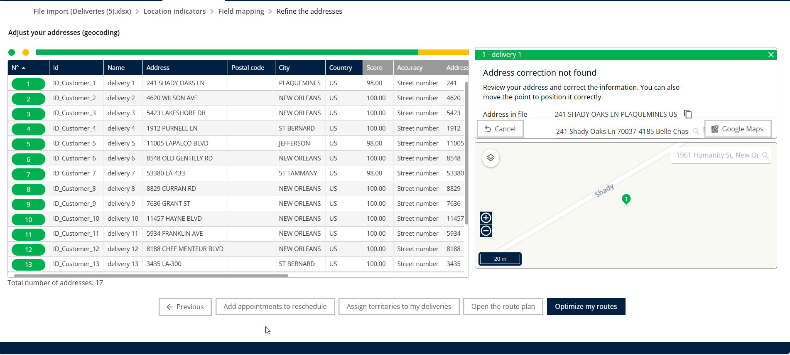

# Modifier l'adresse d'une livraison

## 1. Introduction

Bienvenue ! Ce guide vous montre exactement comment mettre à jour l'adresse d'une livraison existante et garantir que vos itinéraires sont mis à jour instantanément

## 2. Configuration initiale

* **Définir les préférences de notification**
  * Activez le **bouton de notification** pour que les clients reçoivent un SMS/email lorsqu'une adresse est modifiée.
* **Assurer l'exactitude des données**
  * Saisissez les numéros de téléphone des clients dans **format international** et utilisez le **colonne Quartier** pour améliorer la précision du géocodage après les modifications.

## 3. Explications des fonctionnalités et avantages

Le principal avantage de la fonction de modification d'adresse est sa capacité à garantir un routage de livraison précis et efficace lorsque les coordonnées changent.

<table data-header-hidden><thead><tr><th valign="top"></th><th valign="top"></th></tr></thead><tbody><tr><td valign="top">Fonctionnalité</td><td valign="top">Contexte et avantage</td></tr><tr><td valign="top">Modification d'adresse</td><td valign="top">Vous permet de corriger ou de mettre à jour rapidement l'emplacement d'une livraison spécifique en utilisant le champ Adresse</td></tr><tr><td valign="top">Réoptimisation</td><td valign="top">Une fois que vous enregistrez la nouvelle adresse, le système recalcule automatiquement l'itinéraire optimal. Cela signifie que la nouvelle distance et le temps de trajet seront recalculés instantanément après la réoptimisation.</td></tr></tbody></table>

## 4. Mettre à jour l'adresse d'une livraison existante et recalculer l'itinéraire

Cette procédure vous guide pour sélectionner une livraison, mettre à jour son emplacement et lancer une réoptimisation pour afficher le nouvel itinéraire.

**Accéder à l'écran d'optimisation**

1. Depuis la **page d'accueil**, cliquez sur **Optimisation**.

<figure><figcaption></figcaption></figure>

**Sélectionner la livraison à modifier**

2. Sélectionnez les détails de n'importe quelle livraison.
3. Cliquez sur le **bouton Modifier** .

<figure><figcaption></figcaption></figure>

**Saisir la nouvelle adresse**

4. Entrez le **nouvelle adresse** dans le champ Adresse.

**Localiser et confirmer la nouvelle adresse**

5. Faites défiler vers le bas.
6. Cliquez sur **Localiser**

<figure><figcaption></figcaption></figure>

7. Sélectionnez le **nouvelle adresse** que vous avez saisi parmi les options suggérées

<figure><figcaption></figcaption></figure>

**Enregistrer la modification d'adresse**

8. Cliquez sur **bouton Modifier**.

<figure><figcaption></figcaption></figure>

**Démarrer la réoptimisation de l'itinéraire**

9. Cliquez sur **Livraisons**
10. Cliquez sur **Optimiser**

<figure><figcaption></figcaption></figure>

**Résultat attendu**

Après enregistrement et optimisation, vous verrez des résultats immédiats :

* Le nouvel itinéraire et les détails seront affichés clairement sur la carte.
* Le système a recalculé la nouvelle distance et le temps de trajet.

<figure><figcaption></figcaption></figure>

### Méthode alternative : modifier plusieurs adresses depuis la Page _Mes livraisons_&#x20;

1. Aller à **Mes livraisons**.
2. Sélectionnez **Livraisons** pour afficher votre liste de commandes.
3. Ouvrez l'option **Ajustement d'adresse** sur la carte.
4. Modifiez les adresses selon les besoins.

<figure><figcaption></figcaption></figure>
