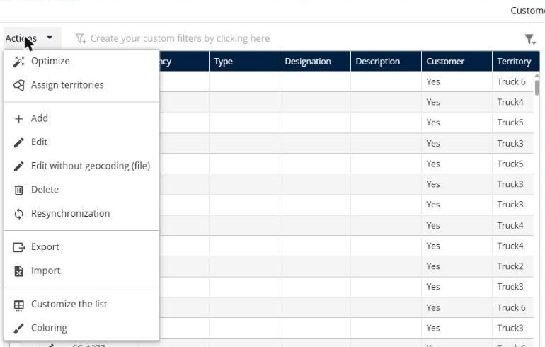
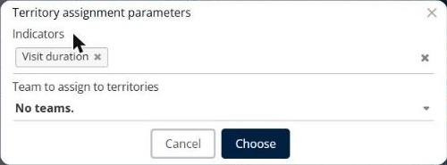
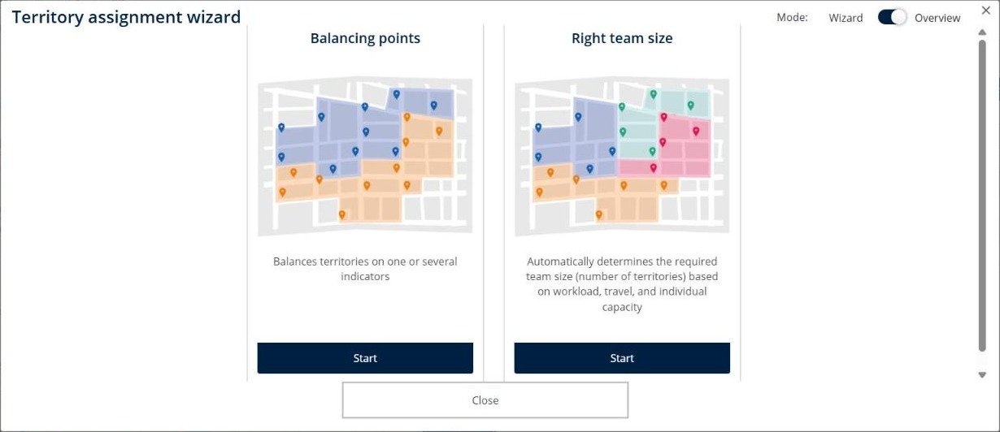
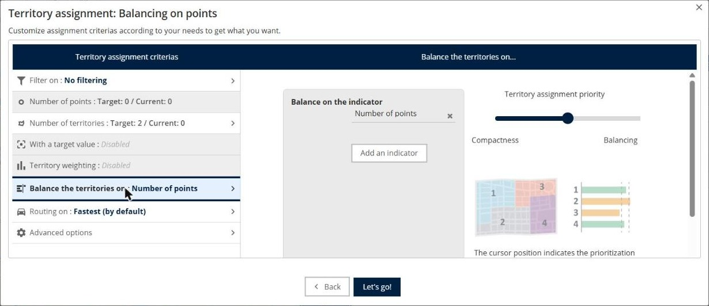
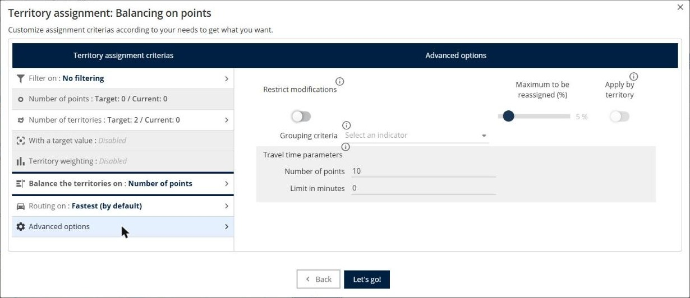
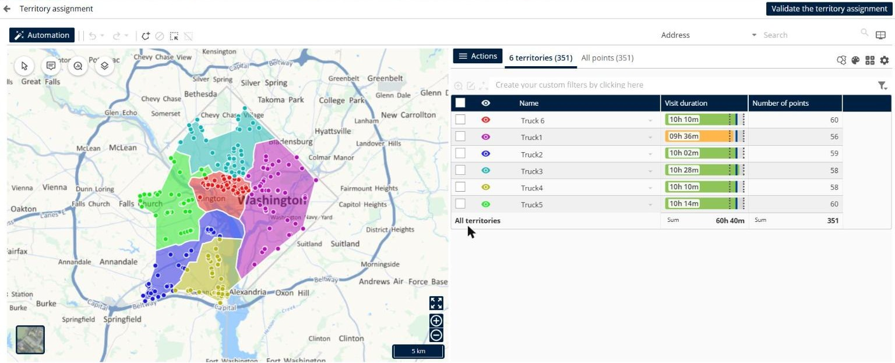
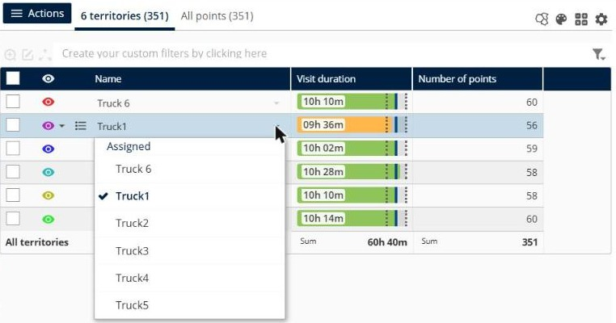

# Affecter des secteurs (sectorisation)

Répartissez vos clients en secteurs équilibrés, affectez une ressource à chaque secteur, et assurez-vous que l’optimisation respecte les secteurs.

## Avant de commencer

* Connectez-vous à **TourSolver**. La sectorisation est une fonctionnalité **Premium**. Voir [Quels pays sont couverts par TourSolver ?](../faq/which-countries-are-covered-by-toursolver.md).
* Importez vos clients dans la page **Clients**.

## Aperçu des fonctionnalités

* **Sectoriser** : ouvre la page de sectorisation pour les clients sélectionnés.
* **Indicateurs** : les valeurs numériques sur lesquelles les secteurs sont équilibrés, par exemple **Durée de visite**, le nombre de points ou la fréquence.
* **Assistant de sectorisation** : crée les secteurs automatiquement, avec **Équilibrage des points** ou **Taille d’équipe adaptée**.
* **Affecté** : la ressource de chaque secteur.
* **Valider la sectorisation** : enregistre les secteurs sur les clients.

## Ouvrir la sectorisation

1. Accédez à **Clients**.
2. Cochez les cases des clients, ou sélectionnez-les tous.
3. Cliquez sur **Actions**, puis sur **Sectoriser**.

<figure><figcaption></figcaption></figure>

4. Dans **Paramètres de sectorisation**, sélectionnez un ou plusieurs **Indicateurs**, par exemple **Durée de visite**, ainsi que l’**Équipe à affecter aux secteurs**.
5. Cliquez sur **Choisir**.

<figure><figcaption></figcaption></figure>

Vous pouvez aussi sectoriser lors de l’import de vos livraisons : à l’étape **Ajustez vos adresses (géocodage)**, cliquez sur **Sectoriser mes livraisons**.

## Créer des secteurs équilibrés

1. Dans la page **Sectorisation**, cliquez sur **Automatisation**.
2. Dans l’**Assistant de sectorisation**, choisissez un mode :
   * **Équilibrage des points** : équilibre les secteurs sur un ou plusieurs indicateurs.
   * **Taille d’équipe adaptée** : détermine le nombre de secteurs nécessaires en fonction de la charge de travail, des déplacements et de la capacité individuelle.

<figure><figcaption></figcaption></figure>

3. Définissez les critères, par exemple le **Nombre de secteurs** et **Équilibrer les secteurs sur**. Cliquez sur **Ajouter un indicateur** pour équilibrer sur plusieurs indicateurs, par exemple le nombre d’enlèvements, la durée de visite ou la fréquence.
4. Déplacez le curseur **Priorité de sectorisation** entre **Compacité** et **Équilibrage**.

<figure><figcaption></figcaption></figure>

5. Si nécessaire, ouvrez les **Options avancées** : **Restreindre les modifications**, **Maximum à réaffecter (%)**, **Critères de regroupement** et **Paramètres de temps de trajet**.

<figure><figcaption></figcaption></figure>

6. Cliquez sur **C’est parti !**.

### Résultat

Les secteurs s’affichent sur la carte et dans la liste, avec une barre pour chaque indicateur. Une barre verte est équilibrée, et une barre orange est déséquilibrée.

<figure><figcaption></figcaption></figure>

## Affecter une ressource à chaque secteur

Après la sectorisation, affectez les ressources manuellement avant d’optimiser. Sinon, l’optimisation ne sait pas quelle ressource dessert quel secteur, et les secteurs ne sont pas respectés.

1. Dans la liste des secteurs, cliquez sur la flèche à côté du nom d’un secteur.
2. Sous **Affecté**, sélectionnez la ressource qui dessert ce secteur.
3. Faites de même pour chaque secteur.

<figure><figcaption></figcaption></figure>

4. Cliquez sur **Valider la sectorisation**.

### Résultat

La colonne **Secteur** des clients affiche leur secteur. Lorsque vous optimisez, chaque ressource visite les clients de son secteur.

## Conseils


**Les indicateurs doivent être numériques** : si un indicateur n’a pas de valeur numérique valide pour tous les points, TourSolver affiche "Some indicators do not have a valid numeric value for all points." Retirez-le des paramètres de sectorisation, ou renseignez les valeurs.



**Points à la même adresse** : utilisez le rayon d’agrégation pour conserver dans le même secteur les points très proches les uns des autres, par exemple à la même adresse.



**Limite** : vous pouvez sectoriser jusqu’à 50 000 clients. Voir [Quel est le nombre maximum de visites pouvant être importées ou optimisées ?](../faq/what-is-the-maximum-number-of-visits-that-can-be-imported-or-optimized.md).


## Rubriques connexes

* [Optimiser vos livraisons](optimize-your-deliveries.md)
* [Optimiser sur plusieurs semaines avec des fréquences](optimize-over-several-weeks-with-frequencies.md)
* [Quels pays sont couverts par TourSolver ?](../faq/which-countries-are-covered-by-toursolver.md)
