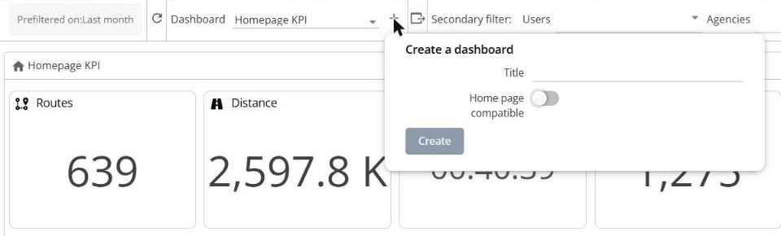
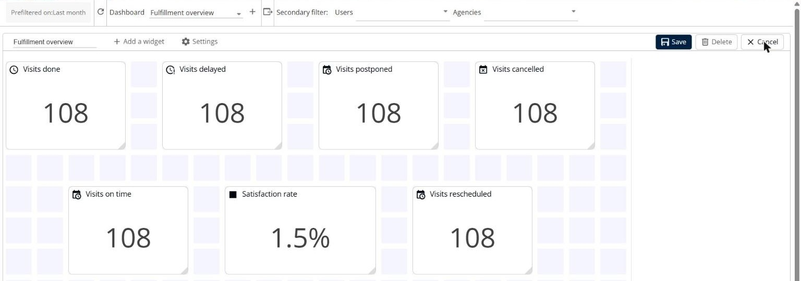
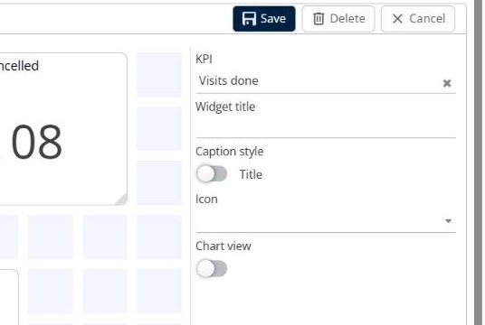
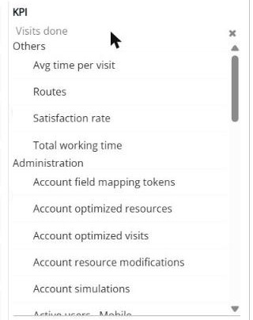
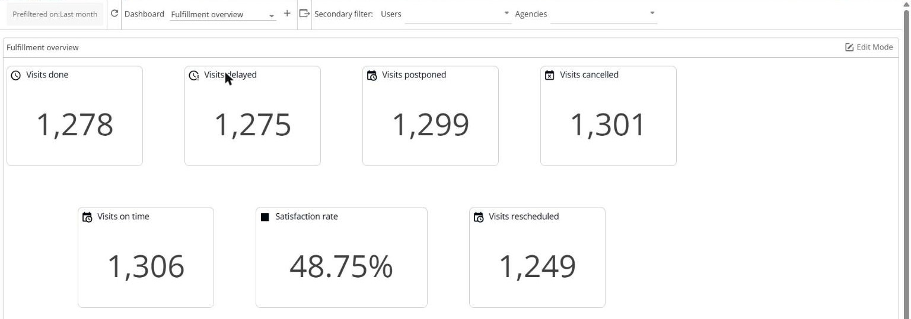

# Créer un tableau de bord de suivi

Créez un tableau de bord avec les indicateurs que vous voulez suivre, par exemple les visites réalisées, en retard ou annulées, et utilisez les tableaux de bord prédéfinis comme exemples.

## Avant de commencer

* Connectez-vous à **TourSolver**.
* Optimisez vos tournées et partagez-les avec l’application mobile, afin que les tableaux de bord contiennent des données. Voir [Partager une tournée avec l’application mobile](share-a-tour-with-the-mobile-app.md).

## Aperçu des fonctionnalités

* **Tableau de bord** : une page de widgets. Chaque widget affiche un indicateur (KPI).
* **Tableaux de bord prédéfinis** : **KPI de la page d’accueil**, **Vue d’ensemble de l’administration**, **Vue d’ensemble du suivi** et **Vue d’ensemble du développement durable**.
* **Filtres** : la période, par exemple **Mois dernier**, et le **Filtre secondaire** sur les **Utilisateurs** et les **Agences**.
* **Mode édition** : ajoute, déplace, redimensionne et configure les widgets d’un tableau de bord.
* **Compatible page d’accueil** : rend le tableau de bord disponible sur la page **Accueil**.

## Créer un tableau de bord

1. Cliquez sur l’onglet **Tableau de bord**.
2. À côté de la liste **Tableau de bord**, cliquez sur **+** (**Créer un tableau de bord**).
3. Saisissez le **Titre** du tableau de bord.
4. Pour afficher le tableau de bord sur la page **Accueil**, activez **Compatible page d’accueil**.
5. Cliquez sur **Créer**.

<figure><figcaption></figcaption></figure>

## Ajouter les indicateurs

1. Sélectionnez le tableau de bord dans la liste **Tableau de bord**, puis cliquez sur **Mode édition**.
2. Cliquez sur **Ajouter un widget**. Un nouveau widget apparaît sur la grille.

<figure><figcaption></figcaption></figure>

3. Cliquez sur le widget, puis configurez-le dans le panneau de droite :
   * **KPI** : l’indicateur affiché par le widget.
   * **Titre du widget**, **Style de légende** et **Icône**.
   * **Vue graphique** : affiche l’indicateur sous forme de graphique.

<figure><figcaption></figcaption></figure>

4. Faites glisser le widget pour le placer, et faites glisser son coin pour le redimensionner. Pour supprimer un widget, cliquez sur son icône de corbeille.
5. Cliquez sur **Enregistrer**. Pour quitter sans enregistrer, cliquez sur **Annuler**.

### Résultat

Le tableau de bord affiche vos indicateurs pour la période sélectionnée. Utilisez le **Filtre secondaire** pour afficher uniquement les données de certains utilisateurs ou de certaines agences.

## Choisir les indicateurs

La liste **KPI** regroupe les indicateurs par thème :

<figure><figcaption></figcaption></figure>

* **Suivi** : Distance, Durée de conduite réelle, Durée de conduite planifiée, À l’heure, Durée de visite, Visites, Visites annulées, Visites en retard, Visites réalisées, Visites à l’heure, Visites reportées, Visites refusées et Visites reprogrammées.
* **Administration** : Jetons de mappage des champs du compte, Ressources optimisées du compte, Visites optimisées du compte, Modifications de ressources du compte, Simulations du compte, Utilisateurs actifs - Mobile, Utilisateurs actifs - Planificateurs, Ressources disponibles, Nombre de ressources, Économies, Quota SMS, SMS utilisés, Connexions des utilisateurs, Visites importées par utilisateur, Simulations par utilisateur, Utilisateurs actifs et Utilisateurs inactifs.
* **Consommation** : CO2, Électricité et Carburant.
* **Autres** : Temps moyen par visite, Tournées, Taux de satisfaction et Temps de travail total.

## Exemple : le tableau de bord Vue d’ensemble du suivi

Sélectionnez **Vue d’ensemble du suivi** dans la liste **Tableau de bord**. Il suit l’exécution de vos tournées avec **Visites réalisées**, **Visites en retard**, **Visites reportées**, **Visites annulées**, **Visites à l’heure**, **Taux de satisfaction** et **Visites reprogrammées**.

<figure><figcaption></figcaption></figure>

Pour créer votre propre version, créez un tableau de bord, puis ajoutez les mêmes indicateurs **Suivi**.

## Conseils


**Recréez un ancien tableau de bord** : les anciens tableaux de bord ne peuvent pas être modifiés de la même manière. Créez un nouveau tableau de bord, puis ajoutez les indicateurs que vous utilisiez.



**Un tableau de bord par public** : créez un tableau de bord pour les planificateurs avec les indicateurs **Suivi**, et un autre pour les administrateurs avec les indicateurs **Administration**.


## Rubriques connexes

* [Comment géolocaliser mes livreurs](how-do-i-geolocate-my-delivery-people.md)
* [Partager une tournée avec l’application mobile](share-a-tour-with-the-mobile-app.md)
