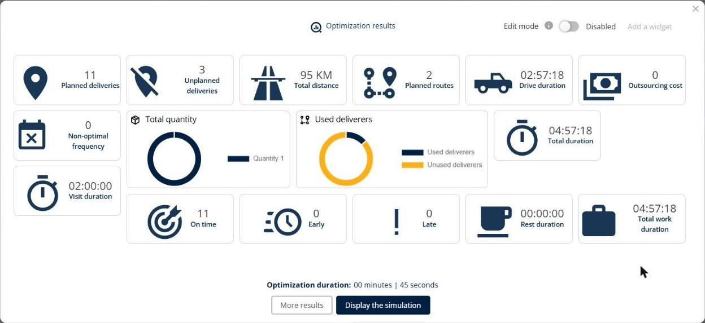
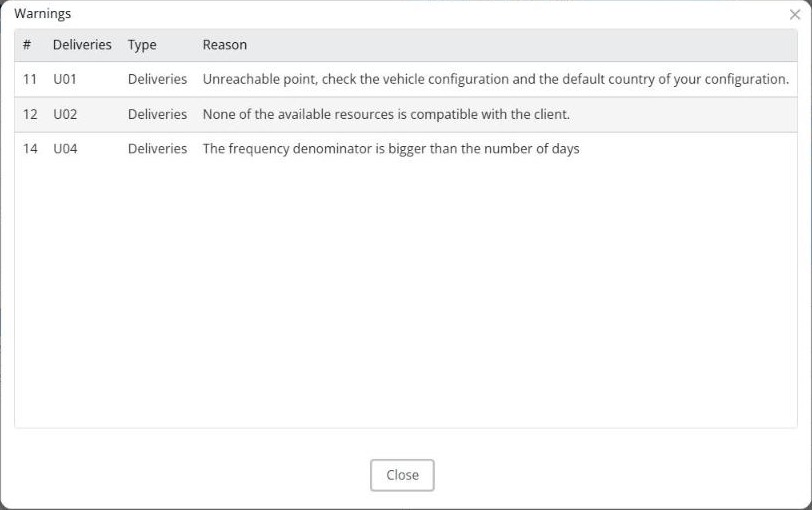
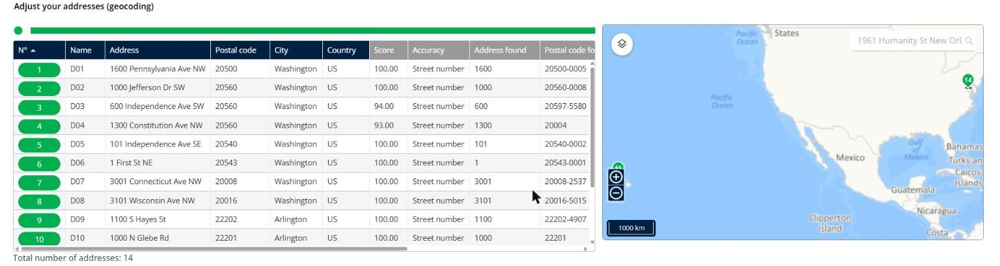
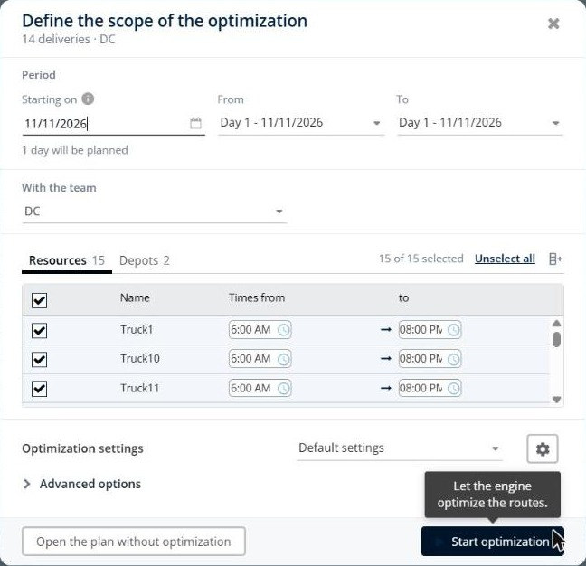
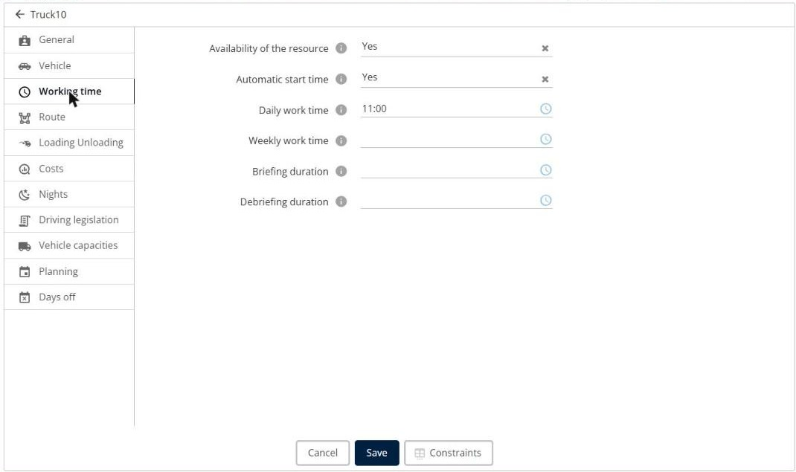
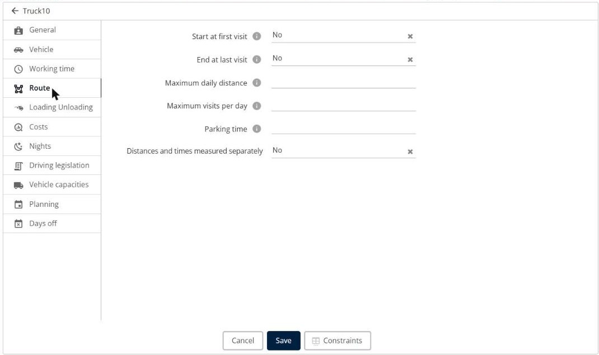
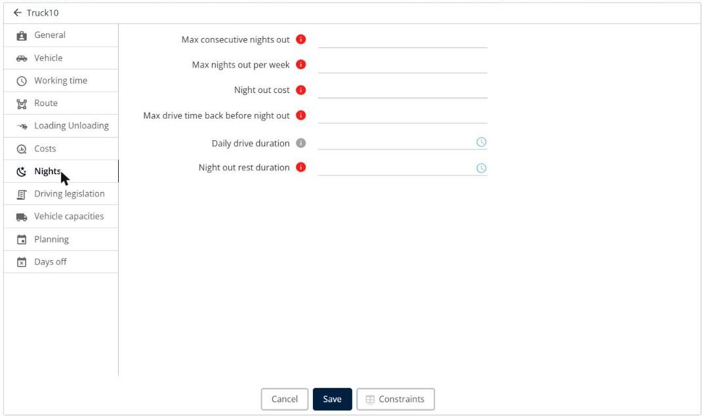
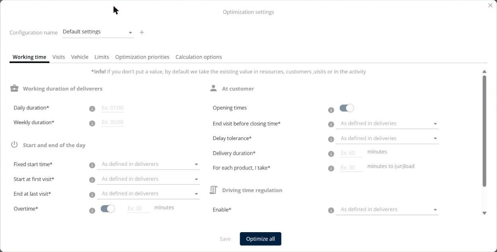

# Diagnostiquer les visites non planifiées et les tournées incohérentes

Découvrez pourquoi certaines visites ne sont pas planifiées ou pourquoi les tournées semblent incohérentes, et vérifiez les contraintes des visites et des ressources à l’origine des problèmes les plus fréquents.

## Avant de commencer

* Connectez-vous à **TourSolver**.
* Importez vos livraisons et optimisez-les. Voir [Optimiser vos livraisons](optimize-your-deliveries.md).

## Aperçu des fonctionnalités

* **Avertissements** : la liste des problèmes détectés pour chaque visite, avec leur raison.
* **Point inaccessible** : une visite que les véhicules ne peuvent pas atteindre par la route.
* **Fenêtre horaire** : les heures d’ouverture et de fermeture d’une visite.
* **Contraintes des ressources** : le temps de travail, les jours travaillés, le maximum de visites par jour et les nuitées de chaque ressource.
* **Fréquence de visite** : une visite qui doit être effectuée plusieurs fois sur une période.
* **Paramètres d’optimisation** : les paramètres de l’optimisation, enregistrés sous un nom de configuration.

## Lire les avertissements

1. Dans les **Résultats de l’optimisation**, vérifiez le nombre de **Livraisons non planifiées**.

<figure><figcaption></figcaption></figure>

2. Cliquez sur **Afficher la simulation**.
3. Dans la barre d’outils, cliquez sur l’icône **Plus d’information**.
4. Dans la fenêtre **Avertissements**, lisez la **Raison** de chaque livraison non planifiée, puis suivez la section ci-dessous qui correspond à cette raison.

<figure><figcaption></figcaption></figure>

Pour les messages relatifs aux capacités, aux compétences et aux jours travaillés, voir [Pourquoi aucune visite n’est-elle planifiée après l’optimisation ?](../faq/why-are-no-visits-planned-after-the-optimization.md).

## Corriger un point inaccessible

**Raison** : "Unreachable point, check the vehicle configuration and the default country of your configuration."

1. À l’étape **Ajustez vos adresses (géocodage)** de l’import, ou sur la carte de la simulation, repérez le point. Un point inaccessible est souvent éloigné des autres visites, par exemple sur une île ou dans un autre pays.

<figure><figcaption></figcaption></figure>

2. Corrigez l’adresse ou les coordonnées de la visite. Voir [Corriger les adresses non géocodées](../import-and-data-setup/fix-addresses-that-are-not-geocoded.md).

## Corriger les fenêtres horaires

**Raisons** : "None of the available resources is compatible with the client.", "The time window end time is earlier than the start time." ou "The time window seems extremely short."

* **Fin avant le début** : vérifiez que l’heure de fermeture est postérieure à l’heure d’ouverture.
* **Fenêtre qui passe minuit** : saisissez l’heure de fermeture au-delà de 24:00. Par exemple, pour une visite de 23 h à 2 h, saisissez **23:00** à **26:00**. Si vous saisissez 23:00 à 02:00, l’heure de fermeture est antérieure à l’heure d’ouverture, et la visite n’est pas planifiée.
* **Fenêtre courte** : vérifiez que la durée de la visite tient dans la fenêtre horaire.
* **Jours d’ouverture** : associez à chaque **Heure d’ouverture** un **Jour d’ouverture** portant le même numéro. Les jours d’ouverture des visites limitent aussi les jours que vous pouvez sélectionner dans **Définir le périmètre de l’optimisation**.

<figure><figcaption></figcaption></figure>

## Vérifier les contraintes des ressources

Renseignez les contraintes des ressources avant la première optimisation. Une valeur manquante ou erronée peut laisser des visites non planifiées ou créer des tournées inattendues.

1. Accédez à **Mes livreurs**, puis cliquez sur l’icône **Modifier** de la ressource.
2. Dans l’onglet **Temps de travail**, vérifiez **Disponibilité de la ressource**, **Heure de départ automatique** et **Durée quotidienne de travail**.

<figure><figcaption></figcaption></figure>

3. Dans l’onglet **Tournée**, vérifiez **Distance quotidienne maximale** et **Maximum de visites par jour**. Un maximum trop bas laisse les autres visites non planifiées.

<figure><figcaption></figcaption></figure>

4. Dans l’onglet **Nuitées**, vérifiez **Maximum de nuitées consécutives**, **Maximum de nuitées par semaine** et **Temps de conduite maximal de retour avant nuitée**. Sans nuitées, une ressource doit revenir au dépôt chaque soir, et les visites trop éloignées restent non planifiées.

<figure><figcaption></figcaption></figure>

5. Dans l’onglet **Planification**, vérifiez les **Jours travaillés** et les horaires de travail.
6. Dans l’onglet **Capacités des véhicules**, vérifiez les capacités.
7. Cliquez sur **Enregistrer**.

## Corriger les fréquences de visite

**Raison** : "The frequency denominator is bigger than the number of days"

* Une fréquence comme **2/5** signifie deux visites sur cinq jours. Sélectionnez une période d’au moins cinq jours dans **Définir le périmètre de l’optimisation**.
* Vérifiez que les ressources ont des **Jours travaillés** sur ces jours.
* Vérifiez que la fréquence n’entre pas en conflit avec le **Maximum de visites par jour** et les nuitées des ressources.

## Relancer l’optimisation après une modification

Une modification des ressources ou de la configuration ne modifie pas les simulations existantes. Lorsque vous voyez "Your activity has changed since you created this simulation. To use the new activity with the same data, click on the "My deliveries" tab and start a new optimization." :

1. Accédez à **Mes livraisons**.
2. Lancez une nouvelle optimisation.

## Comparer les résultats de deux utilisateurs

Deux utilisateurs obtiennent des tournées différentes lorsqu’ils n’optimisent pas les mêmes données avec les mêmes paramètres. Avant de comparer deux résultats, vérifiez que les deux utilisateurs utilisent :

* Les mêmes livraisons, la même période, la même équipe et les mêmes ressources sélectionnées dans **Définir le périmètre de l’optimisation**.
* Le même **Nom de la configuration** dans les **Paramètres d’optimisation**. Pour les ouvrir, cliquez sur l’icône **Voir et modifier les paramètres** dans la barre d’outils de la simulation.
* La même durée d’optimisation : un résultat obtenu avec **Arrêter et voir le résultat** peut différer d’une optimisation complète.

<figure><figcaption></figcaption></figure>

## Cas d’usage : diagnostiquer des visites non planifiées

Téléchargez le fichier d’exemple ci-dessous. Il contient 14 livraisons autour de Washington, DC, pour des ressources qui partent du Maryland. La feuille **Use cases** décrit chaque ligne.


UseCase_RouteDiagnosis.xlsx


| Ligne | Cas d’usage | Résultat dans la fenêtre Avertissements |
| --- | -------- | ----------------------------- |
| **D01 à D10** | Livraisons valides. | Planifiées. |
| **U01** | Adresse à Honolulu, Hawaï : une île que les véhicules ne peuvent pas atteindre. | "Unreachable point, check the vehicle configuration and the default country of your configuration." |
| **U02** | Fenêtre horaire de 23 h à 2 h, saisie sans passer minuit. | "None of the available resources is compatible with the client." |
| **U03** | Fenêtre horaire de 5 minutes, de 9 h 00 à 9 h 05. | Planifiée, car la visite commence dans la fenêtre. |
| **U04** | Fréquence de visite **2/5**, mais les jours d’ouverture de U02 et U03 limitent la période à un jour. | "The frequency denominator is bigger than the number of days" |

Dans ce cas d’usage, 11 livraisons sont planifiées et 3 ne le sont pas. Pour les planifier, supprimez U01, saisissez la fenêtre horaire de U02 sous la forme 23:00 à 26:00, et optimisez une période d’au moins cinq jours pour U04.

## Conseils


**Testez avec un petit fichier** : pour trouver rapidement une cause, optimisez quelques visites avec une seule ressource, puis ajoutez les autres visites.



**Enregistrez les paramètres** : enregistrez vos paramètres d’optimisation sous un nom de configuration, afin que tous les utilisateurs de votre entreprise optimisent avec les mêmes paramètres.


## Rubriques connexes

* [Optimiser vos livraisons](optimize-your-deliveries.md)
* [Pourquoi aucune visite n’est-elle planifiée après l’optimisation ?](../faq/why-are-no-visits-planned-after-the-optimization.md)
* [Comment prioriser le moins de km possible / le plus de clients planifiés ?](../faq/how-to-prioritize-the-fewest-possible-km-the-most-planned-customers.md)
* [Modifier une ressource et les contraintes associées](../resource-and-vehicle-management/modifying-a-resource-and-associated-constraints.md)
