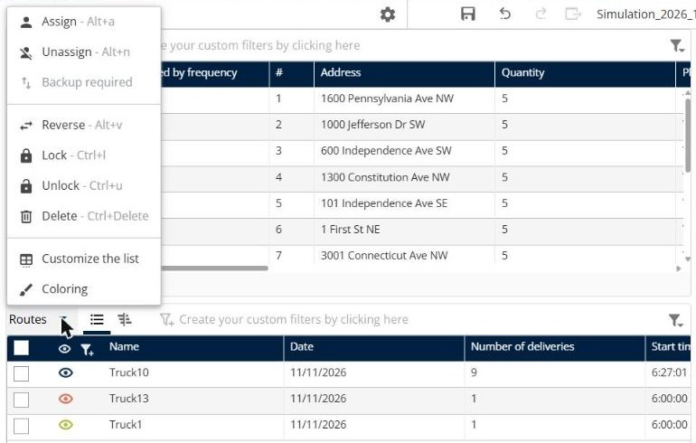
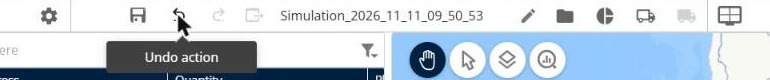
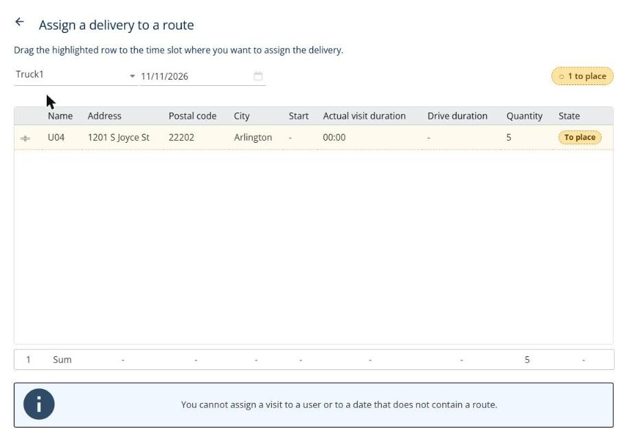
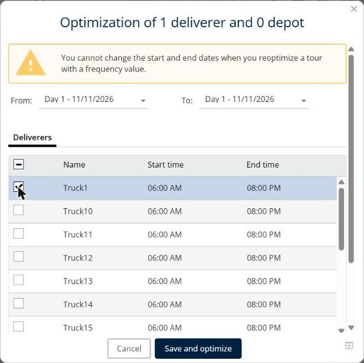
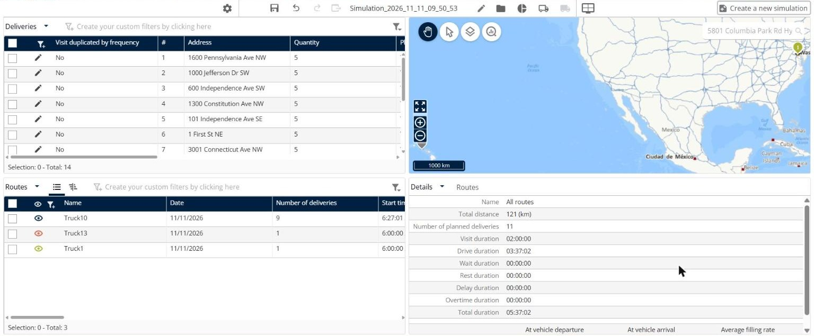

# Modifier les tournées manuellement : réordonner, verrouiller et annuler

Modifiez vos tournées après l’optimisation : réordonnez ou verrouillez une tournée, annulez une modification manuelle, affectez une visite à la main, et affectez une visite à une ressource qui n’a pas encore de tournée.

## Avant de commencer

* Connectez-vous à **TourSolver**.
* Optimisez vos livraisons et ouvrez la simulation. Voir [Optimiser vos livraisons](optimize-your-deliveries.md).

## Aperçu des fonctionnalités

* **Réordonner** : réoptimise les tournées sélectionnées. L’ordre des visites peut changer, et certaines visites peuvent devenir non planifiées.
* **Verrouiller** : conserve une tournée telle quelle lorsque vous réoptimisez ou réordonnez les autres tournées.
* **Annuler l’action** : annule votre dernière modification dans la simulation.
* **Affecter des livraisons** : place une visite à la main dans la tournée et le créneau que vous choisissez.
* **Optimiser les livraisons sélectionnées** : planifie les visites sélectionnées sur les ressources que vous sélectionnez, par exemple une ressource qui n’a pas encore de tournée.

<figure><figcaption></figcaption></figure>

## Réordonner une tournée

1. Dans le panneau **Tournées**, cochez les cases des tournées.
2. Cliquez sur le menu **Tournées**, puis sur **Réordonner**. Vous pouvez aussi appuyer sur **Alt+r**.


**Réordonner relance une optimisation** : TourSolver réoptimise les tournées affectées. L’ordre des visites peut changer, et certaines visites peuvent devenir non planifiées. Verrouillez les tournées que vous voulez conserver avant de réordonner les autres. Voir [Réordonner des tournées](../simulation/simulation-routes-reorder.md).



**Sauvegarde requise** : si **Réordonner** est grisé et affiche **Sauvegarde requise**, enregistrez d’abord la simulation avec l’icône **Enregistrer les modifications** de la barre d’outils.


## Verrouiller une tournée

1. Dans le panneau **Tournées**, cochez les cases des tournées.
2. Cliquez sur le menu **Tournées**, puis sur **Verrouiller**. Vous pouvez aussi appuyer sur **Ctrl+l**.

Pour déverrouiller les tournées, cliquez sur **Déverrouiller**, ou appuyez sur **Ctrl+u**. Voir [Verrouiller et déverrouiller des tournées](../simulation/simulation-routes-lock-unlock.md).

## Annuler une modification manuelle

Dans la barre d’outils de la simulation, cliquez sur la flèche **Annuler l’action**.

<figure><figcaption></figcaption></figure>

Si la flèche d’annulation n’est pas disponible, par exemple après avoir quitté la simulation, relancez l’optimisation depuis **Mes livraisons**.

## Affecter une seule visite à la main

1. Dans le panneau **Livraisons**, cochez la case de la visite.
2. Cliquez sur le menu **Livraisons**, puis sur **Affecter des livraisons**.
3. Sélectionnez la ressource et le jour.
4. Faites glisser la ligne mise en évidence vers le créneau où vous voulez placer la visite dans la tournée.
5. Cliquez sur la flèche de retour pour revenir à la simulation.

Voir [Affecter des livraisons à une tournée](../simulation/simulation-deliveries-assign.md).


**Livraisons au-dessus du départ** : les visites laissées au-dessus du départ de la tournée ne sont pas affectées. Elles restent non planifiées.


## Affecter une visite à une ressource sans tournée

Vous ne pouvez affecter une visite qu’à une ressource et à un jour qui ont déjà une tournée. Si vous sélectionnez une ressource qui ne figure pas dans le panneau **Tournées**, **Affecter des livraisons** affiche "You cannot assign a visit to a user or to a date that does not contain a route."

<figure><figcaption></figcaption></figure>

Pour créer une tournée pour cette ressource :

1. Dans le panneau **Livraisons**, cochez la case de la visite.
2. Si la visite est planifiée sur une autre tournée, cliquez sur le menu **Livraisons**, puis sur **Désaffecter**. Sa **Raison** devient **Désaffectation manuelle**.
3. Cliquez sur le menu **Livraisons**, puis sur **Optimiser**.
4. Décochez les cases de tous les livreurs, puis sélectionnez uniquement la ressource qui doit effectuer la visite, par exemple **Truck1**.
5. Cliquez sur **Enregistrer et optimiser**.

<figure><figcaption></figcaption></figure>

### Résultat

La ressource apparaît dans le panneau **Tournées** avec la visite. Vous pouvez maintenant ajouter d’autres visites à sa tournée avec **Affecter des livraisons**.

<figure><figcaption></figcaption></figure>

## Cas d’usage : déplacer une visite vers une ressource sans tournée

Dans une simulation avec deux tournées, **Truck10** et **Truck13**, la visite **D05** doit être effectuée par **Truck1**, qui n’a pas de tournée :

1. **Affecter des livraisons** avec **Truck1** affiche "You cannot assign a visit to a user or to a date that does not contain a route."
2. **Désaffectez** D05, puis **optimisez**-la avec uniquement **Truck1** sélectionné.
3. Le panneau **Tournées** affiche maintenant trois tournées : **Truck10**, **Truck13** et **Truck1** avec D05.

## Conseils


**Enregistrez avant les modifications importantes** : enregistrez la simulation avant de réordonner ou de réoptimiser, afin de pouvoir y revenir.



**Pauses manuelles** : la réoptimisation d’une tournée supprime les pauses que vous avez ajoutées à la main. Voir [Comment ajouter des pauses déjeuner et des pauses de conduite réglementaires ?](../faq/how-do-i-add-lunch-breaks-and-legal-driving-breaks.md).


## Rubriques connexes

* [Réordonner des tournées](../simulation/simulation-routes-reorder.md)
* [Verrouiller et déverrouiller des tournées](../simulation/simulation-routes-lock-unlock.md)
* [Affecter des livraisons à une tournée](../simulation/simulation-deliveries-assign.md)
* [Désaffecter des livraisons](../simulation/simulation-deliveries-unassign.md)
