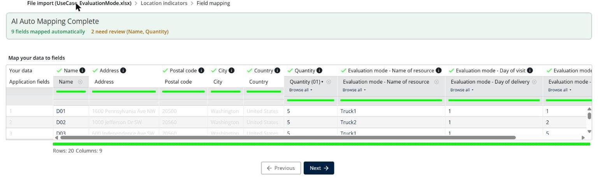
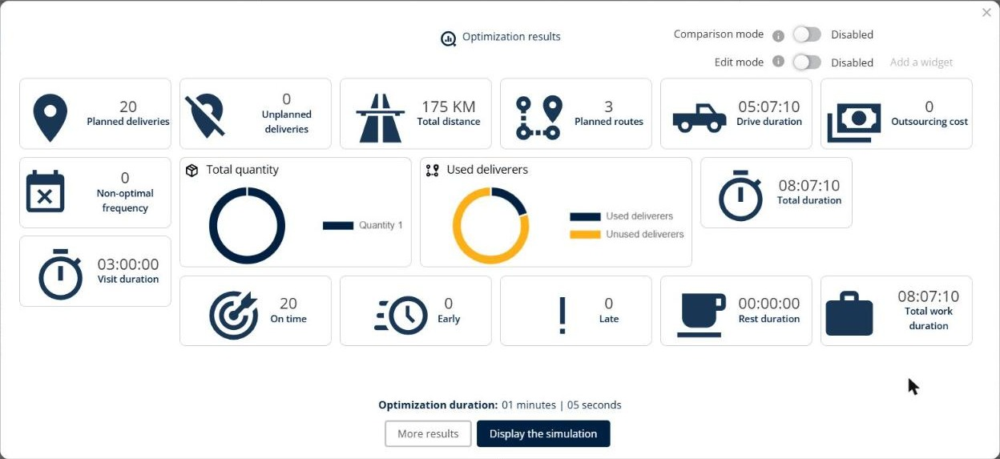
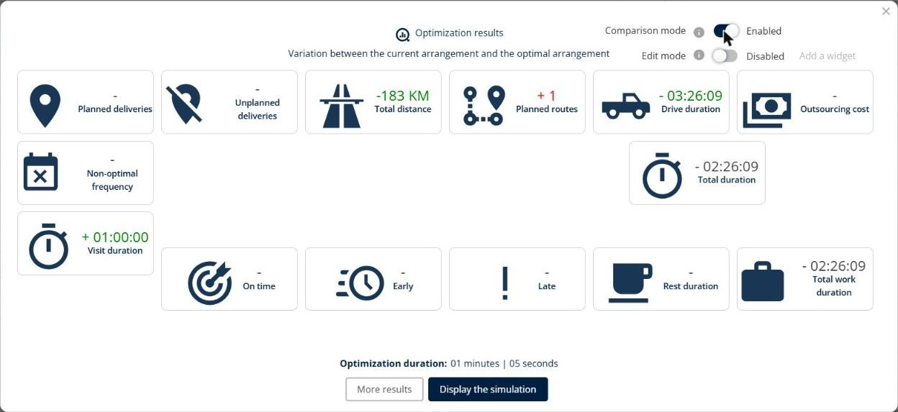
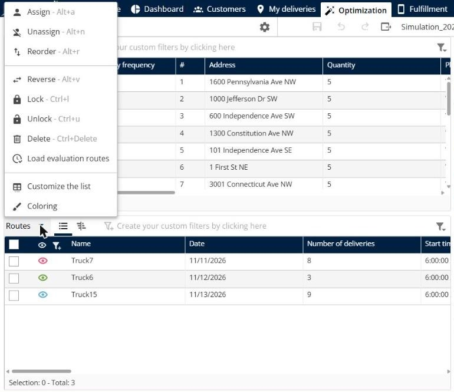
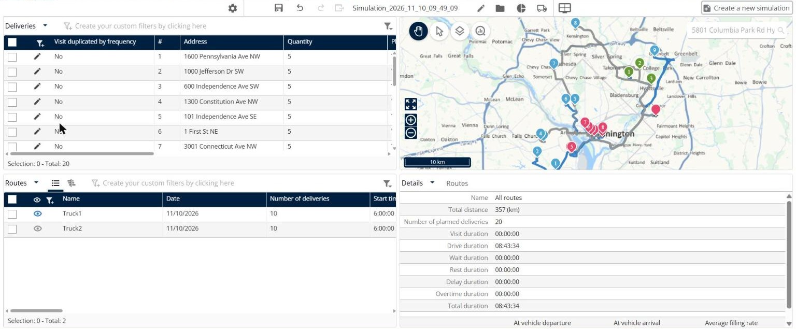
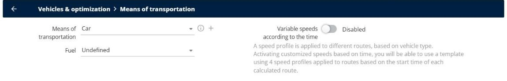

# Évaluer vos tournées existantes

Importez les tournées que vos livreurs ont déjà suivies, par exemple la semaine ou le mois dernier, comparez-les aux tournées optimisées par TourSolver, et mesurez le gain en kilomètres et en durée de conduite.

## Avant de commencer

* Connectez-vous à **TourSolver**.
* Préparez un fichier d’import avec vos tournées actuelles : pour chaque livraison, la ressource qui l’a effectuée, le jour de la livraison et sa position dans la tournée. Voir [Import des livraisons](../import-and-data-setup/import-of-deliveries.md).

## Aperçu des fonctionnalités

* **Mode évaluation** : calcule vos tournées actuelles telles qu’elles sont, afin que vous puissiez les comparer aux tournées optimisées.
* **Champs d’évaluation** : les trois champs du fichier d’import qui décrivent vos tournées actuelles.
* **Mode comparaison** : affiche l’écart entre vos tournées actuelles et les tournées optimisées dans les résultats de l’optimisation.
* **Charger les tournées d’évaluation** : affiche vos tournées actuelles sur la carte et dans la liste des tournées.
* **Vitesse variable selon l’heure** : un paramètre de vitesse qui peut empêcher le chargement des tournées d’évaluation.

## Mapper les champs d’évaluation lors de l’import

1. Accédez à **Mes livraisons** et importez votre fichier.
2. Dans le mappage des champs, vérifiez que les trois champs d’évaluation sont mappés :
   * **Mode évaluation - Nom de la ressource** : la ressource qui effectue la visite. Utilisez exactement le même nom que la ressource dans **Mes livreurs**, par exemple **Truck1**.
   * **Mode évaluation - Jour de visite** (affiché **Mode évaluation - Jour de livraison** dans le mappage) : le jour de la tournée. Utilisez l’un des **Jours travaillés** de la ressource, par exemple **1** pour le premier jour de la période. Si les jours travaillés de vos ressources sont des dates, utilisez une date.
   * **Mode évaluation - Numéro d’ordre** : la position de la visite dans la tournée, par exemple **1**, **2**, **3**. Chaque numéro doit être unique pour une ressource et un jour donnés.

<figure><figcaption></figcaption></figure>

3. Cliquez sur **Suivant**, vérifiez les adresses, puis cliquez sur **Créer le plan de tournées**.


**Les trois champs sont obligatoires** : renseignez les trois champs pour chaque visite. Si l’un d’eux manque, les tournées d’évaluation ne peuvent pas être chargées.


## Optimiser et comparer les résultats

1. Dans **Définir le périmètre de l’optimisation**, vérifiez la période et l’équipe, puis cliquez sur **Démarrer l’optimisation**.
2. Dans les **Résultats de l’optimisation**, activez le **Mode comparaison**.
3. Lisez l’écart entre vos tournées actuelles et les tournées optimisées, par exemple la **Distance totale** et la **Durée de conduite**. Une valeur en vert est un gain.

<figure><figcaption></figcaption></figure>

<figure><figcaption></figcaption></figure>

### Résultat

Vous voyez le gain de l’optimisation. Dans le cas d’usage ci-dessous, les tournées optimisées économisent 183 km et 3 heures 26 minutes de conduite.

## Charger les tournées d’évaluation

1. Cliquez sur **Afficher la simulation**.
2. Cliquez sur le menu **Tournées**, puis sur **Charger les tournées d’évaluation**.

<figure><figcaption></figcaption></figure>

### Résultat

TourSolver affiche vos tournées actuelles sur la carte et dans la liste **Tournées**, avec leur distance et leur durée dans **Détails**.

<figure><figcaption></figcaption></figure>


**Revenir aux tournées optimisées** : cliquez sur la flèche **Annuler l’action**, ou quittez la simulation sans l’enregistrer.


## Résoudre les problèmes liés aux tournées d’évaluation

Si **Charger les tournées d’évaluation** est grisé ou donne des résultats erronés :

1. Vérifiez que les trois champs d’évaluation sont mappés et renseignés pour chaque visite.
2. Vérifiez que chaque **Jour de visite** fait partie des **Jours travaillés** de la ressource, et que chaque **Numéro d’ordre** est unique pour une ressource et un jour donnés.
3. Désactivez les vitesses variables : accédez à **Configuration** > **Véhicules et optimisation** > **Moyens de transport**, désactivez **Vitesse variable selon l’heure**, puis actualisez la page dans votre navigateur (**F5**).

<figure><figcaption></figcaption></figure>

4. Relancez l’optimisation, puis chargez les tournées d’évaluation.

## Cas d’usage : comparer les tournées de la semaine dernière aux tournées optimisées

Téléchargez le fichier d’exemple ci-dessous. Il contient 20 livraisons autour de Washington, DC, effectuées par **Truck1** et **Truck2** le jour **1**, dans un ordre aléatoire.


UseCase_EvaluationMode.xlsx


1. Importez le fichier dans **Mes livraisons**. Les champs d’évaluation sont mappés automatiquement.
2. Optimisez les livraisons avec l’équipe de **Truck1** et **Truck2**.
3. Activez le **Mode comparaison**, puis chargez les tournées d’évaluation.

Dans ce cas d’usage :

* Les tournées actuelles de **Truck1** et **Truck2** parcourent **357 km** en **8 heures 43 minutes**.
* Les tournées optimisées parcourent **175 km** en **5 heures 7 minutes**.
* Le **Mode comparaison** affiche un gain de **183 km** et de **3 heures 26 minutes** de conduite.

## Conseils


**Tournées verrouillées** : si certaines tournées sont verrouillées, le message "Impossible to load evaluation routes as some routes are locked." s’affiche. Déverrouillez les tournées, puis chargez à nouveau les tournées d’évaluation.



**Utilisez des données réelles** : importez les tournées d’une semaine ou d’un mois complet pour obtenir une comparaison fiable.


## Rubriques connexes

* [Import des livraisons](../import-and-data-setup/import-of-deliveries.md)
* [Optimiser vos livraisons](optimize-your-deliveries.md)
* [Verrouiller et déverrouiller des tournées](../simulation/simulation-routes-lock-unlock.md)
