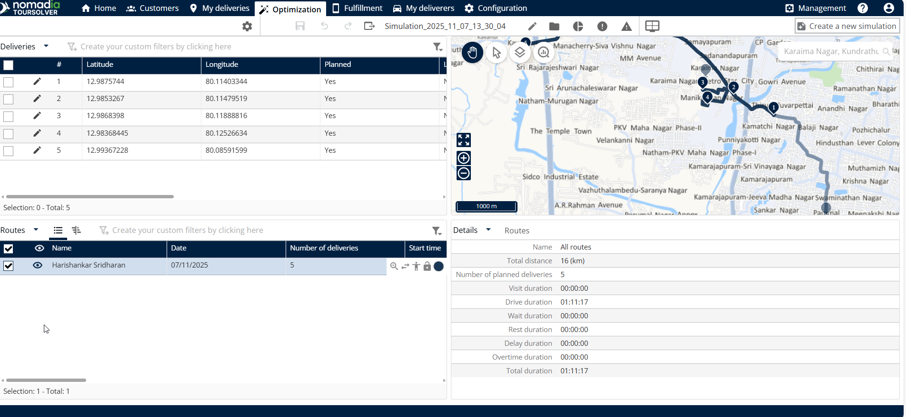
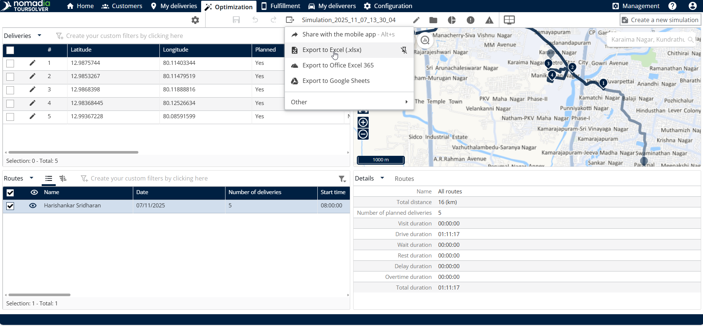
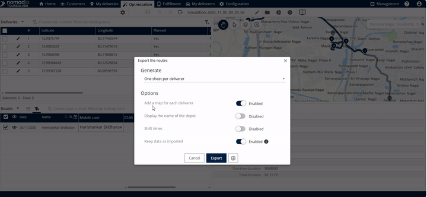
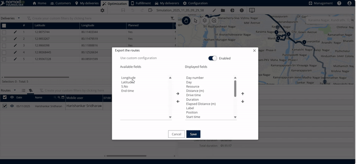
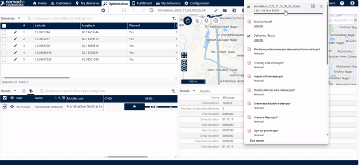
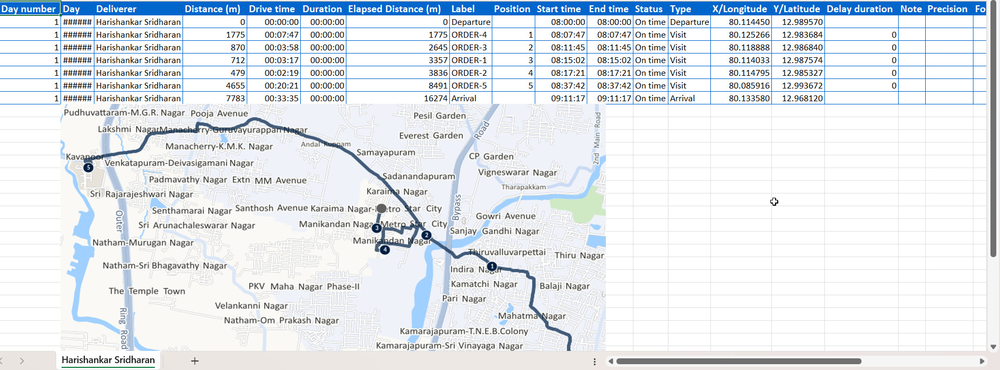

# Exporter mes itinéraires

## 1. Introduction

Ce guide vous expliquera comment sélectionner, personnaliser et exporter vos itinéraires complétés en utilisant le système de gestion des itinéraires. Que vous ayez besoin de partager les résultats avec un membre de l’équipe via Excel ou d’intégrer les données dans un calendrier, ce processus est conçu pour être simple et efficace.

## 2. Configuration initiale

**Personnalisation des paramètres d’exportation Excel**

Lorsque vous choisissez d’exporter vers Excel, le système propose plusieurs options pour adapter le fichier résultant.

1.  **Sélectionnez la mise en page de votre feuille :** Choisissez comment les données d’itinéraire sont organisées :

    * **Une feuille pour tous les livreurs**.
    * **Une feuille par livreur**.
    * _**Contexte**:_ Cela vous aide à décider si vous souhaitez une vue consolidée ou des rapports détaillés pour chaque membre de l’équipe.

    
<figure><figcaption></figcaption></figure>

💡 **Astuce :** Ces configurations s’appliquent uniquement à l’option d’exportation Excel. Les autres formats (comme PowerPoint ou Calendrier) utiliseront leurs paramètres de sortie standard.

2. **Sélection des champs personnalisés (colonnes)**

Vous pouvez choisir quelles colonnes spécifiques (champs) apparaissent dans votre fichier exporté.

1. Cliquez sur **autre** dans la fenêtre de configuration.
2. Vous verrez une liste de **champs disponibles** et **champs d’affichage**.

<figure><figcaption></figcaption></figure>

3. Vous pouvez également **activer la configuration personnalisée** si nécessaire.

* _Contexte :_ Une fois terminé, le fichier d’export contiendra à la fois **colonnes standard et mappées**.

4. Cliquez sur **Enregistrer** lorsque vous aurez terminé la personnalisation des champs.

***

## 3. Explications des fonctionnalités et avantages

Le principal avantage de la fonction d’exportation d’itinéraire est sa flexibilité, vous permettant de partager rapidement des données dans des formats adaptés à différents intervenants.

#### Destinations d’exportation diverses

En cliquant sur **option d’export** et en sélectionnant **autre**, vous débloquez une large gamme de types d’exportation.

| Fonction d’exportation                                               | Avantage/Utilité                                                                                                                         |
| -------------------------------------------------------------------- | ---------------------------------------------------------------------------------------------------------------------------------------- |
| **Exporter vers Excel**                                              | Idéal pour l’analyse détaillée des données, les calculs et les rapports structurés.                                                      |
| **Exporter vers PowerPoint / Office 365 PowerPoint / Google Slides** | Utile pour générer rapidement des présentations ou des synthèses pour les réunions.                                                      |
| **Exporter vers Calendrier (Office Outlook / Google)**               | Permet d’intégrer les horaires et les planning d’itinéraire directement dans les calendriers personnels ou d’équipe.                     |
| **Exporter un résumé des itinéraires envoyé par email**              | Partage efficacement un aperçu à haut niveau du plan d’itinéraire avec les destinataires.                                                |
| **Exporter vers Masternaut .GPX / .GPX étendu**                      | Nécessaire pour une utilisation avec des systèmes de navigation GPS spécifiques ou des logiciels de cartographie avancés.                |
| **Exporter au format KML Google, etc.**                              | Format standard pour visualiser des données géospatiales (comme des itinéraires) dans des outils de cartographie (par ex. Google Earth). |
| **Exporter vers Webhook**                                            | Facilite le transfert automatisé de données vers d’autres systèmes opérationnels.                                                        |

## 4. Exporter un itinéraire vers Excel

C’est la tâche la plus courante et inclut la sélection de l’itinéraire, le choix de la destination, la configuration des paramètres et la finalisation du téléchargement.

Suivez ces étapes pour exporter avec succès l’itinéraire sélectionné :

**Localiser la section Optimisation**

1. Commencez depuis la **page d’accueil**. Cliquez sur Optimisation

**Sélectionner l’itinéraire**

2. **Cliquez sur l’itinéraire** que vous souhaitez exporter.

<figure><figcaption></figcaption></figure>

3. **Initier la boîte de dialogue d’exportation**

**Choisir le format Excel**

4. Puisque vous souhaitez exporter les données vers Excel, cliquez sur **exporter vers Excel**.

<figure><figcaption></figcaption></figure>

**Configurer et générer le fichier**

5. Vérifiez et ajustez vos paramètres de configuration initiaux (mise en page de la feuille, horaires, intégrité des données) comme indiqué dans la Section 2.

<figure><figcaption></figcaption></figure>

6. Si vous avez personnalisé les champs, assurez-vous d’avoir cliqué **Enregistrer**.

<figure><figcaption></figcaption></figure>

**Finaliser l’export et ouvrir le fichier**

7. Cliquez sur **fichier ie téléchargé** pour l’ouvrir

<figure><figcaption></figcaption></figure>

8. Veuillez trouver le **fichier excel téléchargé** ci-dessous.

<figure><figcaption></figcaption></figure>

***

## 5. Conseils de productivité

Voici quelques façons de rendre le processus d’exportation d’itinéraires plus efficace :

* **Personnaliser les colonnes pour plus d’efficacité (filtrer les données) :** Si vous n’avez besoin que de deux ou trois points de données spécifiques pour une analyse rapide, utilisez l’option **autre** dans le menu de configuration pour supprimer les champs inutiles. Cela garde votre rapport propre et ciblé, en veillant à ce que le fichier d’exportation contienne uniquement **colonnes standard et mappées** qui comptent le plus.
* **Utiliser l’export vers Calendrier pour la planification :** Au lieu d’exporter des données complexes, utilisez l’option **exporter vers calendrier** (Office Outlook ou Google) pour fournir rapidement aux livreurs leurs horaires de service finalisés et les rendez-vous d’itinéraire, simplifiant ainsi la logistique quotidienne.
* **Gagner du temps de configuration :** Une fois que vous avez configuré la mise en page souhaitée et la sélection des champs (comme générer **une feuille par livreur** ou inclure **horaires de service**), cliquez sur **Enregistrer**Cela vous permet d’exécuter rapidement l’exportation à l’avenir sans devoir re-sélectionner toutes les configurations détaillées.
