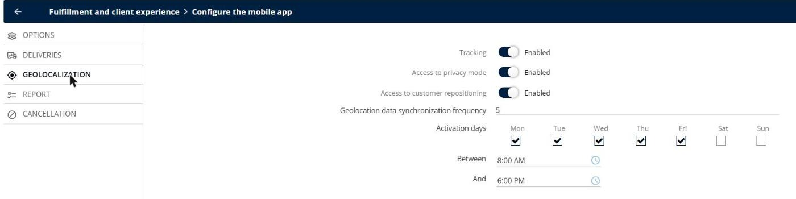
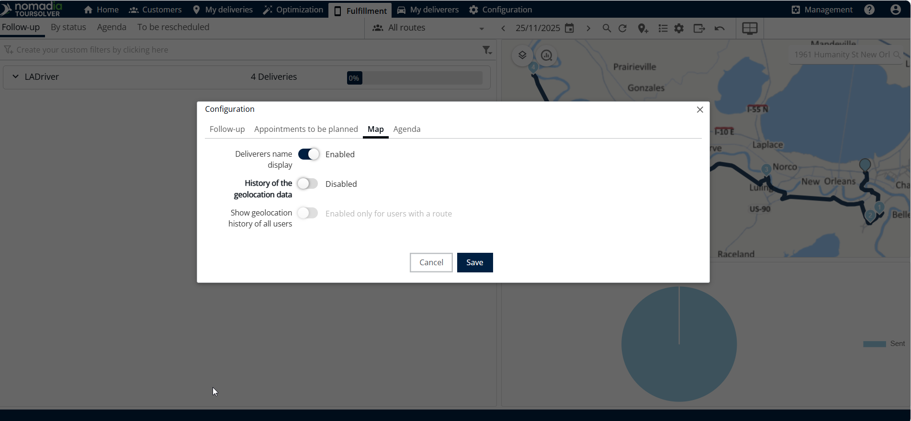

# Comment géolocaliser mes livreurs

Configurez la géolocalisation de l’application mobile, suivez vos livreurs sur la carte de l’onglet **Suivi**, et découvrez pourquoi une position est manquante.

## Avant de commencer

* Connectez-vous à **TourSolver** avec un profil utilisateur qui a accès à la page **Configuration**.
* Créez vos livreurs et leurs tournées, et partagez les tournées avec l’application mobile. Voir [Partager une tournée avec l’application mobile](share-a-tour-with-the-mobile-app.md).
* Donnez à vos livreurs l’**Accès mobile**. Voir [Créer et modifier un utilisateur](../import-and-data-setup/create-and-modify-a-user.md).

## Aperçu des fonctionnalités

* **Tracking** : envoie la position des livreurs depuis l’application mobile vers TourSolver.
* **Accès au mode confidentialité** : permet aux livreurs de désactiver le tracking dans l’application, par exemple pendant une pause. Cela respecte le RGPD.
* **Jours et heures d’activation** : les jours et les heures pendant lesquels le tracking est actif.
* **Fréquence de synchronisation des données de géolocalisation** : la fréquence à laquelle l’application envoie la position.
* **Carte du suivi** : affiche la position et l’historique de géolocalisation des livreurs.

## Configurer la géolocalisation

1. Accédez à **Configuration** > **Suivi et expérience client** > **Configurer l’application mobile**.
2. Cliquez sur **GÉOLOCALISATION**.
3. Activez **Tracking**.
4. Choisissez si les livreurs peuvent utiliser le mode confidentialité (**Accès au mode confidentialité**) et repositionner un client (**Accès au repositionnement client**).
5. Définissez la **Fréquence de synchronisation des données de géolocalisation**.
6. Sélectionnez les **Jours d’activation**, par exemple du **Lun** au **Ven**, et les heures **Entre** et **Et**, par exemple de **08:00** à **18:00**.

<figure><figcaption></figcaption></figure>

7. Dans l’onglet **OPTIONS**, vérifiez le **Nombre de jours consultables dans l’agenda** et la **Fréquence de synchronisation automatique**.

## Afficher la géolocalisation dans l’onglet Suivi

1. Cliquez sur l’onglet **Suivi**.
2. Sélectionnez la date de la tournée à suivre.

>)

3. Cliquez sur **Paramètres** pour choisir ce que la page affiche : **Champs disponibles**, **Champs d’affichage**, **Rendez-vous à planifier**, **Carte** et **Agenda**.

<figure><figcaption></figcaption></figure>

4. Cliquez sur la carte pour afficher l’historique de géolocalisation.

<figure><figcaption></figcaption></figure>

## Résoudre une position manquante

Si un livreur n’apparaît pas sur la carte, vérifiez ces points :

* **Paramètres de tracking** : **Tracking** est activé, et le jour et l’heure actuels sont compris dans les **Jours d’activation** et les heures **Entre** et **Et**.
* **Autorisations du téléphone** : sur le téléphone, l’application TourSolver dispose de l’autorisation de localisation **Toujours autoriser** (Android) ou **Toujours** (iOS), afin de pouvoir envoyer la position en arrière-plan. L’économiseur de batterie ne doit pas arrêter l’application.
* **Mode confidentialité** : le livreur n’a pas activé le mode confidentialité dans l’application.
* **Jour en cours uniquement** : la position est visible uniquement pour le jour en cours. Pour voir les positions passées, utilisez les coordonnées de fin des visites.
* **Application fermée** : lorsque l’application est fermée sur le téléphone, la position n’est plus envoyée et elle est perdue. Le livreur doit garder l’application ouverte en arrière-plan.

## Utiliser les coordonnées de fin des visites

Pour les jours passés, l’export de l’onglet **Suivi** donne la position de chaque visite au moment de son début et de sa fin : **Longitude de début**, **Latitude de début**, **Longitude de fin** et **Latitude de fin**. Ajoutez ces champs aux champs affichés de l’export pour comparer la position réelle avec l’adresse du client.

## Conseils


**Maintenez une synchronisation fréquente** : si le suivi en temps réel est essentiel, utilisez une fréquence de synchronisation courte. Les positions sont alors mises à jour plus souvent.



**Respectez la vie privée** : informez vos livreurs lorsque le tracking est actif, et donnez-leur accès au mode confidentialité en dehors de leur temps de travail.


## Rubriques connexes

* [Partager une tournée avec l’application mobile](share-a-tour-with-the-mobile-app.md)
* [Créer et modifier un utilisateur](../import-and-data-setup/create-and-modify-a-user.md)
* [Pourquoi mon export Excel est-il vide, incomplet ou en échec ?](../faq/why-is-my-excel-export-empty-incomplete-or-failed.md)
