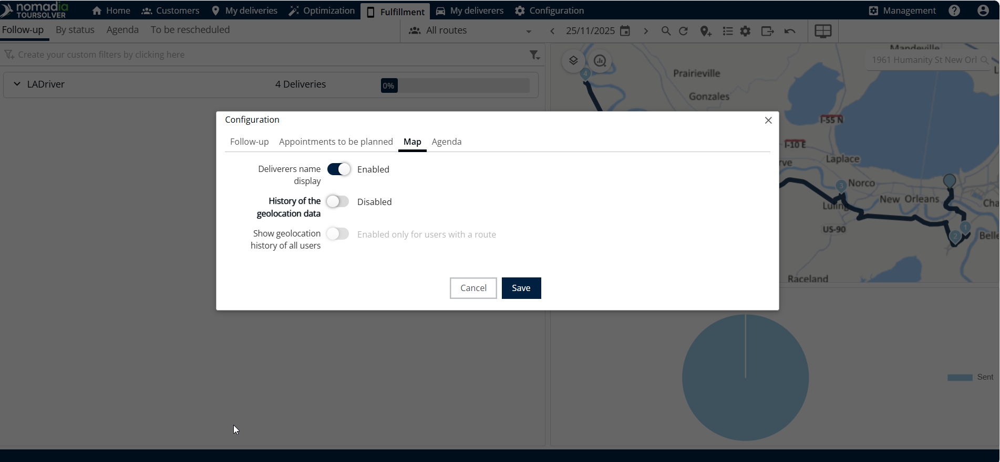

# Comment géolocaliser mes livreurs

## 1. Introduction

Pouvoir localiser votre équipe de livraison en temps réel est crucial pour une gestion efficace des ressources. Ce guide simplifie le processus d'activation des accès nécessaires et de configuration des paramètres de l'application mobile afin que vous puissiez facilement suivre vos livreurs.

## 2. Configuration initiale

Avant de commencer, le système suppose que vous avez déjà configuré les livreurs et leurs parcours planifiés. Si ces étapes ne sont pas terminées, vous devez d'abord créer la livraison, les livreurs et l'itinéraire.

### Exigences système (Configuration des accès)

Pour garantir un suivi réussi, votre personnel de livraison doit disposer des autorisations et des accès appropriés à la fois pour la plateforme web et pour l'application mobile.

**Action préalable**

| Type d'accès                                    | Description                                                       |
| ----------------------------------------------- | ----------------------------------------------------------------- |
| **Configuration du livreur et de l'itinéraire** | Le livreur et son itinéraire assigné doivent déjà être créés.     |
| **Accès web**                                   | Nécessaire pour la connexion au système.                          |
| **Accès mobile**                                | Requis pour utiliser l'application mobile, qui facilite le suivi. |

## 3. Explications des fonctionnalités et avantages

Le système offre des fonctionnalités clés qui vous aident à gérer la sécurité, les autorisations et la visibilité du suivi :

* **Gestion des rôles et des droits**: C'est ici que vous accordez à vos livreurs les permissions nécessaires pour opérer dans le système.
* **Configuration de l'application mobile**: Cette section vous permet d'affiner la manière dont l'application mobile communique avec le système, y compris la vitesse de synchronisation et la visibilité de l'agenda.
* **Paramètres de confidentialité**(**Conformité au RGPD**): Vous avez le pouvoir de limiter quand le suivi a lieu, en respectant les règles de confidentialité des données. Cela renforce la confiance et assure la conformité légale en restreignant le suivi de géolocalisation uniquement aux heures et jours de travail.

## 4. Activation du suivi de géolocalisation

### Configurer l'application mobile

**Modifier les paramètres généraux.**&#x20;

1. Nombre de jours consultables dans l'agenda
2. Fréquence de synchronisation automatique
3. Afficher les informations de temps de trajet

4. **Définir les règles de confidentialité**: Dans la configuration de l'application mobile, activez la confidentialité selon les règles pertinentes (comme le RGPD).

⚠ **Avertissement**: Si vous opérez dans une région avec des lois strictes sur la confidentialité des données (comme le RGPD), assurez-vous d'activer le suivi uniquement pendant les heures et les jours de travail afin de rester conforme.

### Afficher la géolocalisation dans l'onglet Exécution

1. Une fois la configuration terminée, vous pouvez accéder à la vue de suivi dans l'onglet Exécution
2. **Sélectionner la date**: Indiquez la date spécifique qui a été planifiée pour l'itinéraire que vous souhaitez suivre.

>)

3. **Ouvrir les paramètres d'affichage**: Cliquez sur **paramètres**.
4. **Modifier la vue de suivi**: Ici vous pouvez ajuster la façon dont les informations de suivi sont affichées : **Champs disponibles, Champs d'affichage, Rendez-vous à planifier, Carte et Agenda**

<figure><figcaption></figcaption></figure>

3. Cliquez sur la carte pour activer et afficher l'historique de géolocalisation.

<figure><figcaption></figcaption></figure>

## 5. Conseils de productivité

Voici quelques conseils pour maximiser l'utilisation de la fonction de suivi :

* **Personnalisez votre vue**: Utilisez le menu des paramètres dans l'onglet Exécution pour modifier ce que vous voyez à l'écran. Si vous n'avez besoin que du suivi de localisation, assurez-vous que la **carte** et **agenda** les affichages sont activés.
* **Surveiller le temps de trajet**: Assurez-vous de vérifier la configuration de l'application mobile pour **afficher les informations de temps de trajet**. Cela vous aide à prévoir précisément les heures d'arrivée et à gérer les attentes.
* **Maintenir une synchronisation fréquente**: Si le suivi en temps réel est crucial, vérifiez la **fréquence de synchronisation automatique** réglage dans la configuration de l'application mobile. Une fréquence plus élevée fournit des mises à jour de localisation plus immédiates.
