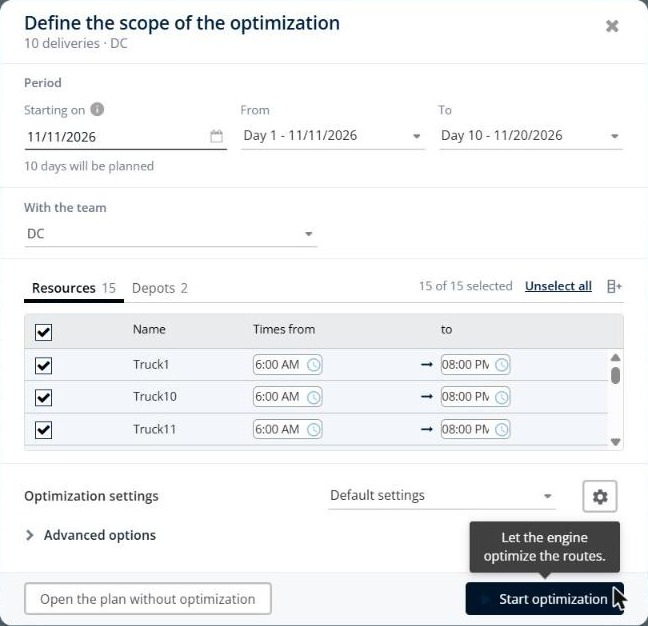
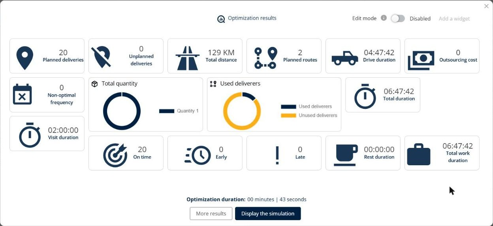
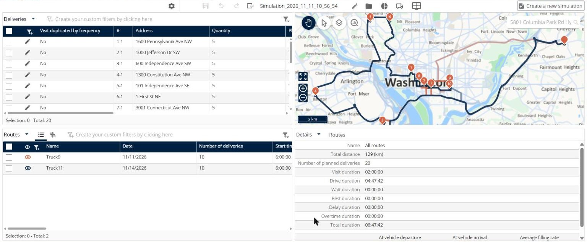

# Optimiser sur plusieurs semaines avec des fréquences

Planifiez des visites qui doivent être effectuées plusieurs fois sur une période, par exemple deux fois en 20 jours, et optimisez vos tournées sur plusieurs semaines ou plusieurs mois.

## Avant de commencer

* Connectez-vous à **TourSolver**.
* Définissez les **Jours travaillés** de vos ressources. Voir [Modifier une ressource et les contraintes associées](../resource-and-vehicle-management/modifying-a-resource-and-associated-constraints.md).

## Aperçu des fonctionnalités

* **Fréquence de visite** : le nombre de visites sur un nombre de jours, par exemple **2/20** pour deux visites en 20 jours.
* **Jour d’ouverture** : les jours pendant lesquels la visite peut être effectuée. Une plage, par exemple **1-30**, définit la période de l’optimisation.
* **Jours travaillés** : les jours pendant lesquels les ressources travaillent. La fréquence est répartie sur ces jours.
* **Visite dupliquée via la fréquence** : la colonne de la liste des livraisons qui affiche les visites créées par la fréquence, numérotées **1-1**, **1-2**, et ainsi de suite.
* **Fréquence non optimale** : le nombre de visites qui ne tombent pas dans la période de visite optimale.

## Préparer le fichier d’import

1. Dans la colonne **Jour d’ouverture**, saisissez les jours de visite sous forme de plage couvrant toute la période, par exemple **1-30** pour 30 jours, ou un intervalle de dates comme **14/05/2026 => 12/06/2026**.
2. Dans la colonne **Fréquence de visite**, saisissez le nombre de visites et le nombre de jours, séparés par une barre oblique, par exemple :
   * **1/5** : une visite tous les 5 jours.
   * **2/20** : deux visites en 20 jours.
3. Importez le fichier dans **Mes livraisons**. Les colonnes **Jour d’ouverture** et **Fréquence de visite** sont mappées automatiquement.


**Les jours travaillés sont obligatoires** : lorsque vous utilisez une fréquence de visite, les **Jours travaillés** des ressources doivent être renseignés.


## Optimiser sur la période

1. Dans **Définir le périmètre de l’optimisation**, vérifiez les jours **Du** et **Au**. La plage de jours d’ouverture de votre fichier définit la période, par exemple **Jour 1** à **Jour 10**.
2. Cliquez sur **Démarrer l’optimisation**.

<figure><figcaption></figcaption></figure>

3. Dans les **Résultats de l’optimisation**, vérifiez la **Fréquence non optimale**. Une valeur de **0** signifie que toutes les visites respectent leur fréquence.

<figure><figcaption></figcaption></figure>

4. Cliquez sur **Afficher la simulation**. La colonne **#** affiche chaque occurrence d’une visite, par exemple **1-1** et **1-2**, avec son **Jour planifié**.

<figure><figcaption></figcaption></figure>

## Vérifier l’interaction avec les autres contraintes

* **Jours travaillés** : la fréquence est répartie sur les jours travaillés par les ressources, et non sur tous les jours de la période. Si les ressources travaillent les jours 1 à 5, une fréquence de **2/10** ne peut pas être planifiée, et TourSolver affiche "The frequency denominator is bigger than the number of days".
* **Maximum de visites par jour** : un **Maximum de visites par jour** trop bas dans l’onglet **Tournée** des ressources peut empêcher les visites répétées de tenir dans la période.
* **Nuitées** : avec des nuitées, une ressource peut rester à l’extérieur pendant plusieurs jours. Vérifiez que la fréquence et le **Maximum de nuitées consécutives** sont compatibles. Voir [Planifier les rechargements, le multi-dépôt et les tournées avec nuitées](plan-reloads-multi-depot-and-overnight-routes.md).
* **Demi-journées non travaillées** : pour planifier une demi-journée de repos, utilisez deux plages de jours travaillés dans l’onglet **Planification** de la ressource, par exemple **Jours travaillés 1** de 8 h 00 à 17 h 00 les jours 1-4, et **Jours travaillés 2** de 8 h 00 à 12 h 00 le jour 5.
* **Quantités différentes** : toutes les occurrences d’une fréquence ont la même quantité. Pour livrer des quantités différentes, créez deux visites. Voir [Planifier les rechargements, le multi-dépôt et les tournées avec nuitées](plan-reloads-multi-depot-and-overnight-routes.md).

## Cas d’usage : planifier deux visites par client

Téléchargez le fichier d’exemple ci-dessous. Il contient 10 clients autour de Washington, DC, avec un **Jour d’ouverture** de **1-10** et une **Fréquence de visite** de **2/10**. Les ressources de l’équipe travaillent les jours 1 à 5.


UseCase_Frequencies.xlsx


1. Importez le fichier et optimisez-le. Aucune visite n’est planifiée : chaque client affiche "The frequency denominator is bigger than the number of days", car les ressources ne travaillent que 5 des 10 jours.
2. Dans le fichier, remplacez la **Fréquence de visite** par **2/5** et le **Jour d’ouverture** par **1-5**, puis importez et optimisez-le à nouveau.
3. Les 20 visites sont planifiées sur deux tournées, le jour 1 et le jour 4, avec une **Fréquence non optimale** de **0**.

## Conseils


**Choisissez une période multiple de la fréquence** : lorsque le nombre de jours de la période n’est pas un multiple du dénominateur de la fréquence, TourSolver signale que la dernière période est incomplète.



**Utilisez la stratégie de recherche RBS** : pour les jeux de données avec des fréquences de visite, la valeur **RBS** de **Avancé : Stratégie de recherche** dans **Options de calcul** peut donner de meilleurs résultats.


## Rubriques connexes

* [Diagnostiquer les visites non planifiées et les tournées incohérentes](diagnose-unplanned-visits-and-inconsistent-routes.md)
* [Planifier les rechargements, le multi-dépôt et les tournées avec nuitées](plan-reloads-multi-depot-and-overnight-routes.md)
* [Optimiser vos livraisons](optimize-your-deliveries.md)
