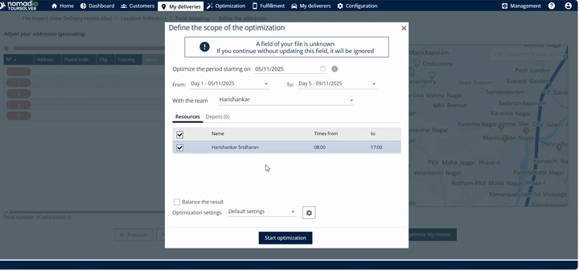
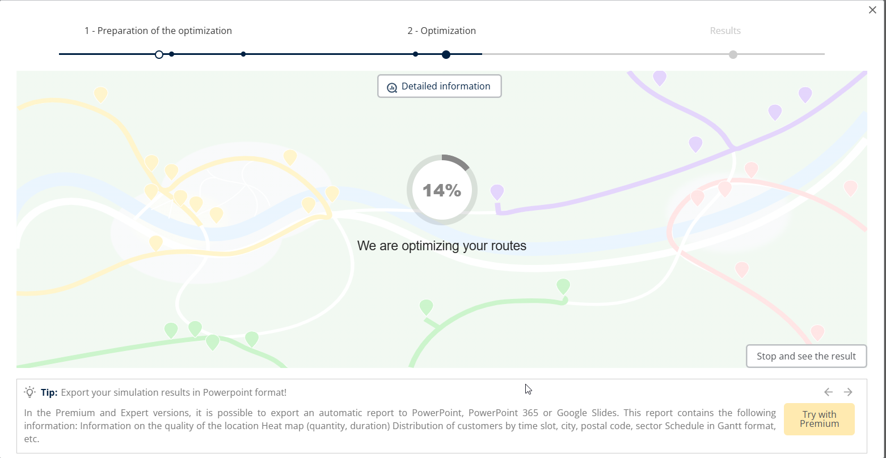
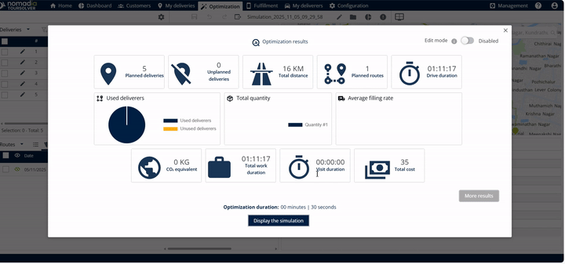
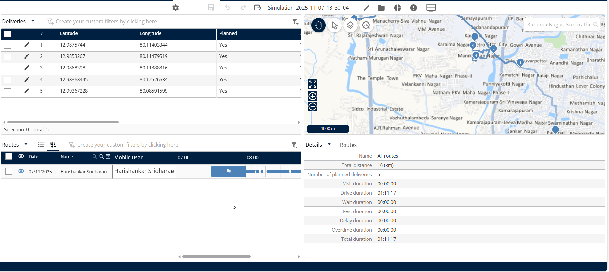
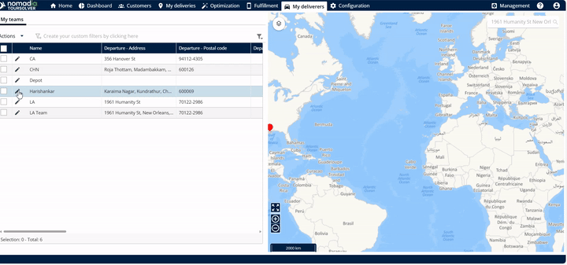
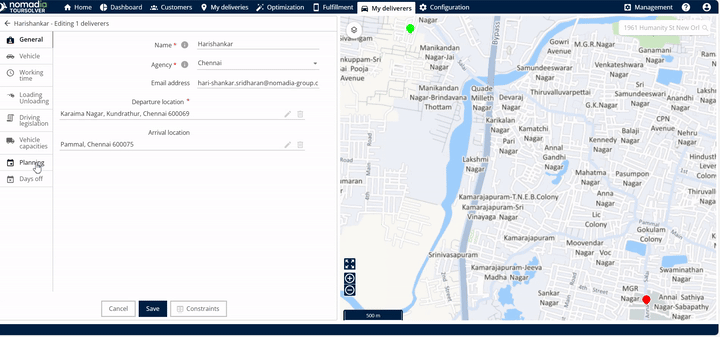
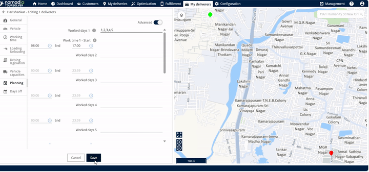

# Optimiser vos livraisons

## 1. Introduction

**Optimiser vos livraisons** la fonctionnalité rationalise vos opérations en calculant la meilleure séquence et les meilleurs itinéraires de livraison possibles. À l'aide de ce guide, vous apprendrez à définir vos préférences d'optimisation et à lancer avec succès le processus de planification des itinéraires.

***

## 2. Configuration initiale

Pour commencer à utiliser la fonctionnalité d'optimisation, on suppose que vous avez déjà importé vos données de livraison dans le système.

Avant de pouvoir commencer l'optimisation, vous devez accéder au point de départ du processus.

1. Accédez à **Mes livraisons**.
2. Après avoir vérifié que les livraisons sont importées, cliquez sur **Suivant**.
3. Cliquez sur **Optimiser mes itinéraires**.

***

## 3. Explications et avantages de la fonctionnalité

Le **Optimisez vos livraisons** offre deux fonctions principales de personnalisation qui vous donnent le contrôle sur la manière dont les itinéraires sont planifiés :

* **Optimisation des itinéraires :** Cette fonction principale prend toutes vos livraisons importées et calcule le planning d'itinéraire le plus efficace.
  * **Avantage :** Livraisons optimisées avec succès, garantissant une utilisation efficace du temps et des ressources.
* **Dates d'optimisation modifiables :** Vous pouvez spécifier exactement quand les itinéraires optimisés doivent commencer à s'exécuter en saisissant ou en modifiant la date de début et la date de fin.
* **Jours de planification modifiables :** Vous avez la possibilité d'ajuster le nombre de jours que le système doit planifier. Ceci est utile si vos besoins opérationnels changent.

## 4. Démarrer l'optimisation des itinéraires

Cette tâche vous guide pour sélectionner la période et lancer le processus de calcul des itinéraires.

1. **Définir la plage de dates d'optimisation :** Sur l'écran d'optimisation, saisissez ou modifiez la date de début et la date de fin souhaitées pour les itinéraires optimisés.
2. **Modifier le nombre de jours (optionnel) :** Si nécessaire, vous pouvez ajuster le nombre de jours de planification directement sur cet écran.

<figure><figcaption></figcaption></figure>

3. Cliquez sur **Démarrer l'optimisation**

<figure><figcaption></figcaption></figure>

#### Affichage des résultats de l'optimisation

1. Cliquez sur Démarrer l'optimisation

<figure><figcaption></figcaption></figure>

2. Une fois l'optimisation en cours, vous pouvez suivre les résultats.

<figure><figcaption></figcaption></figure>

**Examiner les résultats :** Vous verrez le résumé des résultats de l'optimisation.

3. Cliquez sur **Afficher la simulation**

<figure><figcaption></figcaption></figure>

4. Les livraisons ont été optimisées avec succès.

<figure><figcaption></figcaption></figure>

#### Ajustement de la période de planification (nombre de jours)

Si vous devez changer le nombre de jours pour lesquels le système doit planifier les itinéraires, vous pouvez configurer ce paramètre dans **Mes livreurs**.

1. Aller à **Mes livreurs**
2. Localisez la ressource associée à la livraison.

<figure><figcaption></figcaption></figure>

3. Cliquez sur **Planification**

<figure><figcaption></figcaption></figure>

3. **Modifier les jours :** Changez la valeur pour le nouveau nombre de jours que vous souhaitez utiliser pour la planification.
4. Cliquez sur **Enregistrer**

<figure><figcaption></figcaption></figure>

## 5. Conseils de productivité

* ⏳ **Conseil : Faites preuve de patience pour les gros travaux :** Si vous avez de nombreuses livraisons à optimiser, le processus peut prendre plus de temps que prévu. C'est normal car le système effectue des calculs complexes.
* ✅ **Conseil : Vérifiez les résultats tôt :** Vous n'avez pas toujours à attendre la fin du processus. Si vous avez besoin d'un résultat préliminaire rapidement, vous pouvez cliquer sur **Arrêter et voir le résultat** à tout moment pendant le calcul.
* 🎉 **Confirmation de réussite :** Une fois que le système confirme que "Les livraisons ont été optimisées avec succès", vous savez que vos nouveaux itinéraires sont prêts à être mis en œuvre.
