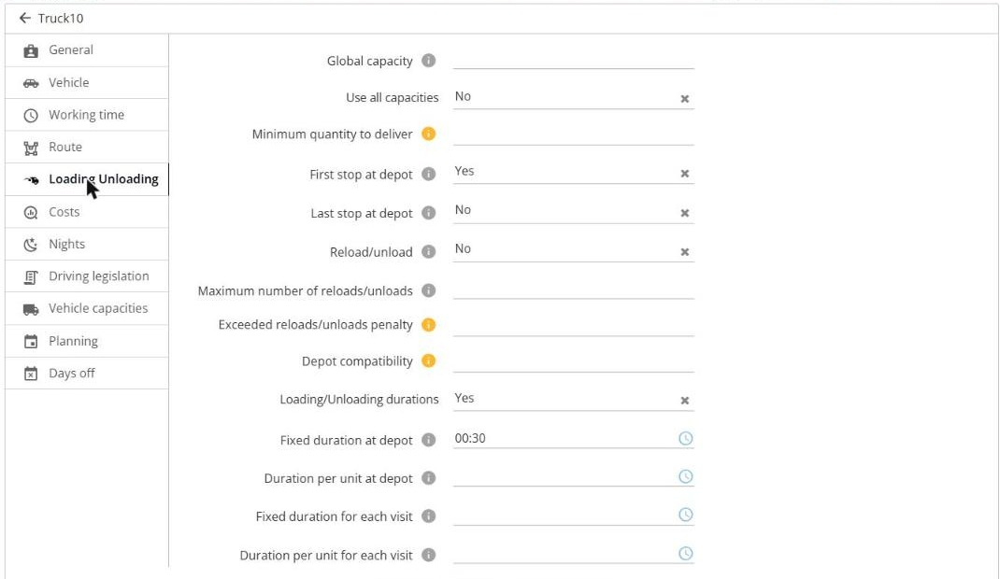
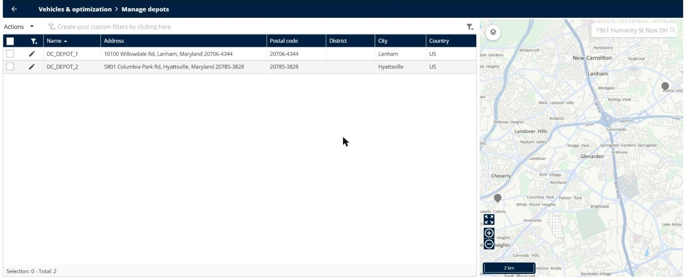
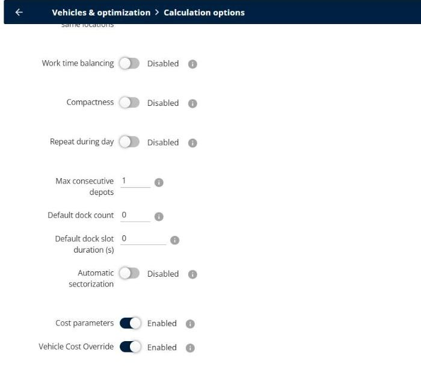
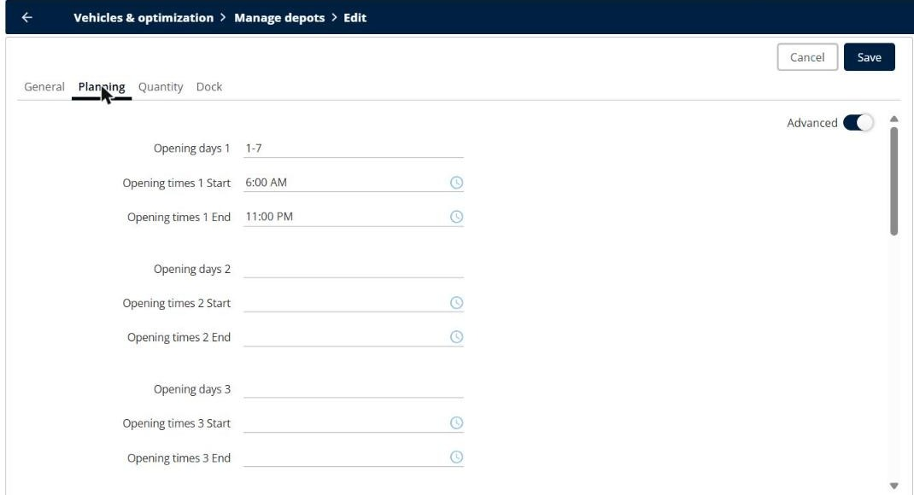
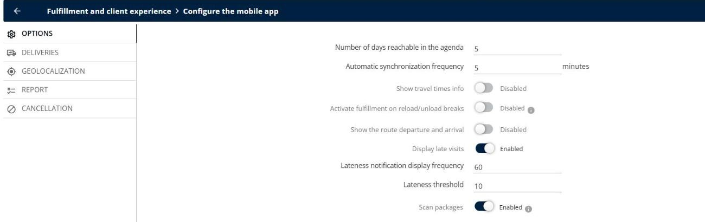
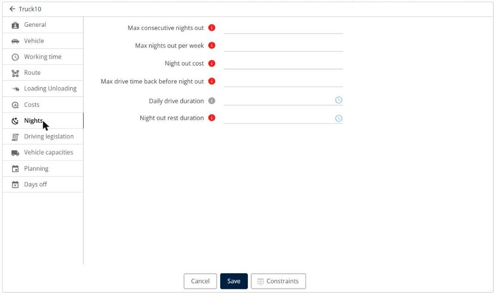

# Planifier les rechargements, le multi-dépôt et les tournées avec nuitées

Permettez à vos ressources de recharger ou de décharger dans vos dépôts pendant la tournée, de passer par plusieurs dépôts, de suivre les rechargements dans l’application mobile, et de planifier des tournées sur plusieurs jours avec des nuitées.

## Avant de commencer

* Connectez-vous à **TourSolver** avec un profil utilisateur qui a accès à la page **Configuration**.
* Créez vos dépôts. Voir [Créer un dépôt](../import-and-data-setup/create-a-depot.md).
* Définissez les **Capacités des véhicules** de vos ressources. Voir [Modifier une ressource et les contraintes associées](../resource-and-vehicle-management/modifying-a-resource-and-associated-constraints.md).

## Aperçu des fonctionnalités

* **Rechargement/déchargement** : permet à une ressource de revenir à un dépôt pendant la tournée pour recharger ou décharger, lorsque sa capacité est atteinte.
* **Nombre maximum de dépôts consécutifs** : le nombre de dépôts qu’une ressource peut visiter l’un après l’autre dans la même tournée.
* **Activer le suivi sur les pauses de rechargement/déchargement** : affiche les rechargements et les déchargements dans l’application mobile comme des visites que le livreur démarre et termine.
* **Jours et horaires d’ouverture d’un dépôt** : les jours et les heures pendant lesquels les ressources peuvent recharger ou décharger au dépôt.
* **Nuitées** : permet à une ressource de rester éloignée de sa base pendant plusieurs jours.

## Autoriser une ressource à recharger ou décharger

1. Accédez à **Mes livreurs**, puis cliquez sur l’icône **Modifier** de la ressource.
2. Cliquez sur l’onglet **Chargement Déchargement**.
3. Définissez **Rechargement/déchargement** sur **Oui**. La ressource peut alors visiter tous ses clients, même si la quantité totale dépasse sa capacité : elle recharge à un dépôt pendant la tournée.
4. Facultatif : saisissez le **Nombre maximum de rechargements/déchargements** par jour et la **Pénalité de dépassement des rechargements/déchargements**.
5. Vérifiez les durées : **Durée fixe au dépôt**, **Durée par unité au dépôt**, **Durée fixe pour chaque visite** et **Durée par unité pour chaque visite**, au format **HH:MM**.
6. Cliquez sur **Enregistrer**.

<figure><figcaption></figcaption></figure>


**Premier et dernier arrêt au dépôt** : si **Premier arrêt au dépôt** et **Dernier arrêt au dépôt** sont tous deux utilisés, la ressource ne recharge jamais pendant la tournée. Elle charge uniquement au départ, à l’arrivée, ou aux deux.


## Utiliser plusieurs dépôts dans la même tournée

1. Accédez à **Configuration** > **Véhicules et optimisation** > **Gérer les dépôts**, et vérifiez vos dépôts.

<figure><figcaption></figcaption></figure>

2. Accédez à **Configuration** > **Véhicules et optimisation** > **Options de calcul**.
3. Sous **Paramètres avancés**, saisissez le **Nombre maximum de dépôts consécutifs**, par exemple **2** si vos véhicules chargent des marchandises différentes dans deux dépôts.

<figure><figcaption></figcaption></figure>


**Gardez une valeur basse** : une valeur de **2** fonctionne. Une valeur de **3** ou plus ne donne pas de résultats, et chaque dépôt supplémentaire augmente fortement la durée de l’optimisation.



**Compatibilité des dépôts** : la contrainte **Compatibilité des dépôts** d’une ressource l’envoie uniquement vers les dépôts qui disposent des produits requis, par exemple **jardinage**. Cette contrainte n’est actuellement pas prise en charge par le moteur standard.


## Définir les horaires d’ouverture d’un dépôt

1. Dans **Gérer les dépôts**, cliquez sur l’icône **Modifier** du dépôt.
2. Cliquez sur l’onglet **Planification**.
3. Saisissez les **Jours d’ouverture**, par exemple **1-7**, ainsi que le **Début** et la **Fin** des **Horaires d’ouverture**.
4. Cliquez sur **Enregistrer**.

<figure><figcaption></figcaption></figure>

Pour un dépôt ou une visite ouvert au-delà de minuit, saisissez l’heure de fin après 24:00 dans votre fichier d’import, par exemple **23:00** à **26:00**. Une fenêtre horaire qui se termine avant de commencer n’est pas valide. Voir [Diagnostiquer les visites non planifiées et les tournées incohérentes](diagnose-unplanned-visits-and-inconsistent-routes.md).

## Suivre les rechargements dans l’application mobile

Par défaut, les rechargements et les déchargements ne s’affichent pas comme des arrêts à valider dans l’application mobile.

1. Accédez à **Configuration** > **Suivi et expérience client** > **Configurer l’application mobile**.
2. Dans l’onglet **OPTIONS**, activez **Activer le suivi sur les pauses de rechargement/déchargement**.

<figure><figcaption></figcaption></figure>

### Résultat

Les rechargements et les déchargements sont traités comme des visites dans l’application mobile : le livreur les démarre et les termine, et la durée réelle est disponible dans **Suivi**.

## Planifier des tournées avec nuitées

1. Accédez à **Mes livreurs**, puis cliquez sur l’icône **Modifier** de la ressource.
2. Dans l’onglet **Planification**, saisissez les **Jours travaillés**, par exemple **1-5**.
3. Dans l’onglet **Nuitées**, saisissez le **Maximum de nuitées consécutives**, par exemple **4** pour une tournée du lundi au vendredi sans retour à la base, ou **2** pour limiter la tournée à deux nuits à l’extérieur.
4. Renseignez les autres champs si nécessaire : **Maximum de nuitées par semaine**, **Coût de la nuitée**, **Temps de conduite maximal de retour avant nuitée** et **Durée de repos de la nuitée**.
5. Cliquez sur **Enregistrer**.

<figure><figcaption></figcaption></figure>


**Contraintes incompatibles** : **Maximum de nuitées consécutives** ne peut pas être utilisé avec **Premier arrêt au dépôt**, **Dernier arrêt au dépôt**, **Durée de briefing**, **Durée de débriefing**, **Départ à la première visite** ou **Arrivée à la dernière visite**.


## Planifier des quantités différentes pour une visite avec fréquence

Une visite avec une fréquence, par exemple **2/5**, est répétée avec la même quantité à chaque fois. Vous ne pouvez pas définir une quantité différente pour chaque occurrence.

Pour livrer des quantités différentes, créez deux visites dans votre fichier d’import, par exemple une visite avec la quantité de la première livraison et une visite avec la quantité de la deuxième livraison, chacune avec son propre jour d’ouverture.

## Conseils


**Les rechargements comptent comme des arrêts** : un rechargement est planifié comme une visite au dépôt, avec sa propre durée. Vérifiez les durées de chargement et de déchargement pour obtenir des tournées réalistes.


## Rubriques connexes

* [Créer un dépôt](../import-and-data-setup/create-a-depot.md)
* [Diagnostiquer les visites non planifiées et les tournées incohérentes](diagnose-unplanned-visits-and-inconsistent-routes.md)
* [Optimiser vos livraisons](optimize-your-deliveries.md)
* [Modifier une ressource et les contraintes associées](../resource-and-vehicle-management/modifying-a-resource-and-associated-constraints.md)
