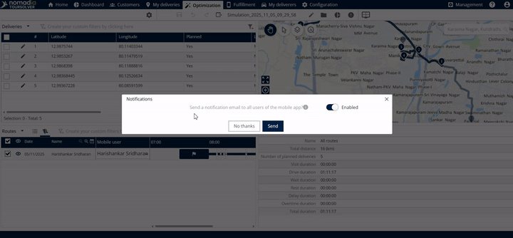
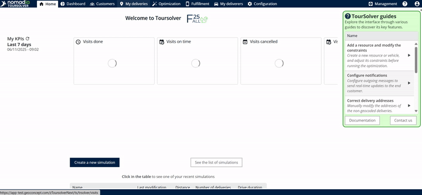
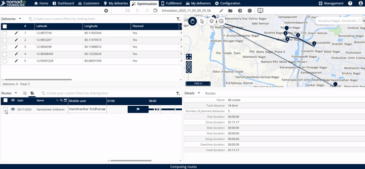
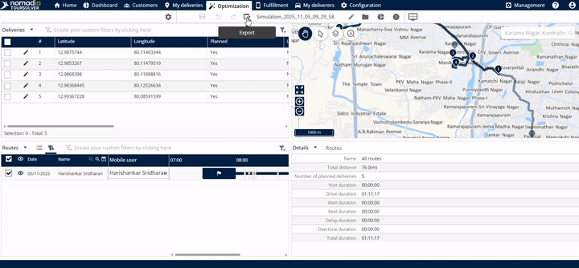
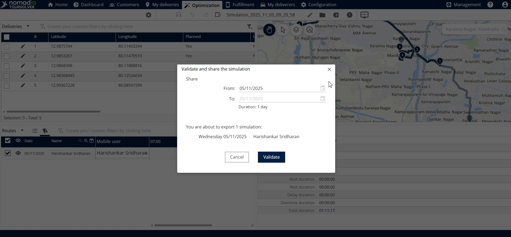
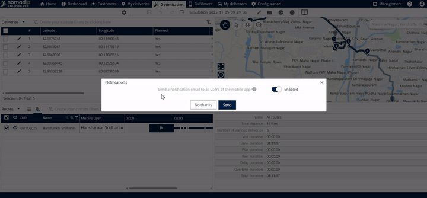
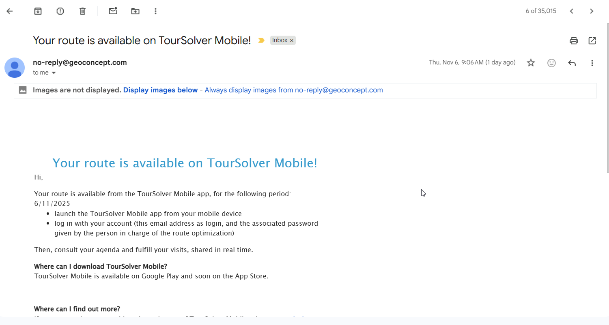

# Partager une tournée avec l'application mobile

## 1. Introduction

Ce guide vous explique le processus d'export d'un itinéraire planifié vers l'application mobile utilisée par votre équipe sur le terrain. Ce processus garantit que les utilisateurs mobiles reçoivent un courrier électronique ou un SMS contenant la tournée partagée et ses livraisons associées.

## 2. Configuration initiale

Pour partager une tournée avec succès, vous devez d'abord accéder à la section d'optimisation et sélectionner un itinéraire terminé.

| Type de compte      | Notification envoyée   | Contenu envoyé                                                                                          |
| ------------------- | ---------------------- | ------------------------------------------------------------------------------------------------------- |
| **Version d'essai** | Notification SMS       | Lien pour télécharger l'application mobile                                                              |
| **Version abonnée** | E-mail de notification | Notification à tous les utilisateurs de l'application mobile sélectionnés que la tournée a été partagée |

## 3. Explications des fonctionnalités avec avantages

Le **Partager avec l'application mobile** fonctionnalité essentielle pour connecter vos efforts de planification à l'exécution sur le terrain.

* **Transfert d'itinéraire fluide :** Transférez facilement des itinéraires complexes et optimisés (tournées) directement sur l'appareil mobile où ils sont nécessaires.
* **Partage spécifique à une date :** Vous pouvez contrôler la plage de dates exacte pendant laquelle la tournée est active et accessible sur l'application mobile. Partager une tournée pour une plage de dates spécifique (par ex. durée de 1 jour) confirme exactement quelles livraisons doivent être effectuées à la/aux date(s) sélectionnée(s).
* **Retour de confirmation :** Le système fournit un retour clair sur le nombre de livraisons partagées et sur le nombre de notifications envoyées aux utilisateurs mobiles.

## 4. Comprendre les notifications

Après avoir partagé la tournée, le système détermine comment les notifications sont délivrées en fonction de vos paramètres de compte.

<figure><figcaption></figcaption></figure>

## 5. Partager une tournée

Suivez ces étapes détaillées pour partager avec succès votre itinéraire optimisé avec vos utilisateurs mobiles.

### Exporter et partager une tournée optimisée

1. Cliquez sur **Optimisation**

<figure><figcaption></figcaption></figure>

2. Choisissez le **itinéraire souhaité** dans la liste

<figure><figcaption></figcaption></figure>

3. Cliquez sur **Exporter** et cliquez sur **Partager avec l'application mobile**

<figure><figcaption></figcaption></figure>

4. **Définir la date de début (Date de début) :** Saisissez la date de début à partir de laquelle vous souhaitez que la tournée soit partagée.
5. Choisissez un **Date de début souhaitée**
6. **Définir la date de fin (Date de fin) :** Choisissez un "**à la date**".

<figure><figcaption></figcaption></figure>

**Remarque**: La durée standard sera de 1 jour, mais vous pouvez ajuster la "date de fin" si nécessaire pour créer des itinéraires sur plusieurs jours.\
Interface de sélection de date affichant Date de début, Date de fin et Durée (1 jour)

<figure><figcaption></figcaption></figure>

7. **Examiner la notification (Essai/Abonné) :** Lisez la notification de confirmation affichée en fonction de si vous utilisez une version d'essai ou une version abonnée.
8. Cliquez sur **Envoyer**

<figure><figcaption></figcaption></figure>

&#x20; **Résultat attendu**: Pop-up de confirmation finale montrant les détails des livraisons partagées et des e-mails envoyés

<figure><figcaption></figcaption></figure>

## 6. Astuce de productivité

* **Astuce : Vérifiez le nombre de livraisons :** Faites toujours attention à la notification finale qui apparaît lorsque vous cliquez sur **envoyer.** Ce message confirme exactement combien de livraisons sont incluses dans la tournée que vous partagez et combien d'e-mails sont envoyés à vos utilisateurs mobiles.
