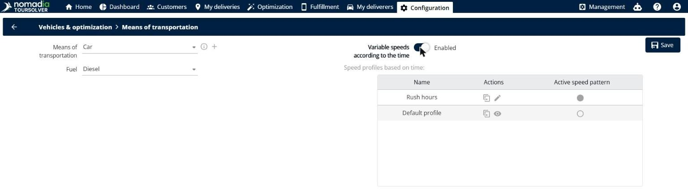
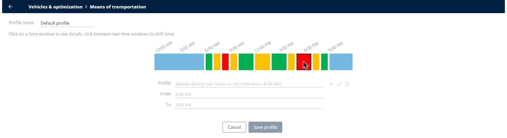
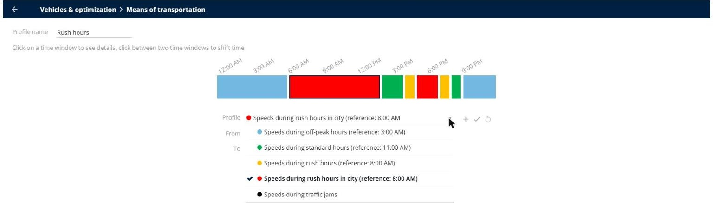
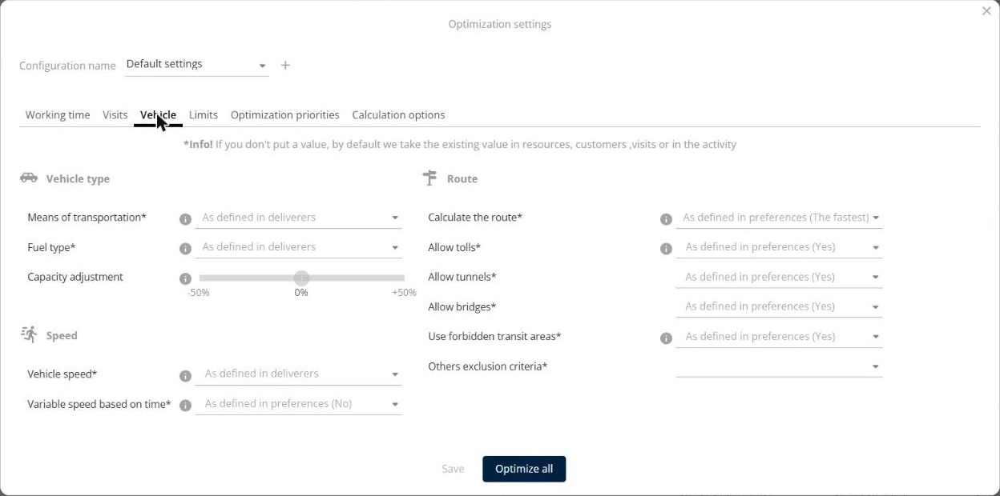

# Configurer des vitesses variables

Rendez les temps de trajet de vos tournées plus réalistes en appliquant des vitesses différentes selon l’heure de la journée, par exemple des vitesses plus lentes aux heures de pointe ou dans les embouteillages en ville.

## Avant de commencer

* Connectez-vous à **TourSolver** avec un profil utilisateur qui a accès à la page **Configuration**.
* Vérifiez que votre abonnement inclut les profils de vitesse. Les vitesses variables sont disponibles uniquement avec la version **PREMIUM**.

## Aperçu des fonctionnalités

* **Moyens de transport** : le profil de véhicule que TourSolver utilise pour calculer les itinéraires, par exemple **Voiture** ou **Camion**. Chaque profil a ses propres vitesses.
* **Vitesses variables selon l’heure** : applique un modèle de vitesse qui fait varier les vitesses selon l’heure de la journée, au lieu d’utiliser les mêmes vitesses toute la journée.
* **Modèle de vitesse** : une journée divisée en plages horaires. Chaque plage horaire utilise un profil de vitesse. TourSolver applique le modèle en fonction de l’heure de départ de chaque itinéraire calculé.
* **Profils de vitesse** : les vitesses appliquées dans une plage horaire :
  * **Vitesses en heures creuses** (bleu) : les vitesses les plus rapides, par exemple la nuit.
  * **Vitesses en heures normales** (vert) : les vitesses habituelles en journée.
  * **Vitesses en heures de pointe** (jaune) : des vitesses plus lentes aux heures chargées.
  * **Vitesses en heures de pointe en ville** (rouge) : les vitesses les plus lentes dans les centres-villes aux heures chargées.
  * **Vitesses dans les embouteillages** (noir) : les vitesses dans un embouteillage.
* **Profil par défaut** : le modèle de vitesse fourni par TourSolver. Vous pouvez le consulter et le dupliquer, mais pas le modifier.

## Activer les vitesses variables

1. Accédez à **Configuration**.
2. Sous **Véhicules et optimisation**, cliquez sur **Moyens de transport**.
3. Activez **Vitesses variables selon l’heure**. La liste **Profils de vitesse selon l’heure** s’affiche.
4. Dans la colonne **Modèle de vitesse actif**, sélectionnez le modèle à utiliser.
5. Cliquez sur **Enregistrer**.

<figure><figcaption></figcaption></figure>

### Résultat

Les prochaines optimisations utilisent les vitesses du modèle actif, en fonction de l’heure de départ de chaque itinéraire.

## Afficher les plages horaires d’un modèle de vitesse

1. Dans la liste **Profils de vitesse selon l’heure**, cliquez sur l’icône en forme d’**œil** du **Profil par défaut**.
2. Cliquez sur une plage horaire de la barre pour afficher son **Profil**, son heure de début (**De**) et son heure de fin (**À**). Par exemple, la plage horaire rouge de **17:00** à **19:00** utilise les **Vitesses en heures de pointe en ville**.

<figure><figcaption></figcaption></figure>

3. Cliquez sur **Annuler** pour revenir à la liste.

## Créer votre propre modèle de vitesse

1. Dans la liste **Profils de vitesse selon l’heure**, cliquez sur l’icône **Dupliquer** d’un modèle existant.
2. Saisissez un **Nom du profil**, par exemple **Heures de pointe**.
3. Cliquez sur une plage horaire, puis sélectionnez le **Profil** de vitesse à lui appliquer.

<figure><figcaption></figcaption></figure>

4. Pour modifier les limites des plages horaires, cliquez entre deux plages horaires, puis décalez l’heure. Pour ajouter une plage horaire, cliquez sur **+**.
5. Cliquez sur **Enregistrer le profil**.
6. Sélectionnez le nouveau modèle dans la colonne **Modèle de vitesse actif**, puis cliquez sur **Enregistrer**.

### Résultat

Vos itinéraires utilisent vos propres plages horaires. Par exemple, si vos chauffeurs sont ralentis en ville chaque matin, attribuez au matin les **Vitesses en heures de pointe en ville**.

## Utiliser les vitesses variables dans une optimisation

Vous pouvez aussi activer ou désactiver les vitesses variables pour une seule optimisation.

1. Dans votre simulation, ouvrez les **Paramètres d’optimisation**.
2. Cliquez sur l’onglet **Véhicule**.
3. Sous **Vitesse**, définissez **Vitesse variable selon l’heure** sur **Oui** ou **Non**.

<figure><figcaption></figcaption></figure>

4. Cliquez sur **Tout optimiser**.

## Conseils


**Modèles de trafic, et non trafic en temps réel** : TourSolver est un outil de planification. Il applique le trafic habituel de chaque moment de la journée (modèles historiques), afin que vous planifiiez à l’avance des itinéraires réalistes. Google Maps utilise le trafic en temps réel au moment de votre recherche, ses temps peuvent donc être différents.



**Mode évaluation** : les vitesses variables peuvent empêcher le chargement des itinéraires d’évaluation. Voir [Évaluer vos itinéraires existants](../operations-and-route-management/evaluate-your-existing-routes.md).



**Une ressource plus lente ou plus rapide** : pour qu’une ressource roule plus lentement ou plus vite que les autres toute la journée, utilisez plutôt la **Pondération de vitesse** dans l’onglet **Véhicule** de la ressource. Voir [Pourquoi les distances et les temps de trajet sont-ils différents de Google Maps ?](../faq/why-are-distances-and-travel-times-different-from-google-maps.md).


## Rubriques connexes

* [Pourquoi les distances et les temps de trajet sont-ils différents de Google Maps ?](../faq/why-are-distances-and-travel-times-different-from-google-maps.md)
* [Création d’une ressource](creating-a-resource.md)
* [Configurer les paramètres d’optimisation](../simulation/simulation-optimization-settings.md)
