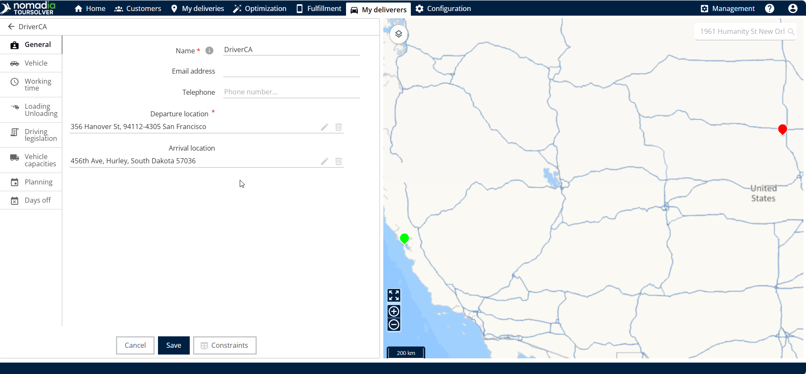
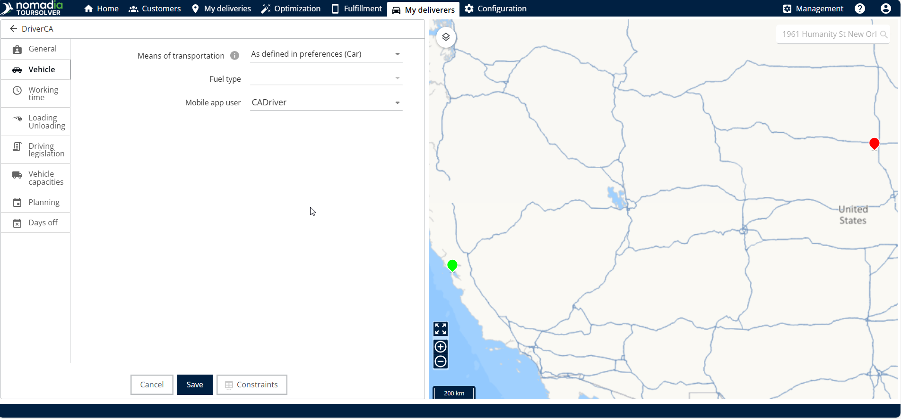
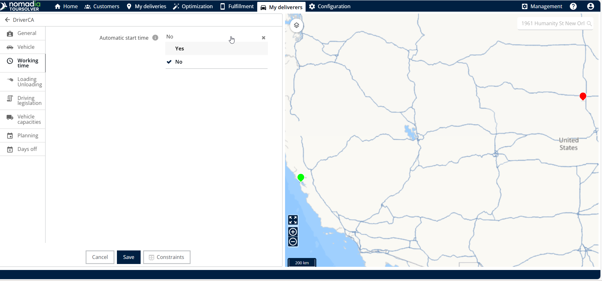
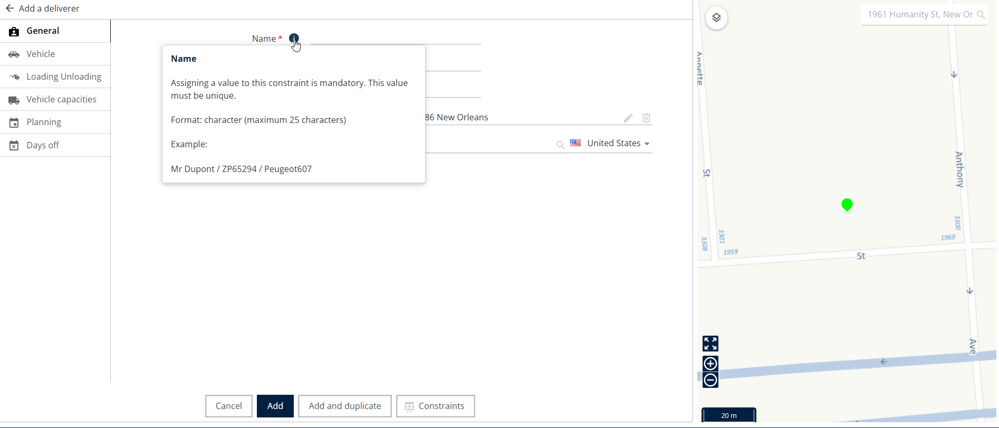

# Création d'une ressource

## 1. Introduction

Bienvenue ! Ce guide vous expliquera les étapes simples pour définir une Ressource, comme un membre du personnel de livraison ou un chauffeur, dans TourSolver. Notre objectif est de vous permettre de configurer vos collaborateurs avec précision et confiance, afin que le système puisse gérer efficacement l'attribution des véhicules, les horaires de travail et les congés.

## 2. Configuration initiale

Pour commencer à définir un nouveau profil de ressource :

1. Allez à la **Page Ressource.**
2. Cliquez sur **Ajouter** situé dans le menu Actions.

<figure><figcaption></figcaption></figure>

## 3. Explications des fonctionnalités et avantages

* La création d'une ressource implique de remplir plusieurs onglets qui définissent comment votre employé opère, se déplace et quand il est disponible.
* **Détails de la ressource (Informations générales**) : C'est ici que vous identifiez le membre du personnel par son nom et spécifiez son point de départ, appelé lieu de départ.
* **Onglet Véhicules** : Ici vous définissez le principal mode de déplacement du membre du personnel en sélectionnant le moyen de transport.
* **Onglet Capacités des véhicules** : Cette section est cruciale pour définir ce que la ressource (ou le véhicule qui lui est attribué) peut transporter. Vous pouvez ajouter des capacités de véhicule pour garantir que les contraintes sont respectées lors de la planification.
* **Onglets Temps de travail et Planification** : Ces sections définissent la disponibilité du membre du personnel, y compris le choix d'activer ou non la fonctionnalité de démarrage automatique, la définition de plages de travail spécifiques et la programmation des pauses déjeuner.
* **Onglet Jours de congé** : Cela vous permet de programmer des dates spécifiques pendant lesquelles la ressource sera indisponible

💡 Astuce : Si vous avez un doute sur un champ ou une contrainte lors de la saisie des informations, vous pouvez survoler les icônes d'aide pour obtenir une clarification. Chaque info-bulle fournit une courte explication de ce que contrôle cette contrainte.

## 4. Création de la ressource

Suivez ces étapes pour créer et définir avec succès votre nouveau membre du personnel de livraison ou chauffeur.

1. Entrez le **nom complet de la ressource**.
2. Entrez le **lieu de départ** (où la ressource commence son service).

<figure><figcaption></figcaption></figure>

3. Allez à la **onglet Véhicules.**
4. Sélectionnez le **moyen de transport** (par ex., voiture, vélo, camion).

<figure><figcaption></figcaption></figure>

5. Allez à la **onglet Temps de travail.**
6. Sélectionnez si vous souhaitez que la fonctionnalité de démarrage automatique soit active (oui ou non).

<figure><figcaption></figcaption></figure>

### Définir les capacités du véhicule

Si votre ressource transporte des marchandises, vous devez définir ses limites de capacité :

1. Allez à la **onglet Capacités des véhicules**.
2. Cliquez sur le symbole plus **(+)** situé dans le coin inférieur.
3. Ajoutez les capacités de véhicule nécessaires dans les champs disponibles.

<figure><figcaption></figcaption></figure>

**Pour supprimer un emplacement de capacité :** Si vous devez supprimer une entrée de capacité, cliquez sur l'icône de suppression située du côté droit.

### Gérer les horaires de travail (Planification)

L'onglet Planification vous permet de définir les plages de travail spécifiques et les pauses pour la ressource.

#### Pour ajouter/modifier des plages de travail :

1. Allez à la **onglet Planification**.
2. Cliquez sur le **plage de travail**.
3. Cliquez sur l' **modifier la plage** .
4. Ajoutez les horaires de travail spécifiques et cliquez **modifier**.

<figure><figcaption></figcaption></figure>

#### Pour gérer les pauses déjeuner :

1. Pour modifier la plage de travail correspondant à la pause déjeuner existante, cliquez sur modifier **pause déjeuner**.
2. Ajoutez la **durée de la pause déjeuner.**
3. Cliquez sur **modifier** pour enregistrer les modifications de la plage de travail de la pause déjeuner.
4. Pour supprimer une plage de pause déjeuner, cliquez sur **supprimer la pause déjeuner**.

<figure><figcaption></figcaption></figure>

### Ajouter des jours de congé

Utilisez l'onglet Jours de congé pour planifier les temps de repos planifiés :

1. Allez à la **Jours de congé** onglet.
2. Cliquez sur l'icône plus **(+)** sur le côté droit pour ajouter une nouvelle entrée.
3. Ajoutez les horaires requis (date de début/date de fin) pendant lesquels la ressource sera en congé.
4. Cliquez sur **ajouter** icône pour enregistrer l'entrée.

⚠ **Avertissement** : Lors de la définition des jours de congé, assurez-vous que la "Date de fin" (la date de fin) est supérieure (postérieure) à la "Date de début" (la date de début).

<figure><figcaption></figcaption></figure>

### Finalisation de la création de la ressource

1. Une fois que vous avez rempli tous les détails nécessaires dans les différents onglets. Cliquez sur **Ajouter**.
2. La ressource sera créée avec succès.

<figure><figcaption></figcaption></figure>

## 5. Conseils de productivité

Ces conseils vous aideront à gérer les horaires et les contraintes rapidement et efficacement :

* **Comprendre les contraintes** : Si vous ne savez pas ce que contrôle un paramètre spécifique, utilisez toujours les icônes d'aide en les survolant pour obtenir une brève explication.

<figure><figcaption></figcaption></figure>

* **Dupliquer rapidement des plages de travail** : Si une ressource a plusieurs plages de travail identiques, vous pouvez gagner du temps en cliquant sur l'option dupliquer la plage de travail puis sur dupliquer pour ajouter rapidement une copie.

<figure><figcaption></figcaption></figure>

* **Gérer la capacité** : N'oubliez pas que vous pouvez toujours supprimer les capacités de véhicule indésirables en cliquant sur l'icône de suppression située à droite de l'entrée.
*  
