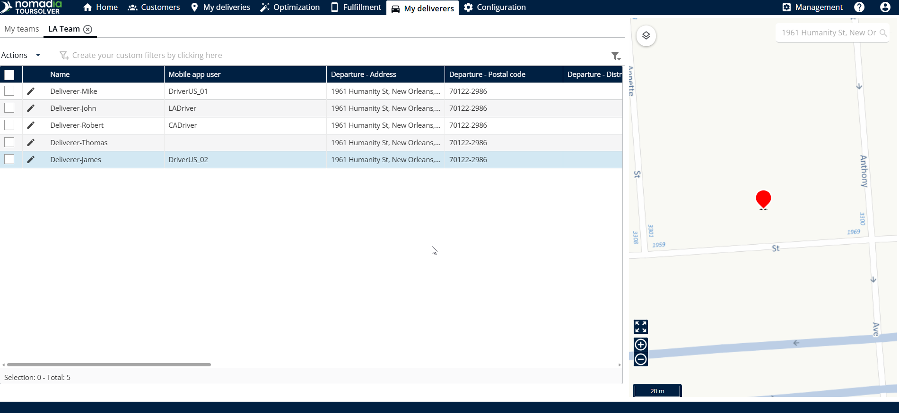
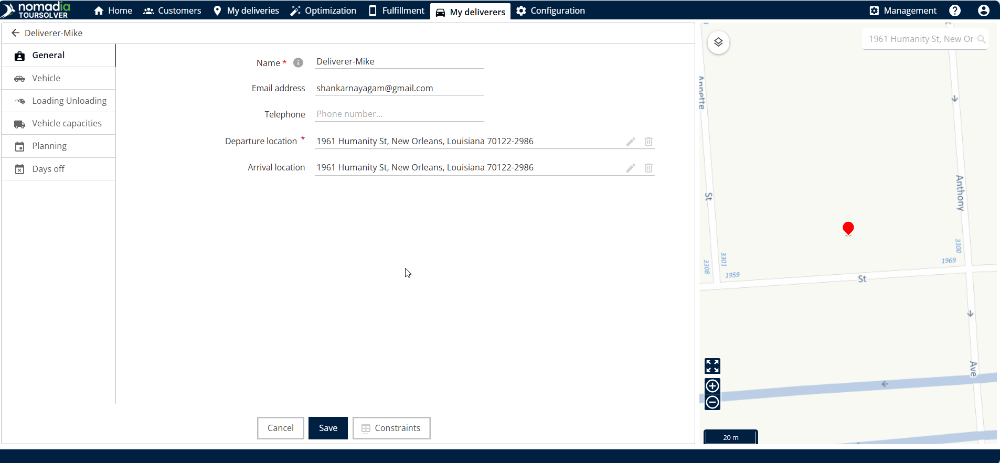
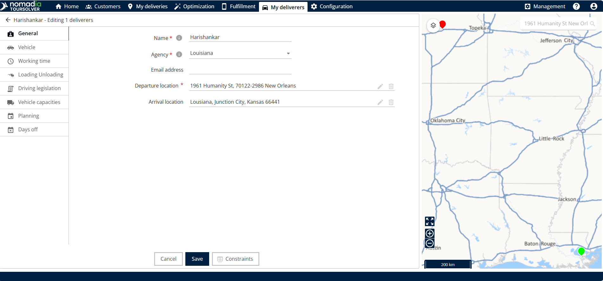
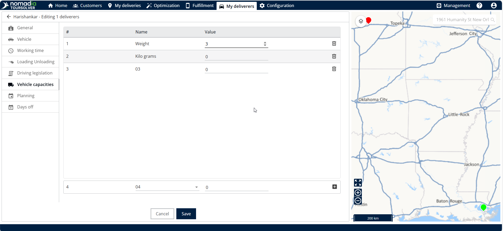
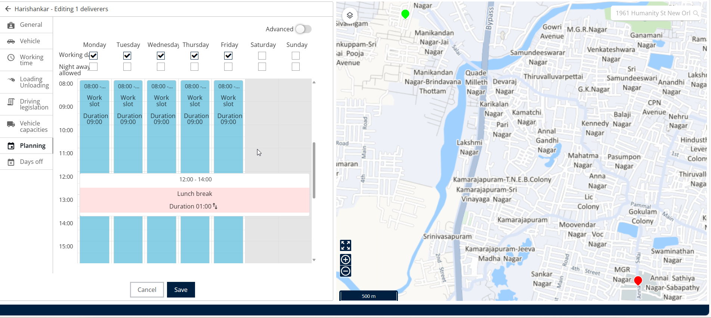
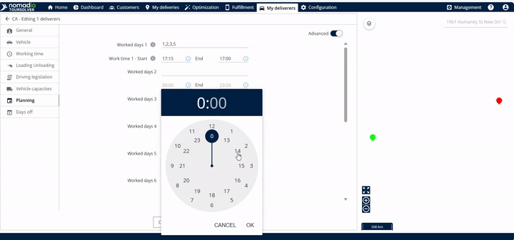
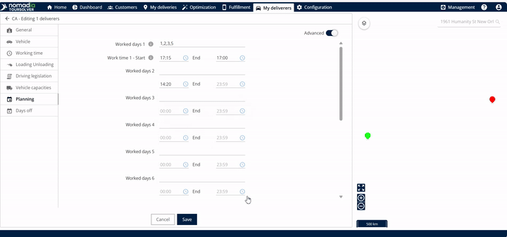

# Modifier une ressource et les contraintes associées

## 1. Introduction

Bienvenue dans votre guide pour gérer et mettre à jour efficacement vos ressources de livraison et leurs principales restrictions, ou « contraintes ». Savoir comment modifier une ressource — qu'il s'agisse d'ajuster la disponibilité d'une équipe ou de changer la capacité du véhicule d'une personne — est essentiel pour des opérations fluides. Dans ce guide, vous apprendrez exactement comment modifier les horaires, les emplacements et les capacités rapidement et avec succès

## 2. Configuration initiale

Vous pouvez commencer à modifier les ressources et les contraintes directement depuis la page d'accueil du système.

#### Accéder à Mes livreurs

<figure><figcaption></figcaption></figure>

1. **Choisissez votre méthode de modification :** Vous disposez de deux façons principales de modifier une ressource : par équipe (affectant un groupe) ou individuellement.
2. Cliquez sur **modifier** (icône crayon) à côté du nom

<figure><figcaption></figcaption></figure>

3. Vous pouvez commencer à modifier les contraintes associées.

<figure><figcaption></figcaption></figure>

## 3. Explications des fonctionnalités et avantages

Les contraintes sont les règles qui régissent quand, où et comment une ressource opère. Voici les contraintes couramment utilisées expliquées :

* Lieu de départ et d'arrivée : Ce paramètre définit le point de départ et le point d'arrivée de la journée de la ressource. Modifier ces emplacements est crucial si l'adresse de départ ou d'arrivée habituelle d'une ressource change (par exemple, si elle travaille depuis un dépôt différent ou rentre chez elle).
* Capacités du véhicule : Cela vous permet de définir des limites sur la capacité du véhicule, généralement mesurée en poids. Cela garantit que votre véhicule de livraison n'est jamais surchargé, ce qui aide à un acheminement sûr et conforme. Vous pouvez définir la valeur de poids en kilogrammes (kg) ou en grammes (g).
* Planification (Plages horaires) : Cela détermine la disponibilité de travail de la ressource. Vous pouvez gérer les heures de début et de fin exactes, et spécifier les jours de la semaine pendant lesquels elle est disponible.

**Conseil**: Pour en savoir plus sur d'autres contraintes, veuillez vous référer à la documentation sur les contraintes.

## 4. Modification des lieux de départ et d'arrivée

Une fois que vous avez accédé à l'écran de modification des contraintes (en utilisant l'icône crayon), suivez les étapes ci-dessous pour mettre à jour les détails spécifiques de la ressource.

Si le point de départ ou d'arrivée d'une ressource change, vous pouvez le mettre à jour ici.

1. **Localiser l'adresse**: Pour modifier le lieu de départ ou d'arrivée en général, recherchez la section pertinente (Lieu de départ ou Lieu d'arrivée).
2. **Mettre à jour l'adresse**: Modifiez l'adresse de départ et l'adresse d'arrivée selon les besoins.

<figure><figcaption></figcaption></figure>

Après la modification, vous verrez les différences sur la carte. La couleur utilisée sera différente pour les lieux de départ et d'arrivée (par exemple, vert ou rouge).

### Mise à jour des capacités du véhicule (Poids)

1. Vous pouvez gérer le poids maximum que le véhicule d'une ressource peut transporter.
2. **Modifier la valeur**: Modifiez la valeur du poids. Vous pouvez saisir cette valeur en kilogrammes ou en grammes.

<figure><figcaption></figcaption></figure>

La section Planification contrôle quand votre ressource est disponible pour travailler. Il existe deux méthodes pour modifier les horaires de travail : Vue Simple et Vue Avancée.

#### Vue Simple (Même horaire chaque jour)

Utilisez la Vue Simple si les heures de travail sont les mêmes pour tous les jours ouvrés.

1. **Accéder à la Planification**: Cliquez sur Planification.
2. **Accéder à la plage horaire**: En Vue Simple, cliquez sur la plage horaire.
3. **Modifier la plage de travail**: Cliquez sur Modifier la plage de travail.
4. **Définir les heures de début et de fin**: Modifiez l'heure de début et l'heure de fin.
5. **Confirmer**: Cliquez sur **bouton Modifier**.

<figure><figcaption></figcaption></figure>

#### Vue Avancée (Horaires différents selon les jours)

Utilisez la Vue Avancée si vous devez définir des heures de début et de fin uniques pour des jours de travail spécifiques.

1. **Accéder à la Planification**: Cliquez sur Planification.
2. **Sélectionner les jours de travail**: En Vue Avancée, vous pouvez modifier les « jours de travail » (par exemple, jour de travail 1, jour de travail 2, etc.). Vous pouvez spécifier une plage, comme 1 à 5, qui représente du lundi au vendredi. Vous pouvez également saisir des jours spécifiques comme 1, 2, 3, 4, 5.
3. **Faire des ajustements**: L'image de l'horloge s'affichera, vous permettant d'effectuer vos ajustements.
4. **Confirmer l'horaire**: Après avoir effectué la modification dans l'horloge, cliquez sur OK.

<figure><figcaption></figcaption></figure>

#### Enregistrement de toutes les modifications

Une fois que vous avez effectué tous les changements nécessaires dans **Départ, Arrivée, Capacité et Planification :**

* Les changements seront affichés avec succès

<figure><figcaption></figcaption></figure>

## 5. Conseils de productivité

Pour vous aider à tirer le meilleur parti de la gestion des ressources :

* **Édition efficace du temps**: Utilisez l'icône d'horloge à côté de l'heure pour afficher rapidement l'image de l'horloge et effectuer des ajustements d'heure précis.
* **Suppression rapide**: Si vous devez supprimer une valeur spécifique de capacité du véhicule, recherchez immédiatement à droite de la saisie du poids l'icône de suppression.
