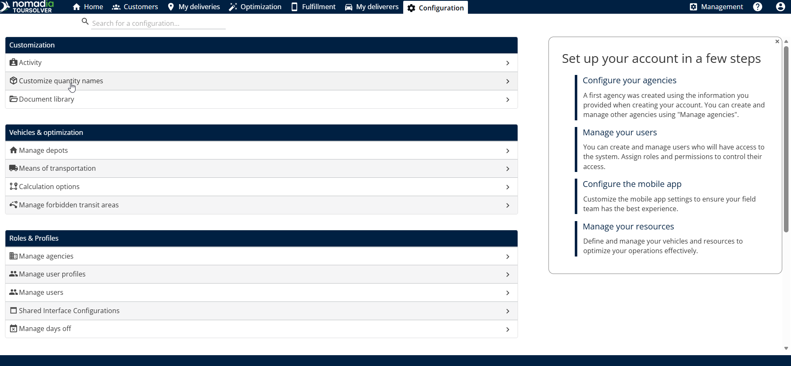
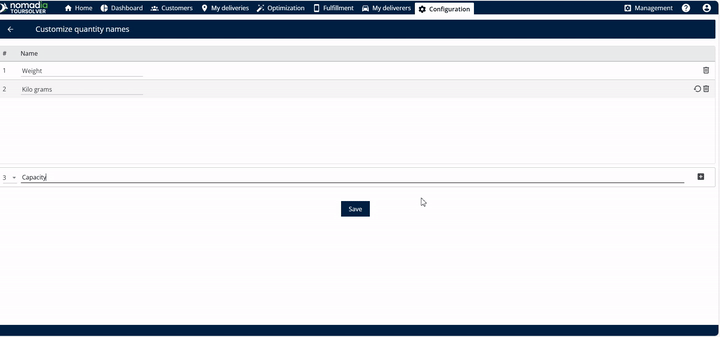
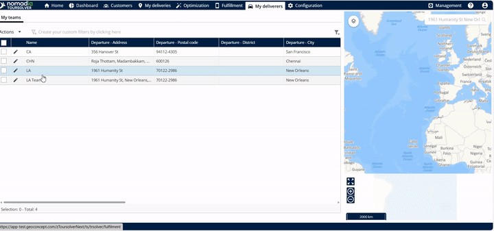
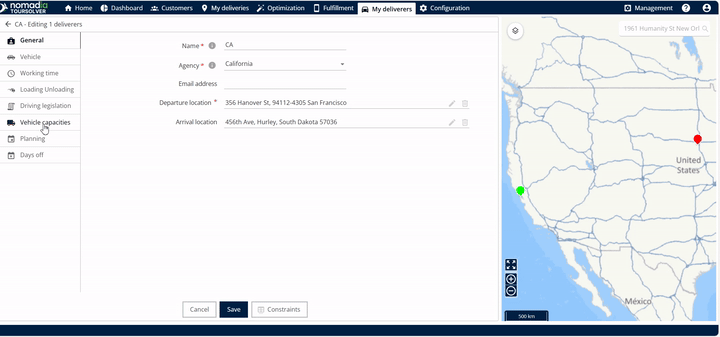
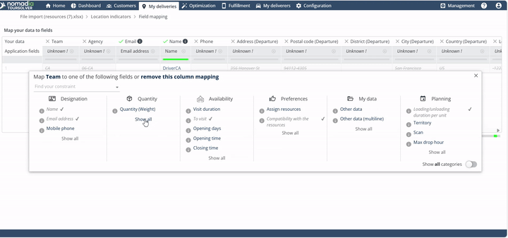

# Renommer une quantité d'un véhicule

## 1. Introduction

Renommer une quantité de véhicule vous aide à personnaliser la terminologie de votre système. En changeant ces noms, vous assurez la clarté et la cohérence lors de l'affichage des capacités des véhicules et de l'importation de nouvelles informations de livraison. Vous apprenez comment renommer avec succès la quantité d'un véhicule.

## 2. Configuration initiale

Aller à _**Configuration → Ressources → Véhicules**_**&#x20;et renommez le champ Quantité** pour refléter votre libellé préféré

## 3. Explications des fonctionnalités et avantages

La possibilité de personnaliser les noms des quantités offre un avantage important en affichant les noms définis par l'utilisateur dans deux zones clés :

* **Affichage de la capacité du véhicule** : Après le renommage, les nouveaux noms sont visibles lorsque vous consultez les détails de capacité d'un véhicule. Cela vous permet de vérifier rapidement quelles limitations de capacité sont attribuées à votre flotte.
* **Écran d'importation des livraisons** : Les nouveaux noms s'affichent lorsque vous importez de nouvelles livraisons. Plus précisément, ils apparaissent lorsque vous sélectionnez Afficher tout sous la section quantité pendant le processus d'importation, garantissant un mappage correct des données.

## 4. Renommer une quantité de véhicule

Suivez ces étapes simples pour mettre à jour les noms des quantités dans votre système :

1. **Accéder à la configuration**
2. **Naviguer vers Personnaliser les noms des quantités**

<figure><figcaption></figcaption></figure>

3. **Renommer la quantité**
4. **Enregistrez vos modifications**

<figure><figcaption></figcaption></figure>

## 5. Vérifier les nouveaux noms dans les capacités des véhicules

1. **Aller à Mes livreurs**
2. **Modifier un véhicule**

<figure><figcaption></figcaption></figure>

3. **Afficher les capacités du véhicule**
4. **Confirmer le nom**

<figure><figcaption></figcaption></figure>

## 6. Vérifier les nouveaux noms lors de l'importation des livraisons

Les quantités renommées sont également visibles lorsque vous importez des livraisons :

1. **Aller à Mes livraisons**
2. **Commencer l'importation**
3. **Traiter les champs d'adresse inconnus**
4. **Afficher toutes les quantités**
5. **Confirmer le nouveau nom**

<figure><figcaption></figcaption></figure>

## 7. Conseils de productivité

* **Conseil** : La vérification immédiate est essentielle.&#x20;
* Après avoir enregistré votre quantité renommée, prenez un moment pour vérifier immédiatement la modification à la fois dans les capacités des véhicules et en contrôlant une importation de livraison en attente. Cela garantit que vos changements se sont correctement propagés dans le système.
* **Conseil** : Restez simple&#x20;
* Utilisez des noms clairs et concis qui sont faciles à comprendre pour tous les membres de votre équipe. Étant donné que le nouveau nom s'affichera dans plusieurs zones, choisir un langage accessible évite toute confusion.
* **Avertissement** : Assurez-vous d'avoir mis à jour tous les champs nécessaires avant de cliquer sur Enregistrer afin d'éviter d'avoir à revenir plusieurs fois au menu de personnalisation.
